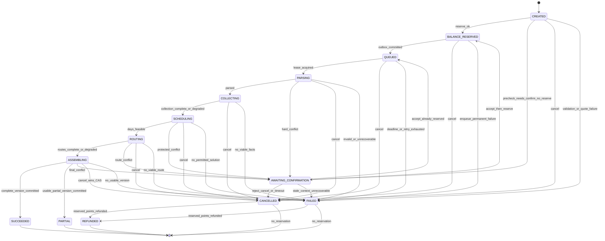

# Planning Task 状态机

| 项目 | 内容 |
|---|---|
| 状态 | Accepted |
| 日期 | 2026-09-20 |
| 事实来源 | MySQL `planning_task`（S04 冻结表结构） |
| 并发控制 | 乐观锁 + 条件更新；事件只追加 |

## 1. 状态定义

| 状态 | 含义 | 默认阶段时限 | 可否接收取消 |
|---|---|---:|---|
| `CREATED` | 请求已校验并创建任务，尚未完成预扣 | 10 秒 | 是 |
| `BALANCE_RESERVED` | 服务端报价对应积分已幂等预扣 | 10 秒 | 是 |
| `QUEUED` | Outbox 已提交，等待 Worker 租约 | 20 秒 | 是 |
| `PARSING` | 解析需求并执行可行性预检 | 30 秒 | 是 |
| `COLLECTING` | 并行获取资讯、天气、预约等来源数据 | 60 秒 | 是 |
| `SCHEDULING` | 日级分配和硬约束初检 | 30 秒 | 是 |
| `ROUTING` | 逐日路线并行计算 | 60 秒 | 是 |
| `ASSEMBLING` | 餐住、质量校验、整合和版本候选生成 | 30 秒 | 是，提交版本事务开始后以 CAS 决胜 |
| `AWAITING_CONFIRMATION` | 已持久化冲突和选项，等待用户决定 | 24 小时 | 是 |
| `SUCCEEDED` | 完整可用版本已原子创建，预扣已确认或确认事件已唯一登记 | 终态 | 否 |
| `PARTIAL` | 可用且可追溯版本已创建，缺失项显式可见，预扣按确认口径结算 | 终态 | 否 |
| `FAILED` | 无可用版本且执行不可继续 | 无预扣时为终态；有预扣时等待退款 | 否 |
| `CANCELLED` | 用户拒绝/取消或确认超时，且没有发布新版本 | 无预扣时为终态；有预扣时等待退款 | 否 |
| `REFUNDED` | `FAILED/CANCELLED` 对应预扣已幂等全额退款 | 终态 | 否 |

首次生成的 `operation_deadline_at` 默认是创建后 180 秒，局部修改默认是执行开始后 60 秒。确认等待暂停执行 Deadline，恢复后重新计算剩余执行预算；阶段时限和全局 Deadline 取更早者。具体配置可调，但不能放宽 M1/M2 Gate。

## 2. 状态图

## 3. 合法迁移表

`system` 表示 Java 业务后端的事务服务；`worker` 表示持有有效租约的 Python Worker；`user` 的命令始终先由 Java 鉴权和校验。

| From | To | 操作者 | 前置条件与原子效果 | 超时/失败处理 |
|---|---|---|---|---|
| `CREATED` | `BALANCE_RESERVED` | system | 服务端 quote 匹配；余额充足；`reserve:{task_id}` 唯一流水成功 | 失败转 `FAILED`，无退款 |
| `CREATED` | `AWAITING_CONFIRMATION` | system | 无需预扣的修改预检发现保护项冲突；保存选项、版本和过期时间 | 24 小时后 `CANCELLED` |
| `CREATED` | `CANCELLED` | user/system | 尚无预扣且任务未开始 | 终态 |
| `CREATED` | `FAILED` | system | 校验、quote 或权限失败；未创建可用版本 | 终态 |
| `BALANCE_RESERVED` | `QUEUED` | system | 任务、预扣、Outbox 在同一事务已提交；消息可重复发布 | 超时转 `FAILED` 后退款 |
| `BALANCE_RESERVED` | `CANCELLED` | user/system | 取消 CAS 成功，尚未发布版本 | 转 `REFUNDED` |
| `BALANCE_RESERVED` | `FAILED` | system | Outbox 永久失败或 Deadline 到期 | 转 `REFUNDED` |
| `QUEUED` | `PARSING` | worker | Consumer Group 消息有效；获得未过期租约；attempt 合法 | 租约过期重投；重试耗尽转 `FAILED` |
| `QUEUED` | `CANCELLED` | user/system | 取消 CAS 成功；Worker 后续结果必须拒绝 | 转 `REFUNDED` |
| `QUEUED` | `FAILED` | system | 全局 Deadline 或重试预算耗尽 | 转 `REFUNDED` |
| `PARSING` | `COLLECTING` | worker | 结构化输入合法；预检无待确认硬冲突；步骤结果幂等写入 | 可重试；无效模型输出转 `FAILED` |
| `PARSING` | `AWAITING_CONFIRMATION` | worker/system | 冲突代码和有限选项经 Java 校验后持久化 | 拒绝/超时转 `CANCELLED` |
| `PARSING` | `CANCELLED/FAILED` | user/system | 取消 CAS，或输入无法合法解析且重试耗尽 | 有预扣则退款 |
| `COLLECTING` | `SCHEDULING` | worker | 必需调用均有 ok/partial/degraded/failed 结构结果；可继续项来源齐全 | 单调用按预算重试；无可用事实转 `FAILED` |
| `COLLECTING` | `CANCELLED/FAILED` | user/system | 取消 CAS，或缺失破坏全部可行方案 | 有预扣则退款 |
| `SCHEDULING` | `ROUTING` | worker | 日级方案通过开放时间、预约、预算初检 | 阶段超时重试；无解转确认或失败 |
| `SCHEDULING` | `AWAITING_CONFIRMATION` | worker/system | 必去/锁定/预约/跨日硬冲突有明确选项 | 接受后从已存 checkpoint 入队 |
| `SCHEDULING` | `CANCELLED/FAILED` | user/system | 取消或没有合法可确认的解 | 有预扣则退款 |
| `ROUTING` | `ASSEMBLING` | worker | 每日路线均有精确结果或显式降级；估算未被当作硬可行证据 | 单日可独立重试；无可行路线转确认/失败 |
| `ROUTING` | `AWAITING_CONFIRMATION` | worker/system | 路线冲突影响保护项且存在可选调整 | 接受后按受影响日起重跑 |
| `ROUTING` | `CANCELLED/FAILED` | user/system | 取消或无可行路线 | 有预扣则退款 |
| `ASSEMBLING` | `SUCCEEDED` | system | 质量检查全过；同事务创建唯一版本、来源快照和结算 Outbox | 重复回调返回既有版本 |
| `ASSEMBLING` | `PARTIAL` | system | 至少有一个可用方案；所有缺失显式；硬约束和来源门禁仍通过；同事务创建唯一版本和结算 Outbox | 不满足任一条件则不能进入 `PARTIAL` |
| `ASSEMBLING` | `AWAITING_CONFIRMATION` | worker/system | 最终检查存在可选但不能自动裁决的硬冲突 | 确认前不创建版本 |
| `ASSEMBLING` | `CANCELLED` | user/system | 取消 CAS 先于版本提交事务成功 | 转 `REFUNDED`；若版本提交先成功则取消返回 409 |
| `ASSEMBLING` | `FAILED` | system | Schema/质量检查失败且无可用版本，重试耗尽 | 转 `REFUNDED` |
| `AWAITING_CONFIRMATION` | `BALANCE_RESERVED` | user/system | 接受决定；最新 ETag 有效；任务尚未预扣；服务端预扣成功 | 余额不足保持确认失败，不入队 |
| `AWAITING_CONFIRMATION` | `QUEUED` | user/system | 接受决定；已预扣；选项、ETag 和确认 revision 均有效 | 重复确认返回既有结果 |
| `AWAITING_CONFIRMATION` | `CANCELLED` | user/system | 拒绝、主动取消或 24 小时到期 | 有预扣则转 `REFUNDED` |
| `AWAITING_CONFIRMATION` | `FAILED` | system | 基准版本已删除/无权访问等不可恢复问题 | 有预扣则退款 |
| `FAILED/CANCELLED` | `REFUNDED` | system | 存在 RESERVED 流水；`refund:{task_id}` 唯一流水成功 | 可无限安全重试，告警但不重复入账 |

表外迁移一律拒绝并记录安全审计；不得通过直接 SQL 修正任务状态。

## 4. 取消与竞态

- 用户只能取消本人任务；ADMIN 也必须走审计接口，不能直接改状态。
- 取消是带 `version` 和当前状态条件的 CAS。成功后写 `task_event` 和结算 Outbox；Worker 的迟到结果因状态/attempt 不匹配而丢弃并审计。
- `ASSEMBLING` 中版本提交与取消以数据库事务先后决胜。版本已提交则任务是 `SUCCEEDED/PARTIAL`，取消返回 409；取消先提交则禁止创建版本。
- `SUCCEEDED/PARTIAL/REFUNDED` 永远不能回到运行态；重新规划必须创建新任务。

## 5. 超时、重试与恢复

每个步骤保存 `attempt_no`、租约所有者、`lease_expires_at`、心跳时间、`input_hash`、输出引用和来源有效期。重试只允许相同逻辑步骤增加 attempt，不覆盖成功结果。

恢复顺序：

1. 从 MySQL 读取任务、步骤和只追加事件，不从 Redis 推断事实状态。
2. 终态直接返回；需要退款的 `FAILED/CANCELLED` 重新投递唯一退款命令。
3. 回收过期租约；校验最后成功步骤的输入哈希和来源新鲜度。
4. 哈希一致且来源新鲜则复用；否则从最早失效步骤开始，并使其下游结果失效但不物理删除审计记录。
5. 重新写 Outbox；Redis 重复投递由 `task_id + step_name + attempt_no` 和事件 ID 去重。

阶段超时先按步骤策略重试；超过阶段重试预算或全局 Deadline 才进入 `FAILED`。429 和短暂网络错误可重试，鉴权错误、Schema 永久无效、越权和明确无解不可盲目重试。

## 6. 终态与结算幂等

- `SUCCEEDED`：存在唯一可用完整版本；`confirm:{task_id}` 确认原预扣。
- `PARTIAL`：存在唯一可用且可追溯的部分版本；缺失字段非空；`confirm:{task_id}` 确认原预扣。
- `FAILED/CANCELLED`：不得存在由该 attempt 发布的新版本；有预扣时执行 `refund:{task_id}` 全额退款。
- `REFUNDED`：退款流水已提交，是有预扣失败/取消任务的最终财务状态。

数据库必须以唯一业务引用约束 reserve/confirm/refund，以 `task_id` 约束首次发布版本，以 `task_id + sequence_no` 约束进度事件。重复消息返回既有结果，不产生第二条经济效果。

## 7. 可执行测试清单

| 类别 | 场景 | 断言 |
|---|---|---|
| 成功 | 完整生成 | 唯一版本、唯一确认流水、终态 `SUCCEEDED` |
| 部分成功 | 天气或资讯非关键缺失 | 可用版本、非空降级字段、唯一确认流水、终态 `PARTIAL` |
| 空值/非法 | 模型空响应或 Schema 无效 | 有限修复/重试后失败；无版本；有预扣则 `REFUNDED` |
| 超时 | 阶段或全局 Deadline 到期 | 终止后续调度；无版本；唯一退款 |
| 重复 | Outbox/Stream/回调/确认/退款重复 | 状态、版本、事件序号和积分效果均不重复 |
| 乱序 | 旧 attempt 在新 attempt 后回调 | 旧结果被拒绝且审计，不覆盖较新步骤 |
| 取消 | QUEUED、运行中和 ASSEMBLING 竞态 | CAS 决胜；取消成功则无版本并退款；版本先成功则返回 409 |
| 重启 | Java、Worker 或 Redis 重启 | 从 MySQL 和新鲜 checkpoint 恢复，不重复调用已成功步骤 |
| 确认 | 接受、拒绝、超时、重复、旧 ETag | 仅有效接受入队；拒绝/超时退款；重复无副作用；旧 ETag 409 |
| Agent 失败 | 每个专业 Agent 分别 failed | 可交付则 `PARTIAL`，破坏硬可行性则确认或失败退款 |
| 结算崩溃 | 版本提交后、确认消费前崩溃 | Outbox 重放后只确认一次，版本不重复 |
