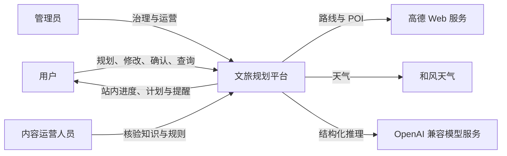
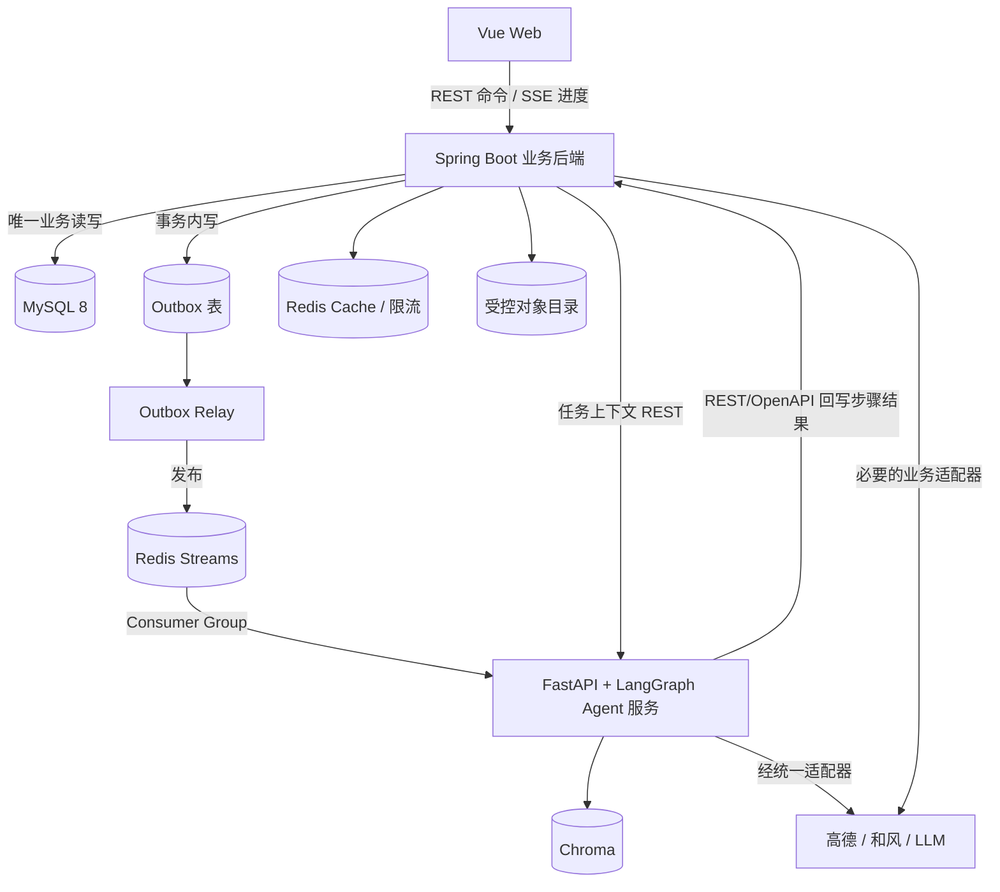
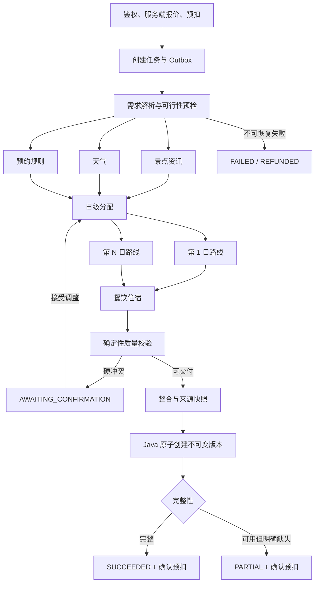
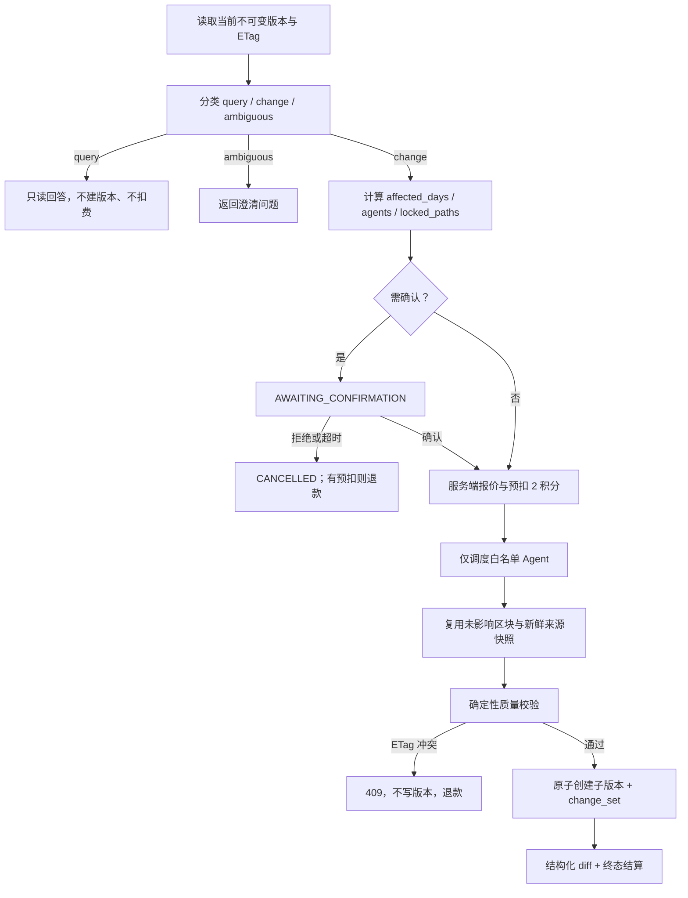
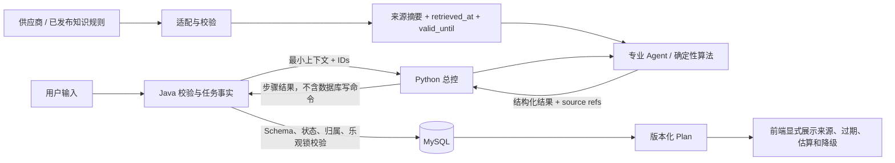
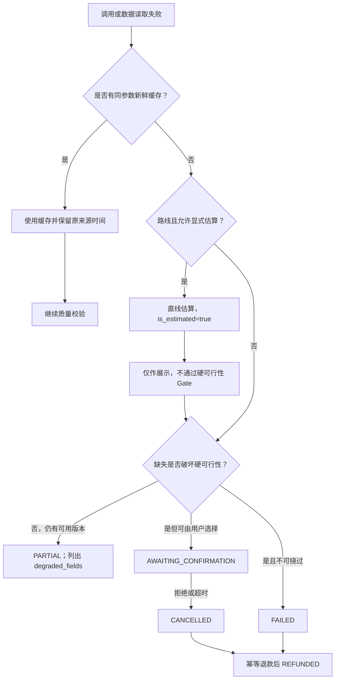

# 总体架构设计

| 项目 | 内容 |
|---|---|
| 状态 | Accepted |
| 日期 | 2026-09-20 |
| 适用范围 | P0 主链路及 P1/P2 的边界预留 |

## 1. 架构原则

- 总控 Agent 是唯一面向用户意图的 Agent；六个专业 Agent 只接受编排调用，彼此不直连。
- Java 业务后端是身份、任务、版本、积分、审计和 MySQL 的唯一写方。
- Python Agent 服务执行编排和计算，只经 S02 OpenAPI 获取上下文、回写步骤结果。
- MySQL 保存业务事实；Redis Streams 只负责投递，Redis Cache、Chroma 和对象文件都不能替代业务事实。
- 所有事实带来源快照；LLM 只做理解、排序与表达，不能补事实。
- 命令走 REST，进度走 SSE；所有重试、回放和结算必须幂等。

## 2. 上下文图

外部系统返回均是不可信输入，必须经过适配、校验、来源摘要和时效处理后才可进入计划。

## 3. 容器图

供应商访问边界：Python 只能由统一 LLM Gateway 访问模型供应商；普通 Agent、前端和用户请求不得绕过 Gateway。Java 仍是业务数据和 MySQL 的唯一写方。详见 ADR-0012。

逻辑上的 Outbox Relay 可部署在 Java 进程内，但它只能读取已提交 Outbox 并发布，不能绕过数据库事务创建任务消息。

## 4. 首次生成 DAG

并行节点只共享最小必要上下文；每一步记录 `input_hash`、`attempt_no`、输出引用和来源新鲜度。具体字段由 S02/S04 冻结。

## 5. 局部修改 DAG

确认前不创建新版本。回滚也是以目标历史版本为内容来源创建新版本，不修改或删除历史版本。

## 6. 事实与控制数据流

原始用户 Prompt、完整供应商响应和敏感字段不进入事件或普通日志；只保存脱敏摘要、哈希、状态、耗时和费用汇总。

## 7. 降级与失败决策图

天气失败不能写成晴天，知识/规则缺失不能由模型补写，鉴权失败不能作为空数据缓存。任何估算、过期、冲突和失败都必须进入结构化状态并对用户可见。

## 8. 可观测与恢复边界

- `request_id` 关联同步请求，`trace_id` 关联整条调用链，`task_id` 关联异步任务；系统字段只能由网关注入。
- 任务事件只追加且 `sequence_no` 单调；SSE 断线从最后序号补拉，客户端按任务和序号去重。
- Worker 用租约和心跳领取步骤；租约过期只增加 `attempt_no`，不能重复创建版本、结算或发布通知。
- 恢复以 MySQL 状态和成功步骤为准；来源仍新鲜则复用，否则从最早受影响步骤重跑。
- 全局 Deadline：首次生成 180 秒，局部修改 60 秒；确认等待暂停执行 Deadline，但有独立 24 小时确认期限。
