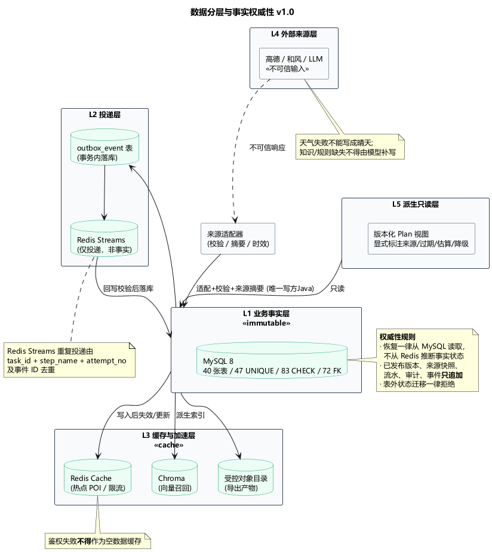
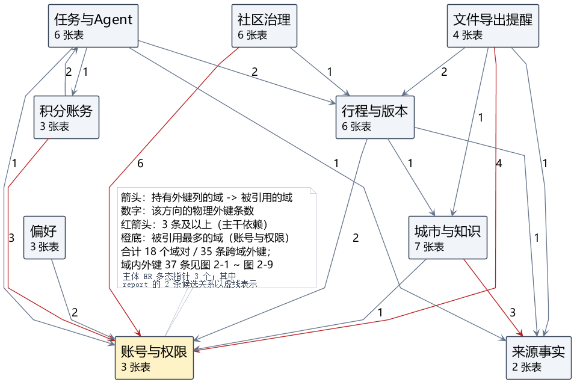
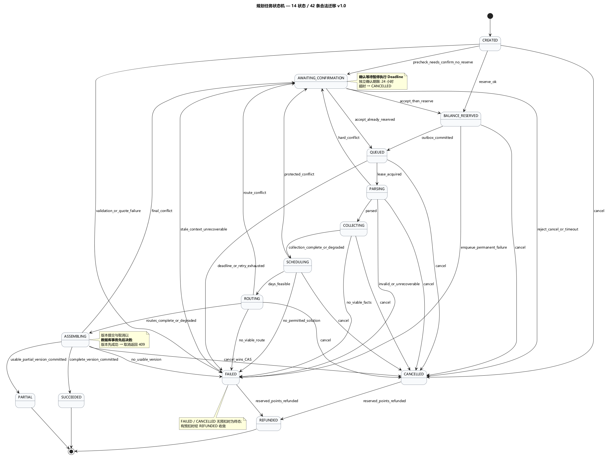

**多智能体协作文旅规划平台**

**数据与接口设计说明书**

*Data & Interface Design Specification*

| **文档编号** | GZUH-CS-S04-DESIGN |
| --- | --- |
| **版本** | v1.0 |
| **文档状态** | 已冻结（Frozen） |
| **密级** | 内部公开 |
| **编制单位** | 贵州大学计算机科学与技术学院 软件工程 2403 班项目组 |
| **适用阶段** | S04 数据模型设计 / S02 契约冻结 |

2026 年 10 月

**目　录**

1\. 文档定位

2\. 设计目标与范围

3\. 总体数据分层

4\. 核心实体与关系

5\. 数据字典

6\. 主键、索引与约束策略

7\. 主要数据流与状态流转

8\. owner、权限、审计、保留与软删除

9\. 数据量级与性能考虑

10\. 接口与模型缺口

11\. 参考文件与一致性说明

12\. 交付物清单

# 1. 文档定位

本文件是基于当前仓库事实形成的数据设计说明，不新增业务规则、不替代 S04 冻结单，也不替代 Flyway migration。当前需求正文未指定一个独立的新增业务子域，因此本文件覆盖已冻结的 S04 首版数据模型，并说明它对 S08 及后续阶段的使用边界。

事实来源优先级如下：

1. 实际迁移：backend/src/main/resources/db/migration/V1__initial_s04_schema.sql；
2. 设计冻结：docs/progress/S04-最终数据模型冻结单.md、docs/progress/S04.md；
3. 已接受的 ADR、需求追踪矩阵、需求与整体设计、Agent 契约和 R5/R8 规范；
4. 本文件仅在上述文件明确表达的范围内归纳，不把推测写成设计结论。

当前仓库：small-soil-ash/agent-travel-project；当前本地分支：dev-r5。本设计未修改 master、S00-S04 冻结材料、OpenAPI 或 migration。

# 2. 设计目标与范围

## 2.1 目标

- 以 MySQL 8、InnoDB、utf8mb4 和 UTC DATETIME(6) 保存业务事实。
- 用关系列保存 owner、状态、版本、时间、来源身份、幂等键、账务金额等稳定查询字段；JSON 只保存契约正文、扩展载荷或脱敏摘要。
- 以不可变版本、来源快照、追加事件、追加账务流水和审计事件保证可追溯性。
- 让 S08 账号、权限和积分接口、S10 适配器、S11 任务编排及后续 S15/S23-S28 能使用统一物理模型。

## 2.2 范围与非范围

范围是 S04 已冻结并已落地的 40 张表、表间关系、约束、索引、owner/权限、保留与脱敏规则，以及它们对后续阶段的依赖。

本文件不实现 Java Entity、Repository、Controller、认证、积分业务、Redis、Agent Worker、SSE、RAG、社区业务或前端；这些属于 S08 及后续阶段。Redis key/TTL 只在官方冻结材料中作为契约存在，不在 MySQL 中建表。

# 3. 总体数据分层

| **数据域** | **表** | **事实性质** | **主要后续使用方** |
| --- | --- | --- | --- |
| 账号与权限 | user_account、user_session、audit_event | 账号、会话吊销和安全审计事实 | S08、S22、S28 |
| 行程与版本 | trip、trip_city、trip_version、plan_snapshot、change_set、trip_version_source | 行程聚合、不可变版本和字段级来源 | S08、S11、S19-S22 |
| 来源事实 | source_record、source_snapshot | 稳定来源身份与取得时快照 | S10、S15-S19 |
| 任务与 Agent | planning_task、task_step、task_event、outbox_event、agent_result、agent_result_source | 任务状态、步骤租约、事件、投递和结果 | S11、S12-S19 |
| 城市与知识 | city、poi、poi_snapshot、poi_alias、knowledge_entry、knowledge_chunk、reservation_rule | 标准主数据、版本事实和审核状态 | S05/S06、S10、S15-S18 |
| 积分账务 | points_quote、points_account、points_ledger | 报价、账户余额和只追加流水 | S08、S11、S25 |
| 社区治理 | post、post_comment、interaction、report、moderation_case、ranking_entry | 社区内容、互动、治理和可重建榜单 | S23、S27、S28 |
| 偏好 | user_preference、preference_evidence、preference_summary | 用户软约束、证据和规则聚合画像 | S24、S27 |
| 文件、导出、提醒 | object_metadata、export_job、reminder_candidate、notification | 文件元数据、异步导出和站内通知 | S26、S27 |

数据分层图

**图 1　S04 数据分层总览**

# 4. 核心实体与关系

数据域关系图

图 2　S04 数据域关系图（域级总览：节点为数据域及其表数；箭头由持有外键列的域指向被引用域，标注该方向上的物理外键条数，红箭头为 3 条及以上的主干依赖；橙底为被引用最多的账号与权限域。合计 18 个域对、35 条跨域外键。各域内部结构见图 2-1～图 2-9，全部图纸集中收录在配套文件《S04 数据模型 ER 图集》（见第 4.2 节）。）

## 4.1 ER 描述

以下基数以 V1 migration 中实际存在的外键与唯一约束为准。凡外键列可空，均写作「可空」，表示 SQL 只约束「父记录存在时子记录归属正确」，不保证每位父记录都有对应子记录。

**账号与权限**

- user_account 1:N user_session（user_session.user_id）、user_account 1:N trip（trip.owner_id）、user_account 1:N trip_version（trip_version.created_by）、user_account 1:N planning_task（planning_task.owner_id）。
- user_account 1:0..1 points_account：points_account.user_id 唯一。数据库层只保证一个用户最多一个积分账户；注册成功必须在同一业务事务内创建 points_account 并追加 100 积分的 GRANT 流水，因此正常注册用户应有且仅有一个账户。不得在首次使用积分时静默惰性创建；若发现账户缺失，应作为数据一致性故障拒绝积分操作并记录审计。用户删除后账户与积分流水按保留规则保留，不物理级联删除。口径说明：物理数据库关系为 1:0..1（唯一键仅保证至多一个账户）；冻结单中的「user_account 1:1 points_account」是业务规则口径（注册成功必须创建账户），二者不矛盾，本文按物理关系表述。
- user_account 1:N audit_event，audit_event.actor_user_id 可空且 ON DELETE SET NULL，因此系统级审计事件可以没有用户 actor。

**行程与版本**

- trip 1:N trip_city、city 1:N trip_city；城市顺序由 trip_city.sequence_no 表达，单城市也是一行，不使用 trip.city_id。
- trip 1:N trip_version；trip_version 1:N trip_version（trip_version.parent_version_id 可空，自引用链式表达版本演进）；trip_version 1:0..1 plan_snapshot（plan_snapshot.trip_version_id 唯一）；trip_version 1:N change_set（change_set.trip_version_id）、trip_version 1:N change_set（change_set.base_version_id 可空，标识本版本从哪个版本演化而来）。回滚通过新版本表达，已发布版本不更新。
- trip.current_version_id 与 poi.current_snapshot_id 为循环引用，由 migration 的 ALTER TABLE 补齐，不参与建表顺序。

**来源**

- source_record 1:N source_snapshot；快照不可更新，被已发布版本或结果引用的快照不得清理。
- trip_version N:M source_snapshot 通过 trip_version_source 保存 JSON Pointer/字段路径级引用，复合主键为 (trip_version_id, source_snapshot_id, field_path)。
- source_snapshot 分别 1:N 关联 poi_snapshot、knowledge_entry、reservation_rule、agent_result_source 和 trip_version_source，保证每条业务事实都能回溯到取得时快照。

**任务与 Agent**

- planning_task 1:N task_step、planning_task 1:N task_event、planning_task 1:N agent_result（agent_result.task_id，结果必须归属具体任务）；task_step 1:N agent_result；task_step.output_result_id 可空 FK 指向选定的 agent_result；agent_result N:M source_snapshot 通过 agent_result_source 关联。
- trip 1:N planning_task（planning_task.trip_id 可空，首次生成时任务尚未挂靠行程）、trip_version 1:N planning_task（planning_task.base_version_id 可空，首次生成无基准版本）。
- outbox_event 使用 aggregate_type + aggregate_id 多态关联任务、积分或版本聚合，不建立跨聚合外键，取值由 CHECK 限定为 TASK/POINTS/TRIP_VERSION。

**城市、POI、知识与规则**

- city 1:N poi；poi 1:N poi_snapshot、poi 1:N poi_alias。
- poi 1:N knowledge_entry，knowledge_entry.poi_id 可空：城市级通用知识不绑定具体 POI。
- knowledge_entry 1:N knowledge_chunk：knowledge_chunk.knowledge_entry_id 关联知识条目，knowledge_chunk 上没有指向 poi 的外键。
- knowledge_entry 1:N knowledge_entry（knowledge_entry.parent_entry_id 可空，自引用，表达条目继承与覆盖）；city 1:N knowledge_entry（knowledge_entry.city_id）、user_account 1:N knowledge_entry（knowledge_entry.created_by）。
- poi 1:N reservation_rule（reservation_rule.poi_id，预约规则必须归属具体 POI）；reservation_rule 1:N reservation_rule（reservation_rule.parent_rule_id 可空，规则版本链）。

**积分账务**

- points_account 1:N points_ledger；user_account 1:N points_account、user_account 1:N points_quote、user_account 1:N points_ledger（points_ledger.user_id）。
- planning_task 与 points_quote 是数据库双向可空外键关系：planning_task.quote_id 可空且 points_quote.task_id 可空；points_quote.task_id 唯一，表示一个任务至多绑定一个报价。报价可以先独立存在，非计费任务两个字段均可为空。实际绑定时以 planning_task.quote_id 作为任务执行和结算读取的权威引用，points_quote.task_id 仅作反向检索；Java 在同一事务内先创建 task（quote_id=NULL），再创建或绑定 quote（task_id=task.id），最后更新 task.quote_id=quote.id，并在提交前校验 user_id/owner_id、报价状态、有效期和两字段互指一致。除事务内中间态外，不允许提交仅一侧非空的绑定关系。
- planning_task 1:N points_ledger（points_ledger.task_id 可空，赠送类流水不挂任务）、points_quote 1:N points_ledger（points_ledger.quote_id 可空，非报价来源的流水不挂报价）。
- 幂等字段分属两表：报价侧为 points_quote.quote_reference（唯一键 uk_quote_reference），账务侧为 points_ledger.business_reference（唯一键 uk_ledger_reference）。预扣、确认、退款只写流水，因此由 business_reference 保证幂等；报价本身的重放由 quote_reference 保证幂等。

**社区与治理**

- user_account 1:N post（post.owner_id）、trip_version 1:N post（post.source_version_id 可空）。
- post 1:N post_comment、post_comment 1:N post_comment（post_comment.parent_comment_id 可空，评论成树）；user_account 1:N post_comment（post_comment.author_id）。
- post N:M user_account 通过 interaction 关联：interaction.post_id 与 interaction.user_id 均为物理外键（post 1:N interaction、user_account 1:N interaction），唯一键 post_id + user_id + interaction_type。
- 举报是单向 1:N：post 1:N report（target_type='POST'）与 post_comment 1:N report（target_type='COMMENT'）。每条 report 记录只有一个 target_type 与一个 target_id，因此一个帖子或评论可以对应多条举报记录；report.target_id 上没有指向 post/post_comment 的物理外键，目标由 Java 按 target_type 在应用层解析。写入举报前必须校验目标存在、类型匹配，并按治理规则判断目标是否可处理；不通过新增多态外键绕过该边界。
- user_account 1:N report（report.reporter_id）；唯一键 uk_report_target(reporter_id, target_type, target_id) 表达「同一举报人对同一目标只能举报一次」，而非举报与内容的双向多对多。
- moderation_case 1:0..N report（report.moderation_case_id 可空）：举报可先独立存在，处理时再归并到治理案件，因此是「案件归并多条举报」的单向关系。moderation_case 自身也用 target_type + target_id 指向帖子或评论，同样不建物理外键。创建案件和归并举报时，Java 必须校验目标存在、类型匹配，并要求 report 与 moderation_case 的 target_type/target_id 完全一致；跨目标归并不得提交。
- post 1:N ranking_entry。

**偏好、文件与提醒**

- user_preference 1:N preference_evidence；user_account 1:N preference_summary；偏好只供本人及受控 Agent 上下文使用。
- user_account 1:N object_metadata；user_account 1:N export_job、trip_version 1:N export_job（export_job.trip_version_id）；export_job N:0..1 object_metadata（export_job.object_metadata_id 可空，任务完成前对象尚未生成）。
- user_account 1:N reminder_candidate、trip 1:N reminder_candidate（reminder_candidate.trip_id）；reservation_rule 1:N reminder_candidate（reminder_candidate.reservation_rule_id 可空）与 source_snapshot 1:N reminder_candidate（reminder_candidate.source_snapshot_id 可空），由 ck_reminder_source 保证两个来源外键恰有一个非空。
- user_account 1:N notification（notification.user_id）；reminder_candidate 1:0..N notification（notification.reminder_candidate_id 可空，非提醒类站内通知不挂候选）。

**跨表一致性规则（应用层校验，SQL 无法表达的部分）**

- trip.current_version_id 必须指向同一 trip 的 trip_version：外键只约束版本存在，归属同一行程由应用层校验。
- trip_version.parent_version_id 与 change_set.base_version_id 必须属于同一行程：版本链与变更集不得跨行程引用。
- planning_task.base_version_id 在 planning_task.trip_id 非空时必须属于同一行程：任务不得以另一行程的版本为基准。
- task_step.output_result_id 指向的 agent_result 必须属于同一任务与同一步骤，不允许跨步骤选取结果。
- points_ledger.account_id 对应的账户必须属于 points_ledger.user_id：账户与用户字段不得指代不同用户。
- points_ledger.quote_id、task_id 与 user_id 的归属必须相互一致：同一笔流水引用的报价、任务与用户必须同源。
- post.source_version_id 必须指向公开版本，且发帖者必须对该版本拥有 owner 权限。
- export_job.user_id 必须拥有对应的 trip_version：导出任务不得跨用户访问他人版本。

## 4.2 ER 图纸的阅读方式与位置

图 2 是域级总览，只回答「9 个数据域之间如何互相引用」这一个问题。各域内部的 40 张表与 37 条域内外键需要各自独占一页横向版面。主体 ER 多态指针字段共 3 个——report.target_id、moderation_case.target_id、outbox_event.aggregate_id，均无物理外键；此外，audit_event.resource_type + resource_id 与 preference_evidence.source_type + source_ref_id 是审计/证据的广义无 FK 引用，不计入主体 ER 多态关系，也不绘制候选实体连线。图集中只有 report.target_id 的 2 条候选目标关系 post → report、post_comment → report 画成虚线，其余 2 个主体 ER 多态指针在对应页题注中用文字交代。这样才能保证图内文字可读，压缩到正文页宽后将无法辨认，因此域内明细外移到配套文件《S04 数据模型 ER 图集》（docs/diagrams/S04-数据模型ER图集.pdf，A4 横向，13 页），正文只保留图 2 并引用图纸编号。图集内容如下：

· 图 2-1～图 2-9　按第 3 节 9 个数据域拆分的域内 ER 子图，每张独占一页横向版面

· 附表 A　跨域外键清单（35 条，按持有外键的域分组，标注外键列、约束名与引用目标）

图集中每张图纸均按 A4 横向整页排版，不再受正文页宽限制，图内实体名、关系标签与批注均可直接阅读。change_set.base_version_id 见图 2-2，moderation_case.assigned_to 见图 2-7 与图 2-1；两条关系均已由 V1 migration 建立物理外键（fk_change_base、fk_moderation_assignee），与第 5 节数据字典逐字段一致。

# 5. 数据字典

## 5.1 阅读约定

- 本节逐字段列出全部 40 张表的 410 个字段。每个字段给出：字段名、完整数据类型、必填或可空、数据库默认值、业务含义。
- 可空性标记：必填 表示 NOT NULL 且无数据库默认值，写入时必须由应用显式提供；必填，默认 X 表示 NOT NULL 且带数据库默认值；可空 表示 NULL 允许。
- 未标注默认值即为无数据库默认值。所有 UUID 主键/外键为 BINARY(16)；哈希为 BINARY(32)；时间为 UTC DATETIME(6)；DATE 为日期。
- 约束记号：PK 主键，FK 外键，UQ 唯一约束，CK 检查约束，IDX 普通索引。
- 本节字段与约束均以 V1 migration 原文为准；字段业务语义以 S04 冻结单为准。凡 migration 未表达的业务规则，不在本节推断。

## 5.2 账号、行程、来源与审计

### 5.2.1 user_account — 账号

| **字段** | **类型** | **必填/默认** | **含义** |
| --- | --- | --- | --- |
| id | BINARY(16) | 必填 | 账号主键，应用生成 UUID |
| username | VARCHAR(64) | 可空 | 用户名，登录标识之一 |
| phone | VARCHAR(32) | 可空 | 手机号，登录标识之一 |
| email | VARCHAR(320) | 可空 | 邮箱，登录标识之一 |
| password_hash | VARCHAR(255) | 必填 | 口令哈希，只存哈希不存明文或可逆密文 |
| role | VARCHAR(16) | 必填 | 角色，取值 USER/ADMIN |
| status | VARCHAR(16) | 必填，默认 ACTIVE | 账号状态，取值 ACTIVE/LOCKED/DISABLED/DELETED |
| failed_login_count | INT | 必填，默认 0 | 连续登录失败次数，用于锁定判定，非负 |
| locked_until | DATETIME(6) | 可空 | 锁定截止时间，空表示未锁定 |
| last_login_at | DATETIME(6) | 可空 | 最近一次成功登录时间 |
| deleted_at | DATETIME(6) | 可空 | 软删除时间，非空表示账号已注销 |
| created_at | DATETIME(6) | 必填，默认 CURRENT_TIMESTAMP(6) | 创建时间 |
| updated_at | DATETIME(6) | 必填，默认 CURRENT_TIMESTAMP(6) | 最后更新时间，由应用维护 |

约束与索引：PK id；UQ username、phone、email（MySQL 唯一索引允许多个 NULL，故未填的登录标识互不冲突）；CK 至少一个登录标识非空、角色白名单、状态白名单、失败次数非负；IDX (status, deleted_at)。

### 5.2.2 user_session — 会话

| **字段** | **类型** | **必填/默认** | **含义** |
| --- | --- | --- | --- |
| id | BINARY(16) | 必填 | 会话主键 |
| user_id | BINARY(16) | 必填 | 所属账号，FK → user_account.id |
| refresh_token_hash | BINARY(32) | 必填 | 刷新令牌哈希，唯一；不存令牌原文 |
| issued_at | DATETIME(6) | 必填 | 签发时间 |
| expires_at | DATETIME(6) | 必填 | 过期时间，必须晚于 issued_at |
| revoked_at | DATETIME(6) | 可空 | 吊销时间，非空表示会话已失效 |
| last_seen_at | DATETIME(6) | 可空 | 最近活跃时间，用于会话清理 |
| client_metadata_json | JSON | 可空 | 最小客户端元数据（设备、UA 等），不含高敏感信息 |
| created_at | DATETIME(6) | 必填，默认 CURRENT_TIMESTAMP(6) | 创建时间 |

约束与索引：PK id；UQ refresh_token_hash；IDX (user_id, expires_at)、(revoked_at)；CK expires_at > issued_at；FK → user_account(id)。

### 5.2.3 trip — 行程聚合

| **字段** | **类型** | **必填/默认** | **含义** |
| --- | --- | --- | --- |
| id | BINARY(16) | 必填 | 行程主键 |
| owner_id | BINARY(16) | 必填 | 行程所有者，FK → user_account.id |
| title | VARCHAR(200) | 必填 | 行程标题 |
| start_date | DATE | 必填 | 行程开始日期 |
| end_date | DATE | 必填 | 行程结束日期，不早于 start_date |
| status | VARCHAR(16) | 必填，默认 DRAFT | 行程状态，取值 DRAFT/ACTIVE/ARCHIVED/DELETED |
| current_version_id | BINARY(16) | 可空 | 当前生效版本，FK → trip_version.id；为空表示尚无版本 |
| deleted_at | DATETIME(6) | 可空 | 软删除时间 |
| created_at | DATETIME(6) | 必填，默认 CURRENT_TIMESTAMP(6) | 创建时间 |
| updated_at | DATETIME(6) | 必填，默认 CURRENT_TIMESTAMP(6) | 最后更新时间 |

约束与索引：PK id；IDX (owner_id, updated_at)、(owner_id, status)；CK end_date >= start_date、状态白名单；FK owner_id → user_account(id)；FK current_version_id → trip_version(id)（由 ALTER TABLE 补齐，用于打破建表循环）。

### 5.2.4 city — 城市主数据

| **字段** | **类型** | **必填/默认** | **含义** |
| --- | --- | --- | --- |
| id | BINARY(16) | 必填 | 城市主键 |
| city_code | VARCHAR(32) | 必填 | 标准城市编码，唯一标识一个城市 |
| name | VARCHAR(128) | 必填 | 城市名称 |
| region_name | VARCHAR(128) | 可空 | 上级行政区名称 |
| timezone | VARCHAR(64) | 必填 | IANA 时区标识，用于跨时区时间计算 |
| status | VARCHAR(16) | 必填，默认 ACTIVE | 城市状态，取值 ACTIVE/DISABLED |
| created_at | DATETIME(6) | 必填，默认 CURRENT_TIMESTAMP(6) | 创建时间 |
| updated_at | DATETIME(6) | 必填，默认 CURRENT_TIMESTAMP(6) | 最后更新时间 |

约束与索引：PK id；UQ city_code；IDX (name, status)；CK 状态白名单。

### 5.2.5 trip_city — 行程城市关联

| **字段** | **类型** | **必填/默认** | **含义** |
| --- | --- | --- | --- |
| id | BINARY(16) | 必填 | 关联行主键 |
| trip_id | BINARY(16) | 必填 | 所属行程，FK → trip.id |
| city_id | BINARY(16) | 必填 | 关联城市，FK → city.id |
| sequence_no | INT | 必填 | 城市访问顺序，从 1 开始；唯一约束使同一城市不重复出现 |
| created_at | DATETIME(6) | 必填，默认 CURRENT_TIMESTAMP(6) | 创建时间 |

约束与索引：PK id；UQ (trip_id, city_id)（同一城市不重复）、(trip_id, sequence_no)（同一顺序号不重复）；IDX (city_id)；CK sequence_no >= 1。

### 5.2.6 trip_version — 不可变版本

| **字段** | **类型** | **必填/默认** | **含义** |
| --- | --- | --- | --- |
| id | BINARY(16) | 必填 | 版本主键 |
| trip_id | BINARY(16) | 必填 | 所属行程，FK → trip.id |
| parent_version_id | BINARY(16) | 可空 | 派生自的父版本，FK → trip_version.id；为空表示首个版本；自引用成链 |
| version_no | INT | 必填 | 行程内版本号，从 1 开始 |
| etag | BINARY(32) | 必填 | 内容版本标识（乐观并发标签），全局唯一 |
| content_hash | BINARY(32) | 必填 | 版本正文内容哈希，行程内唯一，用于去重与幂等 |
| version_status | VARCHAR(16) | 必填 | 版本状态，取值 DRAFT/PUBLISHED/SUPERSEDED |
| schema_version | VARCHAR(64) | 必填 | 计划正文 Schema 版本，保证旧版本可解析 |
| model_version | VARCHAR(128) | 可空 | 生成所用模型标识与版本 |
| prompt_version | VARCHAR(128) | 可空 | 生成所用 Prompt 版本 |
| created_by | BINARY(16) | 必填 | 创建者，FK → user_account.id（用户或系统账号） |
| created_at | DATETIME(6) | 必填，默认 CURRENT_TIMESTAMP(6) | 创建时间 |

约束与索引：PK id；UQ (trip_id, version_no)、etag、(trip_id, content_hash)；IDX (trip_id, version_status)、(parent_version_id)；CK version_no >= 1、状态白名单；FK trip_id、parent_version_id、created_by。

### 5.2.7 plan_snapshot — 计划正文快照

| **字段** | **类型** | **必填/默认** | **含义** |
| --- | --- | --- | --- |
| id | BINARY(16) | 必填 | 快照主键 |
| trip_version_id | BINARY(16) | 必填 | 对应版本，FK → trip_version.id；唯一，一个版本至多一份计划正文 |
| plan_json | JSON | 必填 | 计划完整正文（行程项、编排、引用） |
| summary_json | JSON | 可空 | 计划摘要，供列表与摘要展示 |
| created_at | DATETIME(6) | 必填，默认 CURRENT_TIMESTAMP(6) | 创建时间 |

约束与索引：PK id；UQ trip_version_id；FK trip_version_id → trip_version(id)。只追加，不更新。

### 5.2.8 change_set — 结构化变更

| **字段** | **类型** | **必填/默认** | **含义** |
| --- | --- | --- | --- |
| id | BINARY(16) | 必填 | 变更记录主键 |
| trip_version_id | BINARY(16) | 必填 | 本次变更所属版本，FK → trip_version.id |
| base_version_id | BINARY(16) | 可空 | 变更基准版本，FK → trip_version.id；标识从哪个版本演化而来 |
| change_no | INT | 必填 | 版本内变更序号，从 1 开始 |
| change_type | VARCHAR(32) | 必填 | 变更类型，取值 CREATE/UPDATE/DELETE/MOVE/REORDER/ROLLBACK |
| affected_paths_json | JSON | 必填 | 受影响的字段路径集合（JSON Pointer 数组） |
| change_json | JSON | 必填 | 变更明细正文（前后值） |
| change_hash | BINARY(32) | 必填 | 变更内容哈希，版本内唯一 |
| created_at | DATETIME(6) | 必填，默认 CURRENT_TIMESTAMP(6) | 创建时间 |

约束与索引：PK id；UQ (trip_version_id, change_no)、(trip_version_id, change_hash)；IDX (base_version_id)；CK change_no >= 1、变更类型白名单；FK trip_version_id、base_version_id → trip_version(id)。

### 5.2.9 source_record — 稳定来源身份

| **字段** | **类型** | **必填/默认** | **含义** |
| --- | --- | --- | --- |
| id | BINARY(16) | 必填 | 来源记录主键 |
| source_type | VARCHAR(32) | 必填 | 来源类别，取值 MAP/WEATHER/KNOWLEDGE_BASE/RESERVATION_RULE/POI/USER_INPUT/SYSTEM |
| provider_name | VARCHAR(64) | 必填 | 供应方名称，与 source_type 共同构成来源身份 |
| external_record_id | VARCHAR(255) | 必填 | 供应方侧的记录标识 |
| sanitized_summary_json | JSON | 可空 | 脱敏后的来源摘要，不保存完整原始响应 |
| status | VARCHAR(16) | 必填，默认 ACTIVE | 来源状态，取值 ACTIVE/DISABLED |
| created_at | DATETIME(6) | 必填，默认 CURRENT_TIMESTAMP(6) | 创建时间 |
| updated_at | DATETIME(6) | 必填，默认 CURRENT_TIMESTAMP(6) | 最后更新时间 |

约束与索引：PK id；UQ (source_type, provider_name, external_record_id) 保证同一外部记录只登记一次；IDX 同列组合，供身份查找；CK 来源类型白名单、状态白名单。

### 5.2.10 source_snapshot — 取得时快照

| **字段** | **类型** | **必填/默认** | **含义** |
| --- | --- | --- | --- |
| id | BINARY(16) | 必填 | 快照主键 |
| source_record_id | BINARY(16) | 必填 | 所属来源记录，FK → source_record.id |
| source_version | VARCHAR(128) | 可空 | 供应方侧的数据版本号 |
| retrieved_at | DATETIME(6) | 必填 | 取得时间 |
| valid_until | DATETIME(6) | 可空 | 有效期截止，不早于 retrieved_at；空表示无明确有效期 |
| freshness_status | VARCHAR(16) | 必填 | 新鲜度，取值 FRESH/STALE/UNKNOWN |
| is_estimated | BOOLEAN | 必填，默认 FALSE | 是否为估算值；TRUE 表示不得当作真实事实使用 |
| content_hash | BINARY(32) | 必填 | 快照内容哈希 |
| sanitized_payload_json | JSON | 可空 | 脱敏后的快照正文，不保存完整供应商响应 |
| created_at | DATETIME(6) | 必填，默认 CURRENT_TIMESTAMP(6) | 创建时间 |

约束与索引：PK id；UQ (source_record_id, content_hash, retrieved_at)；IDX (source_record_id, freshness_status, valid_until)；CK 新鲜度白名单、valid_until IS NULL OR valid_until >= retrieved_at；FK source_record_id。只追加，不更新。

### 5.2.11 trip_version_source — 版本字段来源

| **字段** | **类型** | **必填/默认** | **含义** |
| --- | --- | --- | --- |
| trip_version_id | BINARY(16) | 必填 | 版本主键，复合 PK 第一段，FK → trip_version.id |
| source_snapshot_id | BINARY(16) | 必填 | 快照主键，复合 PK 第二段，FK → source_snapshot.id |
| field_path | VARCHAR(255) | 必填 | 版本正文中被该快照支撑的字段路径（JSON Pointer），复合 PK 第三段 |
| created_at | DATETIME(6) | 必填，默认 CURRENT_TIMESTAMP(6) | 创建时间 |

约束与索引：复合 PK (trip_version_id, source_snapshot_id, field_path)；IDX (source_snapshot_id) 用于反查引用；FK 两条均指向父表主键。同一版本对同一快照可引用多个字段路径，故 field_path 参与主键。

### 5.2.12 audit_event — 安全与业务审计

| **字段** | **类型** | **必填/默认** | **含义** |
| --- | --- | --- | --- |
| id | BINARY(16) | 必填 | 审计事件主键 |
| actor_user_id | BINARY(16) | 可空 | 操作者，FK → user_account.id，ON DELETE SET NULL；为空表示系统级事件 |
| action | VARCHAR(64) | 必填 | 操作动作标识 |
| resource_type | VARCHAR(64) | 必填 | 目标资源类型 |
| resource_id | BINARY(16) | 可空 | 目标资源标识；与 resource_type 构成审计资源引用，无物理 FK，不计入主体 ER 多态指针统计 |
| request_id | VARCHAR(128) | 可空 | 关联的外部请求标识 |
| trace_id | VARCHAR(128) | 可空 | 链路追踪标识 |
| outcome | VARCHAR(16) | 必填 | 结果，取值 SUCCESS/DENIED/FAILURE |
| error_code | VARCHAR(64) | 可空 | 失败时的错误码 |
| metadata_json | JSON | 可空 | 补充上下文，已脱敏，不含凭据 |
| created_at | DATETIME(6) | 必填，默认 CURRENT_TIMESTAMP(6) | 创建时间 |

约束与索引：PK id；IDX (resource_type, resource_id, created_at)、(actor_user_id, created_at)、(request_id)；CK outcome 白名单；FK actor_user_id → user_account(id)。只追加，不更新。

## 5.3 任务、Outbox 与 Agent 结果

### 5.3.1 planning_task — 任务事实源

| **字段** | **类型** | **必填/默认** | **含义** |
| --- | --- | --- | --- |
| id | BINARY(16) | 必填 | 任务主键 |
| owner_id | BINARY(16) | 必填 | 任务发起人，FK → user_account.id |
| trip_id | BINARY(16) | 可空 | 关联行程，FK → trip.id；为空表示首版生成任务尚未挂靠行程 |
| base_version_id | BINARY(16) | 可空 | 基准版本，FK → trip_version.id；为空表示首次生成无基准 |
| task_type | VARCHAR(32) | 必填 | 任务类型（生成、改期、取消等） |
| status | VARCHAR(32) | 必填 | 任务状态，取值见 6.3 节状态机白名单 |
| idempotency_key | VARCHAR(128) | 必填 | 幂等键，与 owner_id 组成唯一键，外部重试须复用同一值 |
| request_hash | BINARY(32) | 必填 | 请求内容哈希；同键不同哈希视为不同请求，拒绝复用幂等键 |
| quote_id | BINARY(16) | 可空 | 关联报价，FK → points_quote.id；为空表示未使用报价；由 ALTER TABLE 补齐 |
| reserved_points | BIGINT | 必填，默认 0 | 已预扣积分，非负 |
| request_json | JSON | 必填 | 脱敏后的任务请求正文 |
| operation_deadline_at | DATETIME(6) | 必填 | 任务执行截止时间，用于超时回收 |
| confirmation_deadline_at | DATETIME(6) | 可空 | 用户确认截止时间，超时按失败处理并退款 |
| state_version | BIGINT | 必填，默认 0 | 乐观锁版本号，非负，每次状态变更递增 |
| created_at | DATETIME(6) | 必填，默认 CURRENT_TIMESTAMP(6) | 创建时间 |
| updated_at | DATETIME(6) | 必填，默认 CURRENT_TIMESTAMP(6) | 最后更新时间 |

约束与索引：PK id；UQ (owner_id, idempotency_key)；IDX (status, operation_deadline_at)、(owner_id, created_at)；CK reserved_points >= 0、state_version >= 0、状态白名单；FK owner_id、trip_id、base_version_id、quote_id。quote_id 是任务执行和结算读取的权威报价引用；与 points_quote.task_id 的互指绑定必须按 4.5 节和 7.4 节的同事务规则完成。

### 5.3.2 task_step — 步骤与租约

| **字段** | **类型** | **必填/默认** | **含义** |
| --- | --- | --- | --- |
| id | BINARY(16) | 必填 | 步骤主键 |
| task_id | BINARY(16) | 必填 | 所属任务，FK → planning_task.id |
| step_name | VARCHAR(64) | 必填 | 步骤名称（解析、采集、排程等） |
| status | VARCHAR(32) | 必填 | 步骤状态，取值 PENDING/RUNNING/SUCCEEDED/PARTIAL/DEGRADED/FAILED/CANCELLED |
| attempt_no | INT | 必填，默认 1 | 尝试序号，从 1 开始；与 task_id、step_name 组成唯一键 |
| lease_owner | VARCHAR(128) | 可空 | 当前持有租约的 Worker 标识，空表示无持有者 |
| lease_expires_at | DATETIME(6) | 可空 | 租约到期时间，过期后可被其他 Worker 接管 |
| heartbeat_at | DATETIME(6) | 可空 | 最近心跳时间，用于识别僵死 Worker |
| input_hash | BINARY(32) | 必填 | 步骤输入哈希，判断输入是否变化 |
| output_result_id | BINARY(16) | 可空 | 该步骤产出的结果，FK → agent_result.id；由 ALTER TABLE 补齐 |
| started_at | DATETIME(6) | 可空 | 步骤开始时间 |
| finished_at | DATETIME(6) | 可空 | 步骤结束时间，不早于 started_at |
| created_at | DATETIME(6) | 必填，默认 CURRENT_TIMESTAMP(6) | 创建时间 |
| updated_at | DATETIME(6) | 必填，默认 CURRENT_TIMESTAMP(6) | 最后更新时间 |

约束与索引：PK id；UQ (task_id, step_name, attempt_no)；IDX (status, lease_expires_at)、(task_id, status)；CK attempt_no >= 1、finished_at IS NULL OR started_at IS NULL OR finished_at >= started_at、状态白名单；FK task_id、output_result_id。

### 5.3.3 task_event — 任务事件

| **字段** | **类型** | **必填/默认** | **含义** |
| --- | --- | --- | --- |
| id | BINARY(16) | 必填 | 事件主键 |
| task_id | BINARY(16) | 必填 | 所属任务，FK → planning_task.id |
| sequence_no | BIGINT | 必填 | 任务内事件序号，从 1 开始且严格递增，用于断线补拉与去重 |
| event_type | VARCHAR(64) | 必填 | 事件类型 |
| event_json | JSON | 必填 | 事件正文 |
| created_at | DATETIME(6) | 必填，默认 CURRENT_TIMESTAMP(6) | 创建时间 |

约束与索引：PK id；UQ (task_id, sequence_no)；IDX (task_id, created_at)；CK sequence_no >= 1；FK task_id。只追加，不更新。

### 5.3.4 outbox_event — 事务待投递事件

| **字段** | **类型** | **必填/默认** | **含义** |
| --- | --- | --- | --- |
| id | BINARY(16) | 必填 | 事件主键 |
| aggregate_type | VARCHAR(32) | 必填 | 聚合类型，取值 TASK/POINTS/TRIP_VERSION；与 aggregate_id 共同构成多态指针，无物理 FK |
| aggregate_id | BINARY(16) | 必填 | 聚合根标识，取值须与 aggregate_type 匹配 |
| event_type | VARCHAR(64) | 必填 | 事件类型 |
| idempotency_key | VARCHAR(128) | 必填 | 投递幂等键 |
| payload_json | JSON | 必填 | 事件载荷 |
| publish_status | VARCHAR(16) | 必填，默认 PENDING | 投递状态，取值 PENDING/PUBLISHED/DEAD |
| attempt_count | INT | 必填，默认 0 | 已尝试次数，非负，超限转 DEAD |
| available_at | DATETIME(6) | 必填，默认 CURRENT_TIMESTAMP(6) | 可投递时间，支持延迟重试 |
| published_at | DATETIME(6) | 可空 | 投递成功时间 |
| dead_at | DATETIME(6) | 可空 | 进入死信状态的时间 |
| last_error | VARCHAR(1000) | 可空 | 最近一次投递失败原因 |
| created_at | DATETIME(6) | 必填，默认 CURRENT_TIMESTAMP(6) | 创建时间 |

约束与索引：PK id；UQ (aggregate_type, aggregate_id, idempotency_key)；IDX (publish_status, available_at)（待投递扫描）、(aggregate_type, aggregate_id)；CK 聚合类型白名单、状态白名单、attempt_count >= 0。无指向聚合根的物理外键。

### 5.3.5 agent_result — Agent 结果

| **字段** | **类型** | **必填/默认** | **含义** |
| --- | --- | --- | --- |
| id | BINARY(16) | 必填 | 结果主键 |
| task_id | BINARY(16) | 必填 | 所属任务，FK → planning_task.id |
| step_id | BINARY(16) | 必填 | 产出该结果的步骤，FK → task_step.id |
| attempt_no | INT | 必填 | 对应步骤的尝试序号，从 1 开始 |
| agent_id | VARCHAR(64) | 必填 | 执行 Agent 的标识 |
| schema_version | VARCHAR(64) | 必填 | 结果正文 Schema 版本 |
| request_id | VARCHAR(128) | 必填 | 外部请求标识，全局唯一，用于结果回写幂等 |
| idempotency_key | VARCHAR(128) | 必填 | 幂等键，与 task_id、step_id 组成唯一键 |
| request_hash | BINARY(32) | 必填 | 请求内容哈希，同键不同哈希视为冲突 |
| trace_id | VARCHAR(128) | 必填 | 链路追踪标识 |
| status | VARCHAR(16) | 必填 | 结果状态，取值 ok/partial/degraded/failed |
| result_json | JSON | 可空 | 结构化结果正文 |
| message | VARCHAR(1000) | 可空 | 结果说明或失败原因描述 |
| error_code | VARCHAR(64) | 可空 | 失败时的错误码，取值来自 contracts/error-codes/error-codes.md；status 非 failed 时为空 |
| degraded_fields_json | JSON | 可空 | 降级字段清单，说明哪些字段不可信 |
| generated_at | DATETIME(6) | 必填 | Agent 生成结果的时间 |
| created_at | DATETIME(6) | 必填，默认 CURRENT_TIMESTAMP(6) | 入库时间 |

约束与索引：PK id；UQ request_id、(task_id, step_id, attempt_no)、(task_id, step_id, idempotency_key)；IDX (task_id, step_id, status)、(trace_id)；CK attempt_no >= 1、状态白名单；FK task_id、step_id。只追加，不更新。

### 5.3.6 agent_result_source — 结果来源关联

| **字段** | **类型** | **必填/默认** | **含义** |
| --- | --- | --- | --- |
| result_id | BINARY(16) | 必填 | Agent 结果主键，复合 PK 第一段，FK → agent_result.id |
| source_snapshot_id | BINARY(16) | 必填 | 被该结果引用的来源快照，复合 PK 第二段，FK → source_snapshot.id |

约束与索引：复合 PK (result_id, source_snapshot_id)；FK 两条均指向父表主键。该表无独立业务字段，仅表达「结果引用了哪一份快照」的多对多关系，因此不设 id、时间戳与自增列。

## 5.4 城市、POI、知识与规则

### 5.4.1 poi — POI 稳定身份

| **字段** | **类型** | **必填/默认** | **含义** |
| --- | --- | --- | --- |
| id | BINARY(16) | 必填 | POI 主键 |
| city_id | BINARY(16) | 必填 | 所属城市，FK → city.id |
| external_poi_id | VARCHAR(255) | 必填 | 来源侧的 POI 标识，与 city_id 组成唯一键 |
| name | VARCHAR(255) | 必填 | POI 名称（当前名） |
| category | VARCHAR(64) | 可空 | 分类（餐饮、景点、住宿等） |
| status | VARCHAR(16) | 必填，默认 DRAFT | POI 状态，取值 DRAFT/PUBLISHED/DISABLED |
| current_snapshot_id | BINARY(16) | 可空 | 当前快照，FK → poi_snapshot.id；由 ALTER TABLE 补齐，为空表示尚无快照 |
| created_at | DATETIME(6) | 必填，默认 CURRENT_TIMESTAMP(6) | 创建时间 |
| updated_at | DATETIME(6) | 必填，默认 CURRENT_TIMESTAMP(6) | 最后更新时间 |

约束与索引：PK id；UQ (city_id, external_poi_id)；IDX (city_id, name)、(city_id, status)；CK 状态白名单；FK city_id、current_snapshot_id。

### 5.4.2 poi_snapshot — POI 版本事实

| **字段** | **类型** | **必填/默认** | **含义** |
| --- | --- | --- | --- |
| id | BINARY(16) | 必填 | 快照主键 |
| poi_id | BINARY(16) | 必填 | 所属 POI，FK → poi.id |
| source_snapshot_id | BINARY(16) | 必填 | 该事实的来源快照，FK → source_snapshot.id，保证可回溯 |
| snapshot_no | INT | 必填 | POI 内快照序号，从 1 开始 |
| name | VARCHAR(255) | 必填 | 该版本下的 POI 名称 |
| latitude | DECIMAL(10,7) | 可空 | 纬度，取值范围 [-90, 90] |
| longitude | DECIMAL(10,7) | 可空 | 经度，取值范围 [-180, 180] |
| coordinate_system | VARCHAR(16) | 可空 | 坐标系，取值 WGS84/GCJ02；为空表示未声明，不得默认按 WGS84 解释 |
| category | VARCHAR(64) | 可空 | 该版本下的分类 |
| payload_json | JSON | 可空 | 其他属性正文（营业时间、票价、联系方式等） |
| content_hash | BINARY(32) | 必填 | 快照内容哈希，POI 内唯一 |
| created_at | DATETIME(6) | 必填，默认 CURRENT_TIMESTAMP(6) | 创建时间 |

约束与索引：PK id；UQ (poi_id, snapshot_no)、(poi_id, content_hash)；IDX (source_snapshot_id)；CK snapshot_no >= 1、经纬度成对出现且在合法范围内、坐标系白名单；FK poi_id、source_snapshot_id。只追加，不更新。

### 5.4.3 poi_alias — POI 别名

| **字段** | **类型** | **必填/默认** | **含义** |
| --- | --- | --- | --- |
| id | BINARY(16) | 必填 | 别名主键 |
| poi_id | BINARY(16) | 必填 | 所属 POI，FK → poi.id |
| alias | VARCHAR(255) | 必填 | 别名文本，用于模糊检索与用户输入匹配 |
| alias_type | VARCHAR(32) | 必填 | 别名类型（简称、旧称、译名等） |
| status | VARCHAR(16) | 必填，默认 ACTIVE | 别名状态，取值 ACTIVE/DISABLED |
| deleted_at | DATETIME(6) | 可空 | 软删除时间 |
| created_at | DATETIME(6) | 必填，默认 CURRENT_TIMESTAMP(6) | 创建时间 |

约束与索引：PK id；UQ (poi_id, alias)；IDX (alias)、(poi_id, status)；CK 状态白名单；FK poi_id。

### 5.4.4 knowledge_entry — 审核知识条目

| **字段** | **类型** | **必填/默认** | **含义** |
| --- | --- | --- | --- |
| id | BINARY(16) | 必填 | 知识条目主键 |
| entry_key | VARCHAR(128) | 必填 | 业务稳定键，与 version_no 组成唯一键，标识同一知识条目的不同版本 |
| poi_id | BINARY(16) | 可空 | 关联 POI，FK → poi.id；为空表示城市级通用知识，不绑定具体 POI |
| city_id | BINARY(16) | 必填 | 所属城市，FK → city.id；城市级知识以此为唯一归属 |
| parent_entry_id | BINARY(16) | 可空 | 父条目，FK → knowledge_entry.id；自引用表达继承与覆盖关系 |
| version_no | INT | 必填 | 条目版本号，从 1 开始 |
| title | VARCHAR(255) | 必填 | 条目标题 |
| status | VARCHAR(16) | 必填，默认 DRAFT | 审核状态，取值 DRAFT/REVIEW/PUBLISHED/DISABLED |
| effective_from | DATETIME(6) | 可空 | 生效开始时间 |
| effective_until | DATETIME(6) | 可空 | 生效结束时间，不早于 effective_from；为空表示长期有效 |
| last_verified_at | DATETIME(6) | 可空 | 最近人工核验时间，用于判断知识是否过期 |
| content_hash | BINARY(32) | 必填 | 条目内容哈希，entry_key 内唯一 |
| source_snapshot_id | BINARY(16) | 必填 | 来源快照，FK → source_snapshot.id，保证知识可回溯 |
| created_by | BINARY(16) | 必填 | 创建者，FK → user_account.id（运营或系统账号） |
| created_at | DATETIME(6) | 必填，默认 CURRENT_TIMESTAMP(6) | 创建时间 |
| updated_at | DATETIME(6) | 必填，默认 CURRENT_TIMESTAMP(6) | 最后更新时间 |

约束与索引：PK id；UQ (entry_key, version_no)、(entry_key, content_hash)；IDX (city_id, status, effective_until)、(poi_id, status)；CK version_no >= 1、状态白名单、有效期合法；FK poi_id、city_id、parent_entry_id、source_snapshot_id、created_by。Agent 只能读取 PUBLISHED 状态的条目。

### 5.4.5 knowledge_chunk — 知识文本分块

| **字段** | **类型** | **必填/默认** | **含义** |
| --- | --- | --- | --- |
| id | BINARY(16) | 必填 | 分块主键 |
| knowledge_entry_id | BINARY(16) | 必填 | 所属知识条目，FK → knowledge_entry.id；分块只挂在条目下，不直接关联 poi |
| chunk_no | INT | 必填 | 条目内分块序号，从 1 开始 |
| content_text | TEXT | 必填 | 分块正文，供检索与喂入模型 |
| content_hash | BINARY(32) | 必填 | 分块内容哈希，条目内唯一 |
| vector_record_id | VARCHAR(255) | 可空 | 向量库中的记录标识，指向外部向量索引；向量索引不是事实源 |
| created_at | DATETIME(6) | 必填，默认 CURRENT_TIMESTAMP(6) | 创建时间 |

约束与索引：PK id；UQ (knowledge_entry_id, chunk_no)、(knowledge_entry_id, content_hash)；IDX (vector_record_id)；CK chunk_no >= 1；FK knowledge_entry_id → knowledge_entry(id)。

### 5.4.6 reservation_rule — 预约规则版本

| **字段** | **类型** | **必填/默认** | **含义** |
| --- | --- | --- | --- |
| id | BINARY(16) | 必填 | 规则主键 |
| rule_key | VARCHAR(128) | 必填 | 业务稳定键，与 version_no 组成唯一键 |
| poi_id | BINARY(16) | 必填 | 所属 POI，FK → poi.id；预约规则必须归属具体 POI |
| parent_rule_id | BINARY(16) | 可空 | 父规则，FK → reservation_rule.id；自引用表达规则版本链 |
| version_no | INT | 必填 | 规则版本号，从 1 开始 |
| ticket_type | VARCHAR(128) | 必填 | 票种（成人票、学生票等） |
| audience | VARCHAR(128) | 可空 | 适用人群 |
| channel | VARCHAR(128) | 可空 | 销售渠道 |
| release_timezone | VARCHAR(64) | 必填 | 开售时间所用时区，避免跨时区误算 |
| currency | CHAR(3) | 可空 | 币种，ISO 4217 三字母代码；与 amount_minor 同时为空或同时有值 |
| amount_minor | BIGINT UNSIGNED | 可空 | 最小货币单位金额（如分），非负 |
| effective_from | DATETIME(6) | 必填 | 生效开始时间 |
| effective_until | DATETIME(6) | 可空 | 生效结束时间，不早于 effective_from；为空表示长期有效 |
| last_verified_at | DATETIME(6) | 必填 | 最近核验时间，规则无核验不得视为可信 |
| status | VARCHAR(16) | 必填，默认 DRAFT | 审核状态，取值 DRAFT/REVIEW/PUBLISHED/DISABLED |
| source_snapshot_id | BINARY(16) | 必填 | 来源快照，FK → source_snapshot.id |
| created_at | DATETIME(6) | 必填，默认 CURRENT_TIMESTAMP(6) | 创建时间 |

约束与索引：PK id；UQ (rule_key, version_no)；IDX (poi_id, status, effective_from, effective_until)；CK version_no >= 1、状态白名单、币种与金额成对、有效期合法；FK poi_id、parent_rule_id、source_snapshot_id。

## 5.5 积分、社区、偏好、文件与提醒

### 5.5.1 points_account — 积分账户

| **字段** | **类型** | **必填/默认** | **含义** |
| --- | --- | --- | --- |
| id | BINARY(16) | 必填 | 账户主键 |
| user_id | BINARY(16) | 必填 | 所属账号，FK → user_account.id，唯一；一个用户至多一个账户 |
| balance_points | BIGINT | 必填，默认 0 | 当前可用积分余额，非负 |
| state_version | BIGINT | 必填，默认 0 | 乐观锁版本号，非负，每次余额变更递增 |
| created_at | DATETIME(6) | 必填，默认 CURRENT_TIMESTAMP(6) | 创建时间 |
| updated_at | DATETIME(6) | 必填，默认 CURRENT_TIMESTAMP(6) | 最后更新时间 |

约束与索引：PK id；UQ user_id；IDX (user_id)；CK balance_points >= 0、state_version >= 0；FK user_id。注册成功事务必须同时创建该账户并追加 100 积分的 GRANT 流水；余额只能通过追加 points_ledger 流水变更，不允许直接 UPDATE。

### 5.5.2 points_quote — 方案报价

| **字段** | **类型** | **必填/默认** | **含义** |
| --- | --- | --- | --- |
| id | BINARY(16) | 必填 | 报价主键 |
| user_id | BINARY(16) | 必填 | 报价归属账号，FK → user_account.id |
| task_id | BINARY(16) | 可空 | 关联任务，FK → planning_task.id；为空表示尚未绑定任务；其上有唯一索引，表示每个任务最多一个报价 |
| quote_reference | VARCHAR(128) | 必填 | 报价幂等标识，唯一键 uk_quote_reference；外部重试报价须复用同一值 |
| quote_version | INT | 必填，默认 1 | 报价版本号，从 1 开始 |
| plan_count | TINYINT UNSIGNED | 必填 | 方案数量，取值 1 至 3 |
| points | BIGINT UNSIGNED | 必填 | 报价积分数，必须大于 0 |
| status | VARCHAR(16) | 必填，默认 ISSUED | 报价状态，取值 ISSUED/ACCEPTED/EXPIRED/CANCELLED/CONSUMED |
| expires_at | DATETIME(6) | 必填 | 报价过期时间，必须晚于 created_at |
| accepted_at | DATETIME(6) | 可空 | 用户接受时间 |
| created_at | DATETIME(6) | 必填，默认 CURRENT_TIMESTAMP(6) | 创建时间 |

约束与索引：PK id；UQ quote_reference、task_id；IDX (user_id, status, expires_at)；CK quote_version >= 1、plan_count BETWEEN 1 AND 3、points > 0、expires_at > created_at、状态白名单；FK user_id、task_id。task_id 可空且唯一；绑定任务时必须与 planning_task.quote_id 在同一事务内互相指向，未绑定报价允许暂存。

### 5.5.3 points_ledger — 积分流水

| **字段** | **类型** | **必填/默认** | **含义** |
| --- | --- | --- | --- |
| id | BINARY(16) | 必填 | 流水主键 |
| account_id | BINARY(16) | 必填 | 记账账户，FK → points_account.id |
| user_id | BINARY(16) | 必填 | 归属账号，FK → user_account.id；冗余存储便于按用户直接查询 |
| task_id | BINARY(16) | 可空 | 关联任务，FK → planning_task.id；为空表示赠送、充值等非任务类流水 |
| quote_id | BINARY(16) | 可空 | 关联报价，FK → points_quote.id；为空表示非报价来源流水 |
| entry_type | VARCHAR(16) | 必填 | 流水类型，取值 GRANT/RESERVE/CONFIRM/REFUND/TOP_UP/ADMIN_ADJUST |
| points_delta | BIGINT | 必填 | 本次积分变动量；CONFIRM 必须为 0，其余类型必须非 0 |
| balance_before | BIGINT | 必填 | 变动前余额，非负 |
| balance_after | BIGINT | 必填 | 变动后余额，非负，且必须等于 balance_before + points_delta |
| business_reference | VARCHAR(128) | 必填 | 流水幂等标识，唯一键 uk_ledger_reference；预扣、确认、退款、赠送、充值、管理员调整各自复用同一值 |
| metadata_json | JSON | 可空 | 补充上下文（原因、操作人等），已脱敏 |
| created_at | DATETIME(6) | 必填，默认 CURRENT_TIMESTAMP(6) | 入账时间 |

约束与索引：PK id；UQ business_reference；IDX (account_id, created_at)、(task_id, created_at)、(user_id, created_at)；CK 类型白名单、CONFIRM 与其他类型的 points_delta 规则、方向规则（GRANT/REFUND/TOP_UP 为正、RESERVE 为负、CONFIRM 为 0、ADMIN_ADJUST 非零）、balance_before >= 0、balance_after >= 0、余额守恒 balance_after = balance_before + points_delta；FK account_id、user_id、task_id、quote_id。只追加，不更新、不删除。

### 5.5.4 post — 社区帖子

| **字段** | **类型** | **必填/默认** | **含义** |
| --- | --- | --- | --- |
| id | BINARY(16) | 必填 | 帖子主键 |
| owner_id | BINARY(16) | 必填 | 发布者，FK → user_account.id |
| source_version_id | BINARY(16) | 可空 | 来源行程版本，FK → trip_version.id；为空表示非行程衍生帖子 |
| visibility | VARCHAR(16) | 必填，默认 PRIVATE | 可见范围，取值 PRIVATE/PUBLIC |
| moderation_status | VARCHAR(16) | 必填，默认 DRAFT | 治理状态，取值 DRAFT/PENDING/PUBLISHED/WITHDRAWN/REJECTED |
| title | VARCHAR(200) | 必填 | 帖子标题 |
| content_json | JSON | 必填 | 帖子正文原始内容 |
| sanitized_content_json | JSON | 可空 | 脱敏后用于展示的正文 |
| published_at | DATETIME(6) | 可空 | 公开发布时间 |
| withdrawn_at | DATETIME(6) | 可空 | 撤回时间 |
| deleted_at | DATETIME(6) | 可空 | 软删除时间 |
| created_at | DATETIME(6) | 必填，默认 CURRENT_TIMESTAMP(6) | 创建时间 |
| updated_at | DATETIME(6) | 必填，默认 CURRENT_TIMESTAMP(6) | 最后更新时间 |

约束与索引：PK id；IDX (visibility, moderation_status, published_at)（公开列表）、(owner_id, updated_at)；CK 可见范围白名单、治理状态白名单；FK owner_id、source_version_id。

### 5.5.5 post_comment — 帖子评论

| **字段** | **类型** | **必填/默认** | **含义** |
| --- | --- | --- | --- |
| id | BINARY(16) | 必填 | 评论主键 |
| post_id | BINARY(16) | 必填 | 所属帖子，FK → post.id |
| author_id | BINARY(16) | 必填 | 评论作者，FK → user_account.id |
| parent_comment_id | BINARY(16) | 可空 | 父评论，FK → post_comment.id；自引用使评论成树，空表示顶层评论 |
| body_text | TEXT | 必填 | 评论正文 |
| moderation_status | VARCHAR(16) | 必填，默认 VISIBLE | 治理状态，取值 VISIBLE/HIDDEN/REPORTED/DELETED |
| deleted_at | DATETIME(6) | 可空 | 软删除时间 |
| created_at | DATETIME(6) | 必填，默认 CURRENT_TIMESTAMP(6) | 创建时间 |
| updated_at | DATETIME(6) | 必填，默认 CURRENT_TIMESTAMP(6) | 最后更新时间 |

约束与索引：PK id；IDX (post_id, created_at)、(parent_comment_id, created_at)；CK 状态白名单；FK post_id、author_id、parent_comment_id。自引用形成环路由应用层阻止。

### 5.5.6 interaction — 互动

| **字段** | **类型** | **必填/默认** | **含义** |
| --- | --- | --- | --- |
| id | BINARY(16) | 必填 | 互动主键 |
| post_id | BINARY(16) | 必填 | 目标帖子，FK → post.id |
| user_id | BINARY(16) | 必填 | 互动用户，FK → user_account.id |
| interaction_type | VARCHAR(16) | 必填 | 互动类型，取值 LIKE/FAVORITE/REUSE |
| status | VARCHAR(16) | 必填，默认 ACTIVE | 互动状态，取值 ACTIVE/REMOVED |
| removed_at | DATETIME(6) | 可空 | 取消时间，非空表示互动已取消 |
| created_at | DATETIME(6) | 必填，默认 CURRENT_TIMESTAMP(6) | 创建时间 |

约束与索引：PK id；UQ (post_id, user_id, interaction_type)，同一用户对同一帖子同类互动只有一条；IDX (post_id, interaction_type, status)；CK 类型白名单、状态白名单；FK post_id、user_id。取消互动通过状态与时间字段表达，不删除记录。

### 5.5.7 moderation_case — 治理案件

| **字段** | **类型** | **必填/默认** | **含义** |
| --- | --- | --- | --- |
| id | BINARY(16) | 必填 | 案件主键 |
| target_type | VARCHAR(16) | 必填 | 目标类型，取值 POST/COMMENT；与 target_id 构成多态指针，无物理 FK |
| target_id | BINARY(16) | 必填 | 目标标识，按 target_type 解析为帖子或评论 |
| case_no | INT | 必填 | 同一目标内的案件序号，从 1 开始；与目标组成唯一键 |
| status | VARCHAR(16) | 必填，默认 OPEN | 案件状态，取值 OPEN/REVIEWING/RESOLVED/REJECTED |
| opened_by | BINARY(16) | 必填 | 开案人，FK → user_account.id（用户举报或系统触发） |
| assigned_to | BINARY(16) | 可空 | 受理人，FK → user_account.id；为空表示尚未分配 |
| resolution_code | VARCHAR(64) | 可空 | 处理结论码 |
| resolution_note | VARCHAR(1000) | 可空 | 处理说明 |
| opened_at | DATETIME(6) | 必填 | 开案时间 |
| resolved_at | DATETIME(6) | 可空 | 结案时间 |
| created_at | DATETIME(6) | 必填，默认 CURRENT_TIMESTAMP(6) | 创建时间 |
| updated_at | DATETIME(6) | 必填，默认 CURRENT_TIMESTAMP(6) | 最后更新时间 |

约束与索引：PK id；UQ (target_type, target_id, case_no)；IDX (status, assigned_to, created_at)；CK 目标类型白名单、case_no >= 1、状态白名单；FK opened_by、assigned_to。target_type + target_id 是无物理 FK 的多态指针，目标存在性、类型匹配和举报归并一致性由 Java 校验；治理证据保留，不物理删除。

### 5.5.8 report — 举报

| **字段** | **类型** | **必填/默认** | **含义** |
| --- | --- | --- | --- |
| id | BINARY(16) | 必填 | 举报主键 |
| target_type | VARCHAR(16) | 必填 | 被举报对象类型，取值 POST/COMMENT；每条举报只指向其中一种 |
| target_id | BINARY(16) | 必填 | 被举报对象标识，按 target_type 解析；无指向 post/post_comment 的物理外键 |
| reporter_id | BINARY(16) | 必填 | 举报人，FK → user_account.id |
| reason_code | VARCHAR(64) | 必填 | 举报理由码 |
| detail_text | VARCHAR(1000) | 可空 | 举报补充说明 |
| moderation_case_id | BINARY(16) | 可空 | 归并到的治理案件，FK → moderation_case.id；为空表示尚未归并 |
| status | VARCHAR(16) | 必填，默认 OPEN | 举报状态，取值 OPEN/ACCEPTED/REJECTED/WITHDRAWN |
| created_at | DATETIME(6) | 必填，默认 CURRENT_TIMESTAMP(6) | 举报时间 |

约束与索引：PK id；UQ uk_report_target(reporter_id, target_type, target_id)，即同一举报人对同一目标只能举报一次；IDX (target_type, target_id, status)（按目标查举报）、(moderation_case_id, status)；CK 目标类型白名单、状态白名单；FK reporter_id、moderation_case_id。target_type + target_id 不建立指向 post/post_comment 的物理 FK，由 Java 校验目标存在和类型匹配；归并治理案件时必须与案件目标完全一致。一个帖子或评论可被多个不同举报人举报，因此是帖子/评论 1:N 举报，而非举报与内容的双向多对多。

### 5.5.9 ranking_entry — 榜单结果

| **字段** | **类型** | **必填/默认** | **含义** |
| --- | --- | --- | --- |
| id | BINARY(16) | 必填 | 榜单条目主键 |
| ranking_scope | VARCHAR(64) | 必填 | 榜单范围（如每日精选、热门等） |
| period_start | DATE | 必填 | 统计周期开始日期 |
| period_end | DATE | 必填 | 统计周期结束日期，不早于 period_start |
| post_id | BINARY(16) | 必填 | 榜单对应的帖子，FK → post.id |
| rank_no | INT | 必填 | 排名序号，从 1 开始 |
| score | DECIMAL(12,6) | 必填 | 排名得分，非负 |
| formula_version | VARCHAR(64) | 必填 | 计算公式版本，参与唯一键，保证不同公式版本结果并存 |
| visible | BOOLEAN | 必填，默认 TRUE | 是否对外可见 |
| computed_at | DATETIME(6) | 必填 | 计算时间 |

约束与索引：PK id；UQ (ranking_scope, period_start, post_id, formula_version)；IDX (ranking_scope, period_start, period_end, rank_no)、(post_id, visible)；CK 周期合法、rank_no >= 1、score >= 0；FK post_id。该表是可重建派生结果，不作为社区事实来源。

### 5.5.10 user_preference — 用户偏好

| **字段** | **类型** | **必填/默认** | **含义** |
| --- | --- | --- | --- |
| id | BINARY(16) | 必填 | 偏好主键 |
| user_id | BINARY(16) | 必填 | 所属账号，FK → user_account.id |
| preference_key | VARCHAR(64) | 必填 | 偏好键（如饮食禁忌、节奏偏好） |
| version_no | INT | 必填 | 同一偏好键的版本号，从 1 开始 |
| value_json | JSON | 必填 | 偏好值正文 |
| source_type | VARCHAR(32) | 必填 | 偏好来源，取值 EXPLICIT（用户显式输入）/HISTORY_ANALYSIS（历史分析）/SYSTEM（系统默认） |
| confidence | DECIMAL(5,4) | 可空 | 置信度，取值 0 至 1；为空表示未评估 |
| weight | INT | 必填，默认 0 | 影响权重，数值越大对规划影响越强 |
| last_used_at | DATETIME(6) | 可空 | 最近被规划流程采用的时间 |
| status | VARCHAR(16) | 必填，默认 ACTIVE | 偏好状态，取值 ACTIVE/CLEARED |
| cleared_at | DATETIME(6) | 可空 | 清空时间 |
| created_at | DATETIME(6) | 必填，默认 CURRENT_TIMESTAMP(6) | 创建时间 |
| updated_at | DATETIME(6) | 必填，默认 CURRENT_TIMESTAMP(6) | 最后更新时间 |

约束与索引：PK id；UQ (user_id, preference_key, version_no)；IDX (user_id, status, weight)；CK version_no >= 1、来源白名单、置信度在 0 至 1 之间、状态白名单；FK user_id。偏好只对本人开放，只在受控 Agent 上下文中使用。

### 5.5.11 preference_evidence — 偏好证据

| **字段** | **类型** | **必填/默认** | **含义** |
| --- | --- | --- | --- |
| id | BINARY(16) | 必填 | 证据主键 |
| preference_id | BINARY(16) | 必填 | 所属偏好，FK → user_preference.id |
| source_type | VARCHAR(32) | 必填 | 证据来源类型（显式输入、历史行为等） |
| source_ref_id | BINARY(16) | 可空 | 来源记录标识；与 source_type 构成偏好证据来源引用，无物理 FK，不计入主体 ER 多态指针统计 |
| evidence_hash | BINARY(32) | 必填 | 证据内容哈希，与 preference_id 组成唯一键，防重复计入 |
| observed_at | DATETIME(6) | 必填 | 证据观测时间 |
| weight_delta | INT | 必填，默认 0 | 该证据对权重的影响增量 |
| evidence_json | JSON | 可空 | 证据明细，已脱敏 |
| created_at | DATETIME(6) | 必填，默认 CURRENT_TIMESTAMP(6) | 创建时间 |

约束与索引：PK id；UQ (preference_id, evidence_hash)；IDX (preference_id, observed_at)；FK preference_id。只追加，不更新。

### 5.5.12 preference_summary — 偏好聚合画像

| **字段** | **类型** | **必填/默认** | **含义** |
| --- | --- | --- | --- |
| id | BINARY(16) | 必填 | 画像主键 |
| user_id | BINARY(16) | 必填 | 所属账号，FK → user_account.id |
| summary_version | INT | 必填 | 画像版本号，从 1 开始 |
| sample_count | INT | 必填 | 参与聚合的样本条数，非负；eligible 为真时不得少于 3 |
| eligible | BOOLEAN | 必填，默认 FALSE | 是否可用于对外与 Agent 上下文 |
| summary_json | JSON | 必填 | 聚合画像正文 |
| generated_at | DATETIME(6) | 必填 | 生成时间 |
| created_at | DATETIME(6) | 必填，默认 CURRENT_TIMESTAMP(6) | 创建时间 |

约束与索引：PK id；UQ (user_id, summary_version)；IDX (user_id, generated_at)；CK summary_version >= 1、sample_count >= 0、eligible = FALSE OR sample_count >= 3；FK user_id。样本不足 3 条时不得生成可用画像。

### 5.5.13 object_metadata — 对象文件元数据

| **字段** | **类型** | **必填/默认** | **含义** |
| --- | --- | --- | --- |
| id | BINARY(16) | 必填 | 对象元数据主键 |
| owner_id | BINARY(16) | 必填 | 所有者，FK → user_account.id |
| object_key | VARCHAR(255) | 必填 | 受控存储内的对象键，全局唯一 |
| storage_backend | VARCHAR(16) | 必填 | 存储后端，取值 LOCAL/MINIO |
| mime_type | VARCHAR(128) | 必填 | MIME 类型 |
| size_bytes | BIGINT UNSIGNED | 必填 | 文件字节数 |
| sha256 | BINARY(32) | 必填 | 文件内容 SHA-256，全局唯一，用于秒传与去重 |
| license_type | VARCHAR(64) | 可空 | 授权类型（如来源许可、用户授权） |
| source_uri | VARCHAR(2048) | 可空 | 来源地址（受控记录，不接受客户端本地路径） |
| status | VARCHAR(16) | 必填，默认 PENDING | 对象状态，取值 PENDING/AVAILABLE/EXPIRED/DELETED |
| expires_at | DATETIME(6) | 可空 | 过期时间，用于定期清理 |
| created_at | DATETIME(6) | 必填，默认 CURRENT_TIMESTAMP(6) | 创建时间 |
| updated_at | DATETIME(6) | 必填，默认 CURRENT_TIMESTAMP(6) | 最后更新时间 |

约束与索引：PK id；UQ object_key、sha256；IDX (owner_id, status, expires_at)；CK 存储后端白名单、状态白名单；FK owner_id。不保存本地绝对路径。

### 5.5.14 export_job — 异步导出任务

| **字段** | **类型** | **必填/默认** | **含义** |
| --- | --- | --- | --- |
| id | BINARY(16) | 必填 | 导出任务主键 |
| user_id | BINARY(16) | 必填 | 发起人，FK → user_account.id |
| trip_version_id | BINARY(16) | 必填 | 导出的行程版本，FK → trip_version.id |
| object_metadata_id | BINARY(16) | 可空 | 产出的文件对象，FK → object_metadata.id；为空表示尚未生成 |
| export_format | VARCHAR(16) | 必填 | 导出格式，取值 PDF/ICS |
| status | VARCHAR(16) | 必填，默认 PENDING | 任务状态，取值 PENDING/RUNNING/SUCCEEDED/FAILED/EXPIRED |
| download_token_hash | BINARY(32) | 可空 | 下载令牌哈希，唯一；只存哈希，不存令牌原文 |
| expires_at | DATETIME(6) | 可空 | 下载链接过期时间 |
| completed_at | DATETIME(6) | 可空 | 完成时间 |
| created_at | DATETIME(6) | 必填，默认 CURRENT_TIMESTAMP(6) | 创建时间 |
| updated_at | DATETIME(6) | 必填，默认 CURRENT_TIMESTAMP(6) | 最后更新时间 |

约束与索引：PK id；UQ download_token_hash；IDX (user_id, created_at)、(status, expires_at)；CK 格式白名单、状态白名单；FK user_id、trip_version_id、object_metadata_id。

### 5.5.15 reminder_candidate — 提醒候选

| **字段** | **类型** | **必填/默认** | **含义** |
| --- | --- | --- | --- |
| id | BINARY(16) | 必填 | 候选主键 |
| user_id | BINARY(16) | 必填 | 所属账号，FK → user_account.id |
| trip_id | BINARY(16) | 必填 | 关联行程，FK → trip.id |
| source_type | VARCHAR(32) | 必填 | 候选来源类型，取值 RESERVATION_RULE（预约规则）或 WEATHER（天气来源快照）；决定下面两个来源外键哪个非空 |
| reservation_rule_id | BINARY(16) | 可空 | 预约规则来源，FK → reservation_rule.id；source_type 为 RESERVATION_RULE 时必填 |
| source_snapshot_id | BINARY(16) | 可空 | 来源快照，FK → source_snapshot.id；source_type 为 WEATHER 时必填 |
| candidate_type | VARCHAR(64) | 必填 | 候选类型（开售提醒、天气提醒等） |
| occurs_at | DATETIME(6) | 必填 | 提醒触发时间（UTC） |
| timezone | VARCHAR(64) | 必填 | 触发时间展示所用时区 |
| dedupe_key | VARCHAR(255) | 必填 | 去重键，与 user_id 组成唯一键，避免同一提醒重复生成 |
| status | VARCHAR(16) | 必填，默认 CANDIDATE | 候选状态，取值 CANDIDATE/CONFIRMED/CANCELLED/EXPIRED |
| payload_json | JSON | 必填 | 提醒载荷（展示所需信息） |
| created_at | DATETIME(6) | 必填，默认 CURRENT_TIMESTAMP(6) | 创建时间 |
| updated_at | DATETIME(6) | 必填，默认 CURRENT_TIMESTAMP(6) | 最后更新时间 |

约束与索引：PK id；UQ (user_id, dedupe_key)；IDX (user_id, status, occurs_at)、(status, occurs_at)；CK 来源一致性（RESERVATION_RULE 时规则非空且快照为空，WEATHER 时规则为空且快照非空）、状态白名单；FK user_id、trip_id、reservation_rule_id、source_snapshot_id。

### 5.5.16 notification — 站内通知

| **字段** | **类型** | **必填/默认** | **含义** |
| --- | --- | --- | --- |
| id | BINARY(16) | 必填 | 通知主键 |
| user_id | BINARY(16) | 必填 | 接收账号，FK → user_account.id；通知只对本人可见 |
| reminder_candidate_id | BINARY(16) | 可空 | 来源提醒候选，FK → reminder_candidate.id；为空表示非提醒类通知 |
| notification_type | VARCHAR(32) | 必填 | 通知类型 |
| dedupe_key | VARCHAR(255) | 必填 | 去重键，与 user_id、notification_type 组成唯一键 |
| status | VARCHAR(16) | 必填，默认 PENDING | 投递状态，取值 PENDING/DELIVERED/CANCELLED/EXPIRED |
| scheduled_at | DATETIME(6) | 必填 | 计划投递时间 |
| delivered_at | DATETIME(6) | 可空 | 实际投递时间 |
| cancelled_at | DATETIME(6) | 可空 | 取消时间 |
| expires_at | DATETIME(6) | 可空 | 过期时间，过期后不再展示 |
| payload_json | JSON | 必填 | 通知载荷 |
| created_at | DATETIME(6) | 必填，默认 CURRENT_TIMESTAMP(6) | 创建时间 |

约束与索引：PK id；UQ (user_id, notification_type, dedupe_key)；IDX (status, scheduled_at)（待投递扫描）、(user_id, status)；CK 状态白名单；FK user_id、reminder_candidate_id。当前只有站内投递渠道。

# 6. 主键、索引与约束策略

## 6.1 主键与外键

所有业务实体使用应用生成的 UUID，并以 BINARY(16) 存储。外键用于表达稳定的实体归属和引用；outbox_event 的多态聚合不建 FK，由 Java 聚合白名单和业务校验保证。report、moderation_case 的 target_type + target_id 同样是应用校验的主体 ER 多态指针，不增加指向 post/post_comment 的物理 FK。audit_event 的 resource_type + resource_id、preference_evidence 的 source_type + source_ref_id 是审计/证据的广义无 FK 引用，不计入主体 ER 多态指针统计，也不绘制候选实体关系。循环引用按 migration 的建表顺序处理：先建表，后用 ALTER TABLE 补 trip.current_version_id、poi.current_snapshot_id、task_step.output_result_id 和 planning_task.quote_id。quote_id 与 points_quote.task_id 的双向绑定规则见 4.5 节和 7.4 节。

## 6.2 唯一性与幂等

- 账号登录标识（username/phone/email）、刷新令牌哈希、来源身份（source_type + provider_name + external_record_id）、行程内版本号、Agent request_id、任务步骤 attempt、Outbox 幂等键均有唯一约束。
- 积分的幂等分为两层，不可混用：报价侧为 points_quote.quote_reference（唯一键 uk_quote_reference），账务流水侧为 points_ledger.business_reference（唯一键 uk_ledger_reference）。预扣、确认、退款、赠送、充值和管理员调整都只写流水，因此由 business_reference 保证幂等；同一笔报价被重复提交时由 quote_reference 保证幂等。任务绑定时 planning_task.quote_id 是权威引用，points_quote.task_id 仅作反向检索；两者必须在同一事务内互指，任何已提交的单侧绑定都视为数据一致性错误。
- 举报的去重口径与积分不同：report 的唯一键是 uk_report_target(reporter_id, target_type, target_id)，表达「同一举报人对同一目标只能举报一次」；不同举报人对同一目标的多次举报应各自保留独立记录，不做归并去重。
- 所有外部重试必须使用同一幂等身份；同一 request hash 可返回已保存结果，不同内容不得复用同一 request id。
- 互动、提醒和通知使用业务去重键（interaction 的 post_id + user_id + interaction_type、reminder_candidate 的 user_id + dedupe_key、notification 的 user_id + notification_type + dedupe_key）；删除/取消通过状态或时间字段表达，不以重新插入制造重复事实。

## 6.3 关键检查规则

- 日期/有效期/时间顺序：结束日期不早于开始日期（ck_trip_dates），榜单周期结束不早于开始（ck_ranking_period），步骤完成不早于启动（ck_step_times）；过期时间检查按表分别定义——points_quote 为 expires_at > created_at（ck_quote_expiry）、user_session 为 expires_at > issued_at（ck_session_expiry）；object_metadata、export_job、notification 的过期字段没有对应检查约束，其过期语义由应用层把握。
- 版本：版本号、变更号、快照号从 1 开始；已发布版本、快照、来源快照、事件、Agent 结果、积分流水和审计不可更新或物理删除。
- 积分：使用整数；balance_after = balance_before + points_delta；GRANT/REFUND/TOP_UP 为正，RESERVE 为负，CONFIRM 为 0，ADMIN_ADJUST 非零；余额不可为负。
- 来源：事实必须有来源引用；freshness_status 明确新鲜、过期或未知；is_estimated 不能被省略为“真实”。
- 安全：refresh token 只存哈希；JSON/审计不保存密码、Token、API Key、完整供应商响应、原始 Prompt、精确地址或未经脱敏的敏感偏好。

# 7. 主要数据流与状态流转

本节描述 S08、S11 及后续阶段实现时应当遵循的数据流目标形态。仓库当前只包含 V1 migration 与工程骨架，尚无对应的 Java 业务实现，因此以下流程均为设计约定，不是对现有代码行为的描述。

## 7.1 账号与会话

目标形态：注册流程应由 Java 后端校验唯一登录标识、哈希口令，并在同一业务事务内创建 user_account、points_account 及一条 100 积分的 GRANT 流水；任一写入失败则整体回滚。不得在首次使用积分时静默惰性创建账户；若发现账户缺失，应拒绝积分操作并记录数据一致性审计。登录成功后创建 user_session，刷新令牌只以哈希形式落库；退出或锁定时更新会话吊销状态并写入 audit_event。账号注销采用 DELETED 状态与匿名化处理，不级联破坏历史证据。具体 HTTP 路径、JWT 算法、口令哈希参数和限流窗口在仓库现状中尚未形成完整产品 OpenAPI，仍属于 S08 接口范围，不能由本数据设计臆定。

## 7.2 任务、Outbox 与 Agent

目标形态：

1. Java 应在同一事务中创建 planning_task、必要的积分预扣流水和 outbox_event。
2. Outbox 发布器应按 publish_status 与 available_at 投递至 Redis Streams；数据库记录仍是事实源。
3. Worker 应在租约范围内更新 task_step，Agent 只通过既有 REST/OpenAPI 回写结果；Java 负责校验 Schema、request_id 与来源引用，并追加 agent_result。
4. 任务进度应追加到 task_event，以 task_id + sequence_no 去重和断线补拉；Outbox、事件和结果不能用 Redis 缓存替代。
5. 终态由任务状态机决定，取值范围为 CREATED、BALANCE_RESERVED、QUEUED、PARSING、COLLECTING、SCHEDULING、ROUTING、ASSEMBLING、AWAITING_CONFIRMATION、SUCCEEDED、PARTIAL、FAILED、CANCELLED、REFUNDED；具体转移以 docs/architecture/任务状态机.md 为准。

任务状态机

**图 3　任务状态机**

## 7.3 行程版本与来源

目标形态：新版本应在同一事务内写入 trip_version、plan_snapshot、change_set 与来源关联，并更新 trip.current_version_id。局部修改应先确认再写版本；撤销与回滚通过创建新版本表达，不更新已发布版本。被计划或 Agent 结果引用的 source_snapshot 永不清理。

## 7.4 积分账务

目标形态：points_quote 应记录方案数量与报价期限。任务提交时，Java 以 planning_task.quote_id 作为结算读取入口；报价未绑定时，在同一事务内先创建 task，再创建或更新 quote.task_id，最后更新 task.quote_id，并校验报价归属、状态和有效期，提交后两字段必须互相指向。接受报价后，Java 在账户锁与 state_version 校验下追加 RESERVE 流水，成功终态追加 CONFIRM（points_delta 为 0），全链路失败追加 REFUND。新用户赠送、模拟充值和管理员调整应分别追加 GRANT、TOP_UP、ADMIN_ADJUST。每条流水的 business_reference 必须唯一，重复提交由该唯一键拦截。不接真实支付，不通过删除或修改流水修正余额。

## 7.5 内容、偏好、导出与提醒

目标形态：社区内容应先经过安全、频率与归属校验，再由 R8 负责业务状态流转，R5 提供公共治理基建。report 和 moderation_case 的多态目标由 Java 校验目标存在、类型匹配及案件归并的一致性，数据库不增加指向 post/post_comment 的直接外键。偏好应由显式输入或历史分析产生，少于 3 条历史样本时不得生成可用画像。导出应写入 export_job 与 object_metadata，文件正文存放在受控对象存储，数据库只保留元数据。提醒候选应按来源与去重键生成，source_type 决定使用预约规则还是来源快照；通知只在站内投递。

# 8. owner、权限、审计、保留与软删除

| **数据域** | **owner/权限** | **更新与删除** |
| --- | --- | --- |
| 账号/会话 | 用户本人；ADMIN 逐接口授权 | 注册成功事务创建 points_account 并追加 100 积分 GRANT；账号转 DELETED，会话吊销；密码只写哈希；积分账户和流水按账务保留规则不物理删除。 |
| 行程/版本/快照 | 行程 owner；ADMIN 受控；Agent 无直接数据库权限 | trip 可软删除；已发布版本、快照、变更只追加；owner 可匿名化为 tombstone |
| 来源/知识/规则 | R5 持久化；运营按域维护；Agent 只读已发布内容 | 稳定记录可停用；快照和已发布事实不更新，以新版本替代 |
| 任务/事件/结果 | owner 查询，R5 写，Worker 只在租约范围内更新 | 事件/结果追加；步骤和脱敏模型元数据默认保留 90 天；Outbox 至少保留到重放/对账窗口结束 |
| 账务/审计 | 用户查本人；账务由 R5 写；ADMIN 调整二次确认；审计仅授权查询 | 流水、审计、已引用快照和已发布版本不物理删除 |
| 社区/偏好 | 社区由 R8 主责，R5 提供安全/权限；偏好仅本人和受控 Agent 上下文 | 内容撤回/隐藏；互动标记 removed；偏好可清空或匿名化；治理证据保留 |
| 对象/导出/提醒 | owner 访问，下载经 Java 鉴权；通知仅本人 | 文件和下载令牌默认 24 小时；通知可取消/过期；不接受客户端路径 |

# 9. 数据量级与性能考虑

仓库中没有正式的日写入量、用户量、峰值 QPS、P95 目标或分区阈值数据，这些指标均标注为待确认，本文档不作假设。当前可从模型和规范确定的性能设计只有：

- 账号、owner、状态、时间、租约、来源 freshness、榜单范围和通知投递字段均列化并建立组合索引；
- 事件、流水、审计采用追加写，按业务主体和时间索引，便于补拉、对账和审计查询；
- 大正文/扩展字段使用 JSON 或 TEXT，但不把 owner、状态、版本和授权判断藏进 JSON；
- BINARY(16) UUID 减小索引宽度；哈希字段使用固定长度二进制；
- Redis 只做队列、缓存和限流，缓存失效不能改变 MySQL 事实；
- ranking_entry 是可重建派生结果，不作为社区事实来源；knowledge_chunk.vector_record_id 只连接 Chroma 索引；
- 未来数据增长若达到运维阈值，可评估按时间归档/清理事件、Outbox、通知和审计索引，但必须遵守冻结保留规则并单独评审。

# 10. 接口与模型缺口

当前正式 OpenAPI 只有 contracts/openapi/agent-business.yaml 的 Agent 结果回写接口；它不是完整的用户产品 API。以下内容在仓库中没有完整可执行契约，标记为待确认：

- S08 注册、登录、刷新、退出、当前用户、会话吊销和管理员账号接口的路径、请求/响应、JWT 细节；
- S08 quote、预扣、确认、退款、赠送/初始化积分接口的完整 HTTP 契约和错误响应；
- S11 “Agent 读取任务上下文”的 REST/OpenAPI 路径及最小字段契约；当前 Agent OpenAPI 明确了结果回写，但未提供该读取路径；
- owner 一致性、跨表归属一致性和任务状态转移中部分无法由 MySQL FK 表达的应用校验；
- 真实数据量、并发目标、归档作业调度、分区阈值和索引容量基准。

这些待确认项不应通过新增字段或临时接口自行解决。需要进入相应阶段的接口契约/评审流程后，再修改 OpenAPI、实现代码或新增 migration。

# 11. 参考文件与一致性说明

- README.md：项目规则、三端边界和契约事实来源。
- docs/01-需求与整体设计.md：账号、行程、任务、来源、积分、社区、偏好、导出和提醒需求。
- docs/02-开发决策基线.md：技术栈、MySQL 唯一写方、Outbox、SSE、缓存、对象文件和积分口径。
- docs/04-逐步开发提示词.md：S04 数据模型范围、S08/S10/S11 以及后续阶段边界。
- docs/roles/00-公共工程与协作规范.md、docs/roles/05-R5-业务后端与平台能力规范.md、docs/roles/08-R8-沉淀层与社区规范.md：工程、后端、权限、社区治理边界。
- docs/architecture/总体架构设计.md、docs/architecture/任务状态机.md 和 ADR-0001/0002/0004/0005/0006/0007/0008/0009/0011：服务边界、事件、来源、版本、缓存、积分、向量和对象存储规则。
- docs/需求追踪矩阵.md、docs/需求澄清与决策清单.md：需求到表/接口/阶段的追踪和冻结决策。
- contracts/openapi/agent-business.yaml、contracts/agent-contract-index.md、contracts/error-codes/error-codes.md：Agent 结果回写、来源元数据、幂等和错误码。
- docs/progress/S00.md 至 docs/progress/S06.md、docs/progress/S04-最终数据模型冻结单.md、docs/progress/S04.md：阶段状态和 S04 冻结事实。
- backend/src/main/resources/db/migration/V1__initial_s04_schema.sql：实际字段、默认值、约束、索引和建表顺序的直接依据。

# 12. 交付物清单

本文档随附以下交付物，均以 V1 migration 为唯一事实来源，内容相互一致：

| **交付物** | **路径** | **用途** |
| --- | --- | --- |
| 数据设计说明书（本文档） | docs/多智能体协作文旅规划平台-数据设计说明书.md 与 docs/多智能体协作文旅规划平台-数据设计说明书.docx（两种格式内容一致） | 数据模型设计说明，40 表 410 字段逐字段数据字典 |
| 数据分层图 | docs/diagrams/png/s04-data-tiering.png | 图 1，第 3 节配套 |
| 数据域关系图 | docs/diagrams/png/s04-domain-map.png | 图 2，第 4 节配套 |
| ER 图集（PDF，13 页） | docs/diagrams/S04-数据模型ER图集.pdf | 图 2-1～图 2-9 与附表 A，第 4.2 节配套 |
| 任务状态机图 | docs/diagrams/png/s04-task-state-machine.png | 图 3，第 7.2 节配套 |

本文档仅描述数据设计，不涉及业务代码、Java 实体、OpenAPI 契约或 migration 的变更；S08 产品 API 与 S11 Agent 上下文读取契约仍属未冻结范围（见第 10 节）。本文的全部结论均以 V1 migration 与 S04 冻结单为准，不因本文档存在而视为业务接口已实现。
