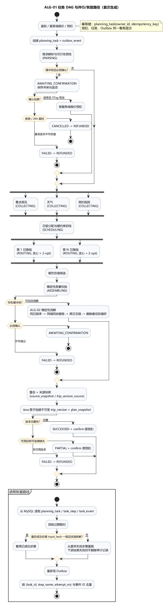
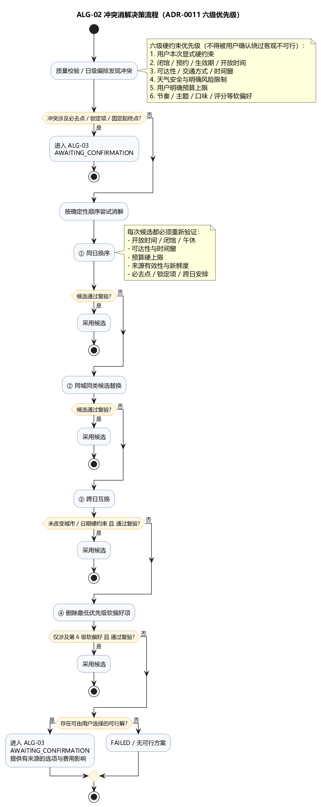
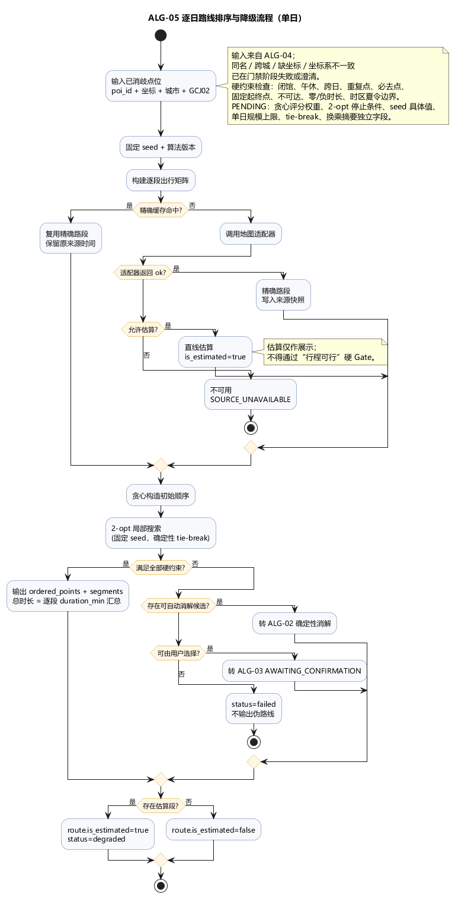
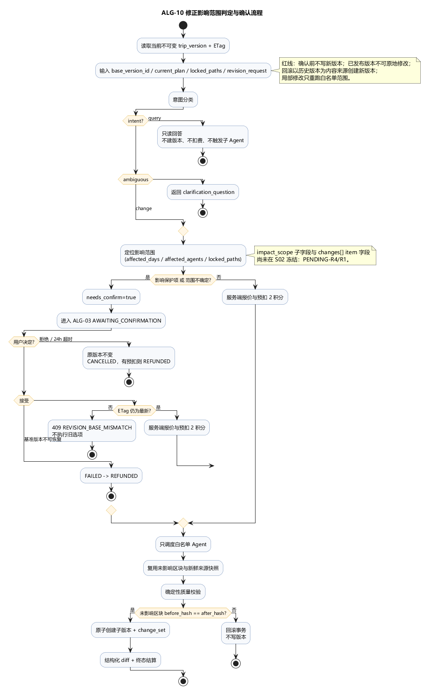

# 多智能体协作文旅规划平台

# 算法设计说明书

*Algorithm Design Specification*

| **项目** | **内容** |
| --- | --- |
| **文档编号** | GZUH-CS-S04-ALG |
| **版本** | v1.0 |
| **文档状态** | 草稿（Draft）· 待独立检验 |
| **密级** | 内部公开 |
| **编制单位** | 贵州大学计算机科学与技术学院<br>软件工程 2403 班项目组 |
| **适用范围** | S11–S13、S15–S21、S23–S25 及 S22 评估收口 |
| **事实来源** | README、docs/01–04、docs/architecture、ADR-0001～0011、contracts/、S04 冻结单与 V1 migration |

2026 年 10 月

> 本文是**设计说明**，不是实现报告，也不是验收报告。文中所有算法均为“设计基线”，不得据此声称任何算法已经实现、上线或通过验收。
> 本文状态为**草稿**，待独立检验 Agent 复验；复验通过前不得标记 `Accepted` 或 `Frozen`。本文不替代 S00–S04 冻结文档、ADR、`contracts/`、Agent Schema 或 Flyway migration。

## 目录

1. 文档定位与适用范围
2. 算法清单与责任矩阵
3. 总体算法流水线
4. 各算法设计（ALG-01 ～ ALG-15）
5. 冲突消解优先级与确认规则判定表
6. 算法与数据模型、Agent 契约、错误码对应关系
7. 算法版本管理与回归策略
8. 性能与并发考虑
9. 待确认项清单
10. 参考文件与一致性说明
附录 A 核验问题修复映射表
附录 B 原 DOCX A1–A13 模块与 ALG 编号映射
附录 C 图件清单

# 1. 文档定位与适用范围

## 1.1 文档定位

本文是项目算法层的设计总入口，汇总并细化各算法模块的目标、边界、输入输出、门禁、判定步骤、降级路径、错误码、数据表映射、测试用例与验收标准。本文只描述**确定性算法与规则判定**，不描述业务实现。

事实来源优先级如下：

1. S00–S04 冻结文档、ADR、`contracts/`、Agent Schema 与 `V1__initial_s04_schema.sql`；
2. `docs/01-需求与整体设计.md`、`docs/02-开发决策基线.md`、`docs/03-多智能体系统规范.md`、`docs/04-逐步开发提示词.md`；
3. `docs/architecture/` 下总体架构、任务状态机、冲突消解与确认规则；
4. `docs/roles/` 各角色规范、`docs/evaluation/methodology.md`、需求追踪矩阵与决策清单；
5. 本文只聚合与交叉引用，不新增需求、不扩大范围、不推翻上述文档。

## 1.2 适用范围

本文覆盖以下 15 个算法：

ALG-01 任务编排与 DAG 调度、ALG-02 冲突消解与优先级裁决、ALG-03 必须确认与不可绕过判定、ALG-04 POI 消歧与路线输入校验、ALG-05 逐日路线排序、ALG-06 路线降级判定、ALG-07 天气窗口判定、ALG-08 知识召回与 RAG 约束、ALG-09 预约规则时效判定、ALG-10 修正意图分类与最小影响范围、ALG-11 榜单五维加权、时间衰减与人工干预、ALG-12 偏好提取、权重与 TOP-K 召回、ALG-13 积分计价、预扣、确认与退款、ALG-14 缓存键、版本、TTL 与失效、ALG-15 算法质量门禁与评估方法。

## 1.3 非范围

本文不实现也不描述：Java/Python/前端业务代码、真实第三方服务调用、账号与认证实现、任务 Worker 实现、SSE 实现、RAG 实现、社区与榜单实现、积分接口实现、导出与提醒实现。上述内容分别属于 S08、S10、S11、S15、S23–S28 等步骤。

## 1.4 术语与编号约定

| 术语 | 含义 |
| --- | --- |
| ALG-xx | 本文统一使用的算法编号，唯一对应本文件第 4 章各节 |
| Agent 专属载荷 | 各 Agent `output.schema.json` 顶层除公共 Envelope 外的业务字段 |
| 公共 Envelope | `schema_version`、`task_id`、`trace_id`、`request_id`、`generated_at`、`status`、`message`、`error_code`、`degraded_fields` |
| 事实 | 路线、天气、票价、预约、资讯、时长等只能来自规定数据源的数据 |
| 硬约束 | 用户显式硬约束、开放/预约时间、可达与时间窗、天气安全、预算硬上限 |
| 软偏好 | 节奏、主题、口味、评分等可加权、可让渡的偏好 |
| 来源快照 | `source_snapshot` 中的一次不可变取得记录 |
| PENDING | 官方文档未冻结、必须由对应负责人确认后实现的事项 |

# 2. 算法清单与责任矩阵

| 编号 | 算法名称 | 主责角色 | 所属阶段 | 优先级 | 官方依据 |
| --- | --- | --- | --- | --- | --- |
| ALG-01 | 任务编排与 DAG 调度 | R1（R5/R7 配合） | S11、S19 | P0 | `docs/03`、总体架构 §4/§8、任务状态机、ADR-0002、R1 规范 §3–5、S11/S19 |
| ALG-02 | 冲突消解与优先级裁决 | R1（R4 配合） | S19 | P0 | 冲突消解与确认规则 §1–2、ADR-0011、R1 规范 §3 |
| ALG-03 | 必须确认与不可绕过判定 | R1（R4/R5 配合） | S19–S21 | P0 | 冲突消解与确认规则 §3–6、任务状态机 §1/§3、ADR-0011、S20/S21 |
| ALG-04 | POI 消歧与路线输入校验 | R2（R1 配合） | S12 | P0 | R2 规范 §2、§6 R2-01；Route Planner input schema；S12 |
| ALG-05 | 逐日路线排序（贪心 + 2-opt） | R2 | S12（ROUTING） | P0 | R2 规范 §2、§6 R2-02；S12；冲突消解与确认规则 §2 |
| ALG-06 | 路线缓存、直线估算与不可用降级 | R2（R5 配合） | S10–S12 | P0 | R2 规范 §2、§5；ADR-0004；ADR-0006；S10/S12 |
| ALG-07 | 天气预报窗口与气候统计分流 | R2 | S13（COLLECTING） | P0 | R2 规范 §3、§6 R2-03；Weather input/output schema；S13 |
| ALG-08 | 知识召回与 RAG 边界 | R3（R1 配合） | S15–S16 | P0 | R3 规范 §2、§6 R3-01/R3-02；ADR-0008；S15/S16 |
| ALG-09 | 预约规则时效与 stale 判定 | R3（R5 配合） | S15、S17 | P0 | R3 规范 §4、§6 R3-03；DEC-014；S15/S17 |
| ALG-10 | 修正意图分类与最小影响范围 | R4（R1/R5 配合） | S20–S21 | P0 | R4 规范 §3–4、§6 R4-02/R4-03；ADR-0005；S20/S21 |
| ALG-11 | 榜单五维加权、时间衰减与人工干预 | R8（R5/R7 配合） | S23 | P1 | R8 规范 §2、R8-01；需求 2.4；REQ-2.4-A |
| ALG-12 | 偏好提取、权重、遗忘与 TOP-K 召回 | R8（R1/R3 配合） | S24 | P1 | R8 规范 §3–4、R8-03；REQ-2.5.4/2.5.5；S24 |
| ALG-13 | 积分计价、预扣、确认与退款 | R5（R1 配合） | S08、S11、S25 | P0 支撑 | 开发决策基线 §4；ADR-0007；DEC-016/017/025；任务状态机 §6；S08/S25 |
| ALG-14 | 缓存键、版本、TTL 与失效 | R5（R2/R3 配合） | S10–S11、S15 | P0 | ADR-0006；需求 2.5.3；REQ-2.5.3；R2 §6 R2-04；R5 §3；S04 冻结单 Redis 契约章节 |
| ALG-15 | 算法质量门禁与评估方法 | R7（R1 配合） | S05、S22、S29 | P0 | `docs/evaluation/methodology.md`；开发决策基线 §5；R2 规范 §4–5；S05/S22 |

> 优先级说明：ALG-01～ALG-10、ALG-13～ALG-15 属 P0 或 P0 主链路支撑；ALG-11、ALG-12 属 P1，必须等 M2 Gate 通过后实施。P2 的社区积分激励、长图导出与复杂运营报表不在本文算法清单内，不得写成 M1 已交付能力。

# 3. 总体算法流水线

## 3.1 七段流水线

总体流水线固定为：**输入校验 → 门禁 → 并行采集 → 排序与消解 → 质量校验 → 版本确认 → 终态结算**。

| 阶段 | 对应算法 | 主要产物 | 失败去向 |
| --- | --- | --- | --- |
| 输入校验 | ALG-01、ALG-04 | 结构化 `trip_scope`、约束集合、消歧后的 POI | `INVALID_INPUT`；不可恢复则 `FAILED` |
| 门禁 | ALG-01、ALG-04、ALG-15 | 身份/归属、Schema、来源新鲜度、版本与 ETag 校验结果 | 不参与偏好权衡；直接失败或澄清 |
| 并行采集 | ALG-07、ALG-08、ALG-09、ALG-14 | 天气、知识、预约、缓存的带来源结果 | 单路降级不阻塞整体 |
| 排序与消解 | ALG-02、ALG-05、ALG-06、ALG-11、ALG-12 | 逐日路线、日级分配、候选排序、冲突消解结果 | 可自动消解则继续；否则转确认或失败 |
| 质量校验 | ALG-15 | 时间重叠、闭馆、可达、预约、预算、来源、过期检查 | 硬冲突转 `AWAITING_CONFIRMATION` 或 `FAILED` |
| 版本确认 | ALG-03、ALG-10 | 不可变 `trip_version`、`plan_snapshot`、`change_set` | 版本冲突返回 409；确认前不写版本 |
| 终态结算 | ALG-13 | `SUCCEEDED`/`PARTIAL`/`FAILED`/`CANCELLED`/`REFUNDED` 与账务 | 每次终态只结算一次 |

## 3.2 首次生成 DAG

首次生成 DAG 已由总体架构 §4 冻结：

```text
鉴权 / 服务端报价 / 预扣
  → 创建 planning_task + Outbox
  → 需求解析与可行性预检（PARSING）
  → 景点资讯 ∥ 天气 ∥ 预约规则（COLLECTING）
  → 日级分配（SCHEDULING）
  → 第 1 日路线 ∥ 第 N 日路线（ROUTING）
  → 餐饮住宿
  → 确定性质量校验（ASSEMBLING）
      ├─ 硬冲突 → AWAITING_CONFIRMATION
      └─ 可交付 → 整合与来源快照
  → Java 原子创建不可变 trip_version
  → SUCCEEDED / PARTIAL
```

## 3.3 局部修改 DAG

局部修改 DAG 已由总体架构 §5 冻结：

```text
读取当前不可变版本与 ETag
  → 分类 query / change / ambiguous
      ├─ query → 只读回答（不建版本、不扣费）
      ├─ ambiguous → 返回澄清问题
      └─ change → 计算 affected_days / affected_agents / locked_paths
            → 需要确认？ ── 是 → AWAITING_CONFIRMATION
            → 服务端报价与预扣 2 积分
            → 只调度白名单 Agent
            → 复用未影响区块与新鲜来源快照
            → 确定性质量校验
                ├─ ETag 冲突 → 409
                └─ 通过 → 原子创建子版本 + change_set
            → 结构化 diff + 终态结算
```

## 3.4 公共红线

以下红线贯穿全部算法，违反即阻断：

1. LLM 不生成路线、天气、票价、预约、资讯等事实，只做理解、排序表达与文案。
2. 名称不是主键；POI 必须消歧为 `poi_id + 坐标 + 城市 + 坐标系`。
3. 直线估算必须标 `is_estimated=true`，且不参与“行程可行”的硬性通过判断。
4. 天气窗口内为 `forecast`，窗口外只能返回 `climate_statistics`，失败不得默认晴天。
5. 随机算法固定 seed 并记录算法版本；相同输入输出稳定。
6. 每条事实必须携带来源快照；过期、估算、冲突、失败必须显式可见。
7. 硬约束不可静默违反；不得删除必去点/锁定项，不得绕过客观不可行。
8. 已发布版本不可原地修改；回滚通过创建新版本完成。
9. Java/Spring Boot 是 MySQL 唯一业务写方；Redis、Chroma、对象文件都不是业务事实来源。

# 4. 各算法设计

> 本章每个算法均按统一结构书写：目标与边界、主责与阶段、官方依据、输入、输出、门禁、硬约束、判定步骤、复杂度、版本与随机性、可配置参数、降级与失败路径、错误码、数据表、测试用例、验收标准、未冻结事项。**凡官方文档未冻结的参数一律写 `PENDING`，不得据此实现。**

## 4.1 ALG-01 任务编排与 DAG 调度

**目标与适用范围**

实现固定 DAG 的依赖顺序执行、可并行分支调度、幂等重试、乱序结果处理、进程恢复与终态判定。适用于首次生成（S19）、局部修改（S20）及全部异步任务链路（S11）。

**主责角色与所属阶段**

主责 R1，R5 负责 `planning_task`/`task_step` 持久化与租约，R7 负责恢复与评估。所属阶段 S11、S19，优先级 P0。

**官方依据**

- `docs/03-多智能体系统规范.md` §1–6；
- `docs/architecture/总体架构设计.md` §4、§5、§8；
- `docs/architecture/任务状态机.md` §1、§3、§5、§6、§7；
- `docs/architecture/ADR/0002-transactional-outbox-redis-streams.md`；
- `docs/roles/01-R1-架构总控与编排规范.md` §3–5；
- `docs/04-逐步开发提示词.md` S11、S19。

**输入（字段级）**

| 字段 | 来源表/契约 | 说明 |
| --- | --- | --- |
| `planning_task.id` | `planning_task` | 任务事实主键 |
| `planning_task.owner_id` | `planning_task` | 归属用户，门禁校验 |
| `planning_task.trip_id` | `planning_task` | 首次生成可为空 |
| `planning_task.base_version_id` | `planning_task` | 局部修改基准版本 |
| `planning_task.task_type` | `planning_task` | 任务类型白名单 |
| `planning_task.idempotency_key` | `planning_task` | `(owner_id,idempotency_key)` 唯一 |
| `planning_task.request_hash` | `planning_task` | `BINARY(32)`，请求幂等 |
| `planning_task.request_json` | `planning_task` | 脱敏原始请求载荷 |
| `planning_task.quote_id` | `planning_task` | 关联 `points_quote` |
| `planning_task.reserved_points` | `planning_task` | 预扣积分校验 |
| `planning_task.operation_deadline_at` | `planning_task` | 首次 180 秒、局部 60 秒 |
| `planning_task.state_version` | `planning_task` | 乐观锁版本 |

**输出（字段级）**

| 产物 | 载体 | 说明 |
| --- | --- | --- |
| `task_step` | `task_step` | 每步骤按 `(task_id, step_name, attempt_no)` 唯一 |
| `task_event` | `task_event` | 只追加，`(task_id, sequence_no)` 唯一 |
| `outbox_event` | `outbox_event` | `aggregate_type + aggregate_id + idempotency_key` 唯一 |
| `agent_result` | `agent_result` | 每 attempt 结果 + `request_id` 幂等 |
| 终态 | `planning_task.status` | `SUCCEEDED`/`PARTIAL`/`FAILED`/`CANCELLED`/`REFUNDED` |

公共 Envelope 由网关注入：`schema_version`、`task_id`、`trace_id`、`request_id`、`generated_at`；业务结果按各 Agent Schema 校验。

**前置条件与门禁**

1. 身份、归属、角色与资源授权通过（R5）。
2. 服务端报价与服务端计算积分匹配，余额充足。
3. 请求 Schema、语义、日期时区、必去点合法。
4. 局部修改必须携带可用 `base_version_id` 与最新 ETag。
5. 事实合法性、Schema 合法性、来源新鲜度作为排序前门禁，不参与偏好权衡，也不能由用户确认绕过。

**硬约束**

- `planning_task` 是任务事实来源；不得从 Redis 或 SSE 反推事实状态。
- 任务、预扣与 Outbox 必须在同一 MySQL 事务提交。
- Consumer 至少一次投递，业务侧必须幂等。
- 步骤以租约 + 心跳领取；租约过期只允许增加 `attempt_no`，不得覆盖成功结果。
- `task_event.sequence_no` 单调；SSE 断线按最后序号补拉去重。
- 终态只结算一次；`SUCCEEDED/PARTIAL/REFUNDED` 永不回到运行态。

**判定/计算步骤（伪代码）**

```text
schedule(task):
  if task.status in terminal: return existing(task)
  if now > task.operation_deadline_at: fail(task, AGENT_TIMEOUT)
  steps = topology_order(FIXED_DAG[task.task_type])
  for step in steps:
      while dependencies(step) not all succeeded_or_degraded:
          await dependency
      lease = acquire_lease(step, worker_id, ttl)
      if lease is None: continue
      recorded = load_step_result(step, input_hash)
      if recorded and source_fresh(recorded.sources): reuse(recorded); continue
      attempt = recorded.attempt_no + 1
      result = invoke_agent(step, minimal_context, attempt)
      persist_with_idempotency(task_id, step_name, attempt, result)
      emit_task_event(task_id, next_sequence_no, result.status)
  return decide_terminal(task)
```

```text
recover(task):
  1. 从 MySQL 读取 planning_task / task_step / task_event，不从 Redis 推断事实
  2. 若已是终态：终态直接返回；FAILED/CANCELLED 重新投递唯一退款命令
  3. 回收过期租约
  4. 校验最后成功步骤的 input_hash 与来源新鲜度：
       一致且新鲜 → 复用
       否则 → 从最早失效步骤重跑，下游结果失效但不物理删除审计记录
  5. 重新写 Outbox；Redis 重复投递由 (task_id, step_name, attempt_no) 与事件 ID 去重
```

**复杂度与规模假设**

- 固定 DAG 遍历为 `O(V+E)`，`V` 为步骤数，`E` 为依赖数；步骤数由固定 DAG 决定。
- 乱序去重与幂等查询依赖唯一键索引 `(task_id, step_name, attempt_no)`、`(task_id, sequence_no)`。
- 单任务并发 Worker 数、队列深度、Redis Stream 分片与保留长度的具体数值未冻结，统一标 `PENDING`。

**算法版本、随机性与可复现性**

- 调度本身为确定性规则；若排序或 Agent 内含随机部分，必须由对应 Agent 固定 seed 并记录算法版本。
- DAG 结构、步骤名与状态枚举变化视为调度契约变更，必须新版本并跑固定基准。
- `task_event.sequence_no` 与 `attempt_no` 保证可重放；相同输入与相同来源快照应得到相同终态。

**可调参数与配置项**

| 参数 | 状态 | 说明 |
| --- | --- | --- |
| 首次生成 `operation_deadline_at` | 已冻结 180 秒 | 任务状态机 §1 |
| 局部修改 `operation_deadline_at` | 已冻结 60 秒 | 任务状态机 §1 |
| 确认等待 | 已冻结 24 小时 | 任务状态机 §1 |
| 阶段时限 | 已冻结（状态机 §1） | `CREATED` 10s、`BALANCE_RESERVED` 10s、`QUEUED` 20s、`PARSING` 30s、`COLLECTING` 60s、`SCHEDULING` 30s、`ROUTING` 60s、`ASSEMBLING` 30s |
| 单 Agent 重试次数与退避 | `PENDING` | R1/R7 未冻结具体上限 |
| Worker 并发与租约 TTL | `PENDING` | S11 实现前由 R1/R5/R7 确认 |
| Stream 保留长度 | `PENDING` | 不得自行编造 |

**降级与失败路径**

- 单 Agent `partial/degraded`：汇总 `degraded_fields`，继续产出可交付方案。
- 单 Agent `failed`：若缺失破坏硬可行性 → 转确认或失败；否则走 `PARTIAL`。
- 全局 Deadline 或重试耗尽 → `FAILED` → 有预扣则 `REFUNDED`。
- 取消与版本提交竞争：取消 CAS 先成功则禁止创建版本并退款；版本先提交则取消返回 409。
- 乱序旧 attempt 回调：因状态/attempt 不匹配被拒绝并写审计，不覆盖较新步骤。

**错误码**

| 场景 | 错误码 |
| --- | --- |
| 身份、归属、状态、版本、幂等键或 Schema 校验失败 | `INVALID_INPUT` |
| 任务/步骤上下文不可用 | `CONTEXT_NOT_FOUND` |
| Agent 超过 deadline | `AGENT_TIMEOUT` |
| Agent 运行体或供应商不可用 | `AGENT_UNAVAILABLE` |
| Agent 返回不符合 Schema | `CONTRACT_VIOLATION` |
| 同一 request_id 已有终态结果 | `DUPLICATE_REQUEST`（返回已存结果） |
| 用户或系统取消 | `CANCELLED` |
| 确认超时 | `CONFIRMATION_TIMEOUT`（**PENDING**：未纳入稳定错误码表，见第 9 章） |

**对应数据库表**

`planning_task`、`task_step`、`task_event`、`outbox_event`、`agent_result`、`agent_result_source`、`audit_event`。

**测试用例**

1. 固定 DAG 可回放；步骤顺序与依赖正确。
2. 重复投递、乱序回调、消费者崩溃后重启、Redis 重启。
3. 租约过期与其他 Worker 领取。
4. 进程恢复：最后成功步骤输入哈希一致且来源新鲜时复用，否则重跑。
5. 取消与版本提交竞争（CAS 决胜）。
6. 终态重复回调只结算一次。
7. 阶段超时与全局 Deadline。

**验收标准**

- 固定 DAG 可回放；终态和降级确定（REQ-2.2.1、S11/S19）。
- 重复、乱序、崩溃、重启后任务与积分不丢失、不重复。
- 任一失败路径返回稳定错误码，不以自然语言掩盖。
- 不得把本文设计当作已实现证据。

**未冻结参数与待确认项**

重试上限与退避、Worker 并发、租约 TTL、Stream 保留长度、`CONFIRMATION_TIMEOUT` 的正式错误码归属，均为 `PENDING`。



**图 4-1　ALG-01 任务 DAG 与并行/恢复路径**

## 4.2 ALG-02 冲突消解与优先级裁决

**目标与适用范围**

在候选方案之间按六级硬约束优先级做确定性裁决，并严格按“同日换序 → 同城同类候选替换 → 跨日互换 → 删除最低优先级软偏好项”的顺序尝试自动消解。适用于 S19 日级编排与最终 Plan 整合。

**主责角色与所属阶段**

主责 R1，R4 提供修正意图与影响范围，R2/R3 提供事实。所属阶段 S19，优先级 P0。

**官方依据**

- `docs/architecture/冲突消解与确认规则.md` §1–2、§6；
- `docs/architecture/ADR/0011-constraint-and-confirmation-policy.md`；
- `docs/roles/01-R1-架构总控与编排规范.md` §3。

**输入（字段级）**

| 字段 | 来源 | 说明 |
| --- | --- | --- |
| 候选方案集合 | ALG-05/ALG-06 输出、`agent_result` | 含逐日 `ordered_points` 与 `segments` |
| 用户显式硬约束 | `planning_task.request_json` / 结构化输入 | 城市、日期、必去点、固定起终、锁定项、已确认选择 |
| 开放/预约窗口 | `reservation_rule` + `source_snapshot` | 闭馆、预约、生效期 |
| 可达与时间窗 | ALG-05/ALG-06 | 交通方式与时间窗 |
| 天气安全 | ALG-07 输出 | 明确风险限制 |
| 预算硬上限 | 用户显式输入 | 与服务端金额口径一致 |
| 软偏好 | 用户偏好标签（ALG-12） | 节奏、主题、口味、评分 |

**输出（字段级）**

| 字段 | 说明 |
| --- | --- |
| 选中候选 / 消解记录 | 写入 `change_set.change_json`、`affected_paths_json` 与 `change_hash` |
| 冲突代码 | 结构化冲突标识；机器枚举待确认 |
| 可选变更集合 | 提供给 ALG-03 的确认选项 |
| `degraded_fields` | 消解过程中被降级的字段 |

**前置条件与门禁**

事实合法性、身份/资源授权、Schema 合法性、来源新鲜度是排序前的门禁，不参与偏好权衡，也不能由用户确认绕过。

**硬约束**

六级优先级（高优先级不得绕过客观不可行）：

1. 用户本次显式硬约束：城市/日期、必去点、固定起终点、锁定项、已确认选择；
2. 闭馆、预约、生效期和开放时间；
3. 可达性、交通方式和时间窗；
4. 天气安全与明确风险限制；
5. 用户明确预算上限；
6. 节奏、主题、口味、评分等软偏好。

**判定/计算步骤（伪代码）**

```text
resolve(conflict):
  if protected_item_affected(conflict): return confirm(conflict)   # ALG-03
  for rule in [SAME_DAY_REORDER, SAME_CITY_SAME_TYPE_REPLACE, CROSS_DAY_SWAP, DROP_LOWEST_SOFT]:
      candidate = apply(rule, conflict)
      if candidate is None: continue
      if not revalidate(candidate): continue   # 开放时间/可达/预算/来源
      if violates_hard_constraints(candidate): continue
      return candidate
  if user_choice_available(conflict): return confirm(conflict)
  return fail(conflict)
```

`revalidate(candidate)` 必须逐项检查：开放时间、闭馆、午休、可达性、时间窗、预算、来源有效性与新鲜度、必去点/锁定项、跨日安排。

**复杂度与规模假设**

- 候选数量受点位规模与日期数限制；每次消解需对候选做一次门禁复验。
- 单日点位规模上限、跨城市候选数、搜索半径未冻结，标 `PENDING`。
- 实现需保证候选枚举顺序确定，避免因集合遍历顺序不同导致结果漂移。

**算法版本、随机性与可复现性**

- 六级优先级与消解顺序固定，是确定性规则。
- 若候选替换涉及评分，评分权重与 tie-break 规则未冻结，必须 `PENDING`，不得自行定 0.3/0.2/0.5 等系数。
- 相同输入与来源快照应得到相同消解结果；每次候选复验结果写入审计。

**可调参数与配置项**

| 参数 | 状态 |
| --- | --- |
| 六级优先级顺序 | 已冻结 |
| 自动消解四步顺序 | 已冻结 |
| 候选替换评分权重与 tie-break | `PENDING` |
| 每次复验项清单 | 已冻结（开放时间/可达/预算/来源） |
| 搜索半径、候选配额 | `PENDING` |

**降级与失败路径**

- 可自动消解 → 继续质量校验。
- 保护项冲突 → `AWAITING_CONFIRMATION`。
- 所有可行解超出硬约束 → 转确认（提供选项）或 `FAILED`。
- 不得删除必去/锁定项，不得改变城市或日期，不得用过期事实作硬约束，不得用自然语言掩盖结构化冲突。

**错误码**

`INVALID_INPUT`、`SOURCE_UNAVAILABLE`、`SOURCE_STALE`、`CONTRACT_VIOLATION`；确认路径错误码见 ALG-03。

**对应数据库表**

`trip_version`、`plan_snapshot`、`change_set`、`source_snapshot`、`planning_task`、`task_event`、`agent_result`、`audit_event`。

**测试用例**

必去点闭馆、预算无解、跨日互换、软偏好调整不需确认、已确认预约需跨日、路线只有直线估算、确认期间版本更新。

**验收标准**

- 六级优先级与 ADR-0011 一致；消解顺序与官方规则一致。
- 每次候选都重新验证开放时间、可达性、预算和来源。
- 硬约束违反数为 0；保护项冲突必须进入确认。

**未冻结参数与待确认项**

候选评分权重、tie-break 规则、搜索半径、候选配额、冲突代码枚举，均为 `PENDING`。



**图 4-2　ALG-02 冲突消解决策流程**

## 4.3 ALG-03 必须确认与不可绕过判定

**目标与适用范围**

定义进入 `AWAITING_CONFIRMATION` 的触发条件、确认请求字段、拒绝与超时处理、确认生命周期与不可绕过条件。适用于 S19–S21。

**主责角色与所属阶段**

主责 R1，R4 生成确认问题，R5 校验确认命令、ETag 与积分预扣。所属阶段 S19–S21，优先级 P0。

**官方依据**

- `docs/architecture/冲突消解与确认规则.md` §3–6；
- `docs/architecture/任务状态机.md` §1、§3、§6、§7；
- `docs/architecture/ADR/0011-constraint-and-confirmation-policy.md`；
- `docs/04-逐步开发提示词.md` S20、S21。

**输入（字段级）**

| 字段 | 说明 | 依据 |
| --- | --- | --- |
| `base_version_id` | 冲突所基于的版本 | 冲突消解与确认规则 §3 |
| 冲突代码 | 结构化冲突标识 | 同上（具体枚举 `PENDING`） |
| 受影响日期/对象 | 结构化影响范围 | 同上 |
| 保持不变项 | 保护项清单 | 同上 |
| 可选变更 | 有来源的可选项 | 同上 |
| 来源摘要 | 每个选项的依据 | 同上 |
| 费用影响 | 积分/预算影响 | 同上 |
| 过期时间 | 确认过期时刻 | 同上 |
| 确认 revision | 幂等键的一部分 | 任务状态机 §6 |
| 用户决定 | 接受/拒绝 | 冲突消解与确认规则 §5 |

> 上述机器字段的**精确字段名与 Schema** 在 S02 冻结契约中未定义，属 `PENDING-R1/R5`；本文只描述语义，不擅自创造契约字段。

**输出（字段级）**

| 输出 | 说明 |
| --- | --- |
| `AWAITING_CONFIRMATION` | `planning_task.status`，含 `confirmation_deadline_at` |
| 确认记录 | 写入 `task_event`（只追加）与 `audit_event` |
| 接受后 | 按最新 ETag 重新校验；未预扣先按服务端报价预扣，再入队 |
| 拒绝/超时后 | `CANCELLED`；有预扣则幂等退款并转 `REFUNDED` |

**前置条件与门禁**

1. 冲突本身已通过 ALG-02 判定为“必须确认”。
2. 身份、资源归属、余额、幂等键与版本校验通过。
3. 确认请求必须包含全部必填语义字段；缺失则 `INVALID_INPUT`。

**硬约束与触发条件**

命中任一条件即进入 `AWAITING_CONFIRMATION`：

1. 删除、替换或改变必去点、用户锁定项、固定起终点；
2. 改动已确认预约、已选择票种或跨日安排；
3. 所有可行解都会超过明确预算、日期、开放时间或交通硬约束；
4. 修改影响范围无法唯一确定，或波及请求范围外的日期/Agent；
5. 局部修改基于旧版本，需用户在刷新后重新选择；
6. 质量校验发现多个可行方案，需用户在明确代价间选择。

不可由用户确认绕过的条件（直接失败或澄清）：

- 身份、资源归属、余额、幂等键或版本校验失败；
- 必需事实无合法来源、Schema 无效或模型输出修复后仍无效；
- 路线不可达且无已验证替代，或安全风险不可接受；
- 用户要求真实支付、预订、抓取受限平台或范围外能力。

**判定/计算步骤（伪代码）**

```text
confirmation_flow(task, conflict):
  if not requires_confirmation(conflict): return auto_resolve(conflict)
  if not bypassable(conflict): return fail_or_clarify(conflict)
  persist_conflict(task, conflict, expires_at = now + 24h)
  task.status = AWAITING_CONFIRMATION
  emit_task_event(task, AWAITING_CONFIRMATION, conflict)
  wait for decision keyed by (task_id, confirmation_revision)
  on decision:
      if duplicate(decision): return stored_result
      if decision == ACCEPT:
          if current_etag != conflict.base_etag: return 409 REVISION_BASE_MISMATCH
          if not reserved: reserve(points)
          task.status = QUEUED; enqueue_affected_scope()
      if decision == REJECT: cancel_and_refund(task)
  on timeout (24h): cancel_and_refund(task)   # CONFIRMATION_TIMEOUT，PENDING
```

**复杂度与规模假设**

- 单任务同时只允许一个有效确认请求；确认选项数量有限，具体上限 `PENDING`。
- 确认生命周期长于执行 Deadline；等待确认期间暂停执行 Deadline，恢复后重新计算剩余执行预算。

**算法版本、随机性与可复现性**

- 触发条件与生命周期是确定性规则。
- 确认问题文本可由 LLM 生成，但必须只表达 ALG-02 已确定的冲突与选项，不得新增事实或改变选项集合。
- 相同冲突与来源快照必须生成相同触发判定与相同选项集合。

**可调参数与配置项**

| 参数 | 状态 |
| --- | --- |
| 确认等待时长 | 已冻结 24 小时 |
| 执行 Deadline | 首次 180 秒、局部 60 秒 |
| 确认 revision 规则 | 已冻结语义为 `task_id + confirmation_revision` 只接受一次 |
| 冲突代码枚举 | `PENDING` |
| 确认请求/响应机器字段 | `PENDING-R1/R5` |
| `CONFIRMATION_TIMEOUT` 对外错误码 | `PENDING`（未在稳定错误码表中） |

**降级与失败路径**

- 接受：以保存的选项与最新 ETag 重新校验；通过后按服务端报价预扣并入队。
- 拒绝：转 `CANCELLED`；有预扣则幂等退款并转 `REFUNDED`。
- 24 小时无响应：等同拒绝，记录 `CONFIRMATION_TIMEOUT`，不自动选择默认项。
- 确认期间版本变化：返回 409 版本冲突，旧确认失效，不执行、不扣费。
- 基准版本被删除/无权访问：`FAILED`；有预扣则退款。

**错误码**

`INVALID_INPUT`、`REVISION_BASE_MISMATCH`、`CANCELLED`、`CONTEXT_NOT_FOUND`、`CONTRACT_VIOLATION`；`CONFIRMATION_TIMEOUT` 目前 `PENDING`。

**对应数据库表**

`planning_task`（`status`、`confirmation_deadline_at`）、`trip_version`（`etag`）、`change_set`、`task_event`、`outbox_event`、`points_quote`、`points_ledger`、`audit_event`。

**测试用例**

1. 必去点闭馆：不删除、不安排闭馆时段，给出换日/替换选项并等待确认。
2. 已确认预约需跨日：等待确认，拒绝后原版本不变。
3. 重复确认：只执行一次、只预扣一次、只创建一个版本。
4. 确认期间版本更新：409 冲突，不执行旧选项。
5. 确认超时：`CANCELLED` 并退款，不自动选默认项。
6. 不可绕过条件：直接失败或澄清，不提供“仍然继续”。

**验收标准**

- 确认前不写新版本；拒绝/超时后原版本不变。
- 相同 `task_id + confirmation_revision` 只接受一次决定，重复决定返回原结果。
- 接受路径重新校验 ETag 与余额；旧 ETag 必须 409。
- 过程写入 `task_event` 与 `audit_event`。

**未冻结参数与待确认项**

冲突代码枚举、确认请求/响应机器字段、确认选项上限、`CONFIRMATION_TIMEOUT` 的正式错误码归属，均为 `PENDING`。

## 4.4 ALG-04 POI 消歧与路线输入校验

**目标与适用范围**

把名称文本显式消歧为 `poi_id + 坐标 + 城市 + 坐标系`，并在进入路线算法前完成输入校验。适用于 S12 路线链路前置。

**主责角色与所属阶段**

主责 R2，R1 配合契约对齐。所属阶段 S12（PARSING/输入前置），优先级 P0。

**官方依据**

- `docs/roles/02-R2-路线气象与算法规范.md` §2、§5、§6 R2-01；
- `agents/02-route-planner/input.schema.json`；
- `agents/04-attractions/output.schema.json`、`agents/06-reservation-rules/output.schema.json`；
- `docs/04-逐步开发提示词.md` S12。

**输入（字段级）**

| 字段 | 类型 | 必填 | 说明 |
| --- | --- | --- | --- |
| `origin.poi_id` / `destination.poi_id` / `points[].poi_id` | string | 视槽位 | 内部 POI 标识 |
| `name` | string | 是 | 仅用于消歧，不作为主键 |
| `city_id` | string | 是 | 城市标准 ID |
| `latitude` | number | 是 | `-90..90` |
| `longitude` | number | 是 | `-180..180` |
| `coordinate_system` | enum | 是 | 当前契约仅允许 `GCJ02` |
| `date` | date | 是 | `YYYY-MM-DD` |
| `time_window` | object | 是 | `start`/`end`，`HH:MM` 24 小时制 |
| `transport_preference` | enum | 否 | 步行/公交/地铁/打车/混合 |

**输出（字段级）**

| 输出 | 说明 |
| --- | --- |
| 唯一实体 | `poi_id + 坐标 + 城市 + GCJ02`，继续进入 ALG-05 |
| 结构化澄清 | 同名/跨城/缺坐标时要求用户选择 |
| 结构化失败 | 不可恢复的输入问题 |

**前置条件与门禁**

1. 名称不能作为唯一主键；同名实体由运营人员确认，不能由 embedding 自动合并。
2. 坐标系必须一致；当前契约只允许 `GCJ02`。
3. 缺坐标、跨城市、同名无法唯一确定时不得猜测。

**硬约束**

- `poi_id` 必须来自 `poi` 表且状态可用。
- 跨城市点或坐标系不一致点必须失败或澄清。
- 路线 `ordered_points` 中的标识必须与输入 `poi_id` 同源；**不得把 `point_id` 与 `poi_id` 混用**（见下方字段对齐说明）。

**判定/计算步骤（伪代码）**

```text
resolve_poi(candidate):
  if missing name or missing city context: return CLARIFY(missing_context)
  matches = lookup(name, city_id)
  if matches.empty: return FAIL(SOURCE_UNAVAILABLE)
  if matches.size > 1: return CLARIFY(AMBIGUOUS_NAME, matches)
  poi = matches.single()
  if poi.city_id != city_id: return FAIL(CROSS_CITY)
  if poi.latitude is null or poi.longitude is null: return FAIL(MISSING_COORDINATE)
  if poi.coordinate_system != "GCJ02": return FAIL(COORDINATE_SYSTEM_MISMATCH)
  return ResolvedPoint(poi.poi_id, poi.name, poi.city_id, poi.lat, poi.lng, "GCJ02")
```

**复杂度与规模假设**

- 单次消歧为 `O(log n)`（按城市 + 名称/别名索引）或 `O(m)`（同名候选数 `m`）。
- 单次请求 POI 数量上限、别名数量与同名候选上限未冻结，标 `PENDING`。

**算法版本、随机性与可复现性**

- 消歧为确定性查找 + 人工确认，不使用 embedding 自动合并。
- 相同名称、城市与别名索引版本必须得到相同候选集合与相同澄清结果。

**可调参数与配置项**

| 参数 | 状态 |
| --- | --- |
| 坐标系枚举 | 已冻结 `GCJ02` |
| 消歧策略 | 已冻结：显式消歧，不按名称猜测 |
| 同名候选上限 | `PENDING` |
| POI 数量上限 | `PENDING` |

**降级与失败路径**

- 同名/跨城 → 结构化澄清。
- 缺坐标/坐标系不一致 → 结构化失败或澄清，不进入路线。
- POI 库不可用 → `SOURCE_UNAVAILABLE`；不得用名称构造伪坐标。

**错误码**

`INVALID_INPUT`、`SOURCE_UNAVAILABLE`、`SOURCE_STALE`、`CONTEXT_NOT_FOUND`。

**对应数据库表**

`poi`、`poi_alias`、`poi_snapshot`、`city`、`source_snapshot`。

**字段对齐说明（核验 MAJOR-01 修复）**

- `agents/02-route-planner/input.schema.json` 使用 `poi_id`；
- `agents/04-attractions/output.schema.json` 与 `agents/06-reservation-rules/output.schema.json` 使用 `point_id`；
- 路线输出 `route.ordered_points` 的语义应为 `poi_id` 序列；`point_id` 与 `poi_id` 的跨契约等价关系**未在 S02 冻结**，属 `PENDING-R1/R2`，本文不擅自新增契约字段。

**测试用例**

重复点、同名 POI、无坐标、闭馆、跨城市、坐标系不一致、POI 库空返回。

**验收标准**

- 不按名称猜测；同名/跨城/缺坐标必须失败或澄清。
- 路线输入包含 `poi_id`、城市、坐标与 `GCJ02`。
- 门禁结果可回查来源。

**未冻结参数与待确认项**

`point_id`↔`poi_id` 的契约级等价关系、同名候选上限、POI 数量上限、别名匹配算法，均为 `PENDING`。

## 4.5 ALG-05 逐日路线排序（贪心 + 2-opt）

**目标与适用范围**

对单日给定点位集合求解带时间窗与固定起终点的旅行商变体（TSPTW），按“可解释的贪心构造 + 2-opt 局部搜索”给出顺序与逐段路线。适用于 S12（ROUTING），逐日并行。

**主责角色与所属阶段**

主责 R2，R5 提供缓存与适配器。所属阶段 S12，优先级 P0。

**官方依据**

- `docs/roles/02-R2-路线气象与算法规范.md` §2、§5、§6 R2-02；
- `docs/04-逐步开发提示词.md` S12；
- `docs/architecture/冲突消解与确认规则.md` §2；
- `agents/02-route-planner/output.schema.json`。

**输入（字段级）**

| 字段 | 类型 | 说明 |
| --- | --- | --- |
| `date` | date | 当日日期 |
| `city_id` | string | 城市标准 ID |
| `coordinate_system` | enum | `GCJ02` |
| `points[]` | object[] | 已消歧的 `poi_id + 坐标 + 城市 + 坐标系` |
| `origin` / `destination` | object | 固定起终点（可选） |
| `transport_preference` | enum | 步行/公交/地铁/打车/混合 |
| `time_window` | object | `start`/`end` |
| 必去约束、开放时段、最大通勤、同行人限制 | 结构化输入 | 来自 ALG-01/ALG-04 门禁后 |

**输出（字段级）**

| 字段 | 类型 | 说明 |
| --- | --- | --- |
| `route.ordered_points` | string[] | 排序后的点位标识序列（语义为 `poi_id`，见 ALG-04） |
| `route.segments` | object[] | 逐段路线；Schema 中为数组，字段语义见下 |
| `route.is_estimated` | boolean | 是否存在估算段 |
| `status` / `message` / `degraded_fields` | Envelope | 降级可见 |
| `source_metadata` | object[] | 每条事实的来源与新鲜度 |

`route.segments` 逐段字段（依据 `agents/02-route-planner/prompt.txt`，Schema 中为未细分数组，**精确字段级 Schema 仍为 PENDING**）：

| 字段 | 说明 |
| --- | --- |
| `from_poi_id` / `to_poi_id` | 起点/终点 POI 标识 |
| `transport` | 交通方式 |
| `distance_m` | 距离（米） |
| `duration_min` | 时长（分钟） |
| `source_record_id` | 来源记录 |
| `retrieved_at` | 取得时间 |
| `is_estimated` | 是否估算 |

**前置条件与门禁**

1. 输入点位已完成 ALG-04 消歧。
2. 开放时间、闭馆、午休、跨日、必去点、固定起终点、不可达、零/负时长、时区夏令边界均须检查。
3. 地图适配器必须统一超时、供应商别名、请求哈希、取得时间、来源与坐标系。

**硬约束**

- 顺序由算法求解，LLM 只把柔性偏好翻译为权重/约束并透传顺序。
- 总通勤必须等于逐段汇总；门到门、步行、排队、游玩时长不得混入路线时长。
- 直线估算不得通过“行程可行”的硬 Gate。
- 不可达、跨城、超时必须回传结构化冲突。

**判定/计算步骤（伪代码）**

```text
order_day_route(points, origin, destination, time_window, prefs):
  matrix = build_travel_matrix(points + origin + destination)   # 精确缓存优先，见 ALG-06
  order = greedy_construct(matrix, constraints, prefs, seed)
  improved = true
  while improved:
      improved = false
      for i, j in candidate_pairs(order):          # 2-opt 邻域
          cand = two_opt_swap(order, i, j)
          if total_cost(cand) < total_cost(order) and feasible(cand):
              order = cand; improved = true
  if not feasible(order): return degrade_or_fail(order)
  segments = compute_segments(order, matrix)
  assert sum(segments.duration_min) == total_duration(order)
  return Route(order, segments, is_estimated=any(seg.is_estimated))
```

`feasible(order)` 检查闭馆、午休、时间窗、固定起终点、必去点、零/负时长、时区边界；`total_cost` 的软偏好权重未冻结。

**复杂度与规模假设**

- 距离矩阵构建 `O(n²)` 次适配器查询（可缓存）；
- 贪心构造 `O(n²)`；
- 2-opt 单轮 `O(n²)` 次邻域评估，多轮至收敛；
- 单日点位数上限、2-opt 轮次上限、时间预算未冻结，标 `PENDING`。

**算法版本、随机性与可复现性**

- 随机算法固定 seed 并记录算法版本；seed 具体取值与算法版本命名格式为 `PENDING`。
- 相同 JSON 输入、语义不变时，校验和排序确定，输出逐字一致。
- tie-break 规则（同分候选的选择顺序）未冻结，必须 `PENDING`。

**可调参数与配置项**

| 参数 | 状态 |
| --- | --- |
| 贪心 + 2-opt 方向 | 已冻结 |
| 固定 seed + 算法版本 | 已冻结为要求，具体取值/格式 `PENDING` |
| 软偏好权重、tie-break | `PENDING` |
| 2-opt 停止条件、搜索预算 | `PENDING` |
| 单日点位规模上限 | `PENDING` |

**降级与失败路径**

- 无精确路线但允许估算 → 直线估算，`route.is_estimated=true`，`status=degraded`，且不通过硬可行 Gate。
- 无法排出任何顺序 → `status=failed`，不输出伪路线。
- 单日路线可独立重试；无可行路线转确认或失败。

**错误码**

`INVALID_INPUT`、`AGENT_TIMEOUT`、`AGENT_UNAVAILABLE`、`SOURCE_UNAVAILABLE`、`SOURCE_STALE`、`CONTRACT_VIOLATION`。

**对应数据库表**

`source_snapshot`、`agent_result`、`agent_result_source`、`task_step`、`trip_version`、`plan_snapshot`、`trip_version_source`、`audit_event`。路线缓存只存在于 Redis（见 ALG-14），不在 MySQL 建缓存业务表。

**测试用例**

重复点、闭馆、午休、跨日、必去点、无解案例、地图 429/空数据、缓存参数不一致、总时长可由分段复算、时间窗边界、零/负时长、夏令时边界。

**验收标准**

- 算法而非 LLM 计算路线；估算不通过硬 Gate（REQ-2.2.2）。
- 总时长等于逐段汇总；门到门/步行/排队/游玩时长分离。
- 相同固定输入输出稳定排序；每次算法更新跑固定基准。

**未冻结参数与待确认项（含核验 MAJOR-11 修复）**

核验报告指出 A4 缺少“换乘摘要”。本文明确：**换乘摘要必须能由 `route.segments` 复算**（换乘次数、换乘方式、步行/等待拆分），但 `agents/02-route-planner/output.schema.json` 目前只把 `segments` 定义为未细分数组，没有冻结独立的 `transfer_summary` 字段。因此换乘摘要的独立字段名与结构为 `PENDING-R2/R1`，本节不擅自新增契约字段。

其余待确认：贪心评分权重、2-opt 停止条件、seed 具体值、算法版本格式、单日规模上限、tie-break 规则。



**图 4-3　ALG-05 逐日路线排序与降级流程**

## 4.6 ALG-06 路线缓存、直线估算与不可用降级

**目标与适用范围**

定义路线数据的三级降级：精确缓存 → 直线估算 → 不可用。适用于 S10–S12 全部路线/地图调用。

**主责角色与所属阶段**

主责 R2，R5 提供缓存与适配器。所属阶段 S10–S12，优先级 P0。

**官方依据**

- `docs/roles/02-R2-路线气象与算法规范.md` §2、§5；
- `docs/architecture/ADR/0004-source-snapshots.md`；
- `docs/architecture/ADR/0006-cache-ownership.md`；
- `docs/architecture/总体架构设计.md` §7；
- `docs/04-逐步开发提示词.md` S10、S12。

**输入（字段级）**

| 字段 | 说明 |
| --- | --- |
| 路线请求参数 | 坐标系、端点、方式、时段、城市 |
| 缓存查询结果 | 命中/未命中、原来源时间、TTL 状态 |
| 适配器结果 | 精确结果或错误（timeout / 429 / quota / empty / auth） |
| `source_snapshot` | 已取得的来源快照 |

**输出（字段级）**

| 字段 | 说明 |
| --- | --- |
| 精确路段 | `distance_m`、`duration_min`、`source_record_id`、`retrieved_at` |
| 估算路段 | 同上 + `is_estimated=true` |
| `route.is_estimated` | 是否含估算段 |
| 不可用状态 | `degraded`/`failed` + `degraded_fields` |

**前置条件与门禁**

1. 缓存命中必须保留原来源时间并向用户展示新鲜度。
2. 鉴权失败、配额错误不得进入业务负缓存。
3. 直线估算不得作为精确事实或硬可行证据。

**硬约束**

- 精准匹配缓存 → 仅在明确无缓存时直线估算 → 不可用，顺序不可颠倒。
- 直线距离不得冒充道路路线。
- 缓存不能作为业务事实来源；缓存失效不等于数据仍可作事实。
- 授权失败不能缓存为“空结果”。

**判定/计算步骤（伪代码）**

```text
resolve_leg(leg):
  cached = cache_get(route_key(leg))          # 见 ALG-14
  if cached and fresh(cached):
      return Exact(with original source time)
  result = adapter.route(leg)
  if result.ok:
      cache_put(route_key(leg), result, ttl)
      return Exact(result)
  if result.error in {AUTH, QUOTA}:
      return Unavailable(result.error)         # 不写负缓存
  if estimate_allowed(leg):
      return Estimated(straight_line(leg), is_estimated=true)
  return Unavailable(SOURCE_UNAVAILABLE)
```

**复杂度与规模假设**

- 单段降级为 `O(1)` 查询 + `O(1)` 估算（几何距离）。
- 单日逐段总复杂度与线段数线性相关。
- 缓存容量、TTL、负缓存时长未冻结，`PENDING`（见 ALG-14）。

**算法版本、随机性与可复现性**

- 直线估算公式与地球半径参数未在仓库冻结，属 `PENDING`；本文只要求“可复算、可解释”。
- 估算结果必须带 `is_estimated=true` 与来源类型，保证同输入可复现。

**可调参数与配置项**

| 参数 | 状态 |
| --- | --- |
| 三级降级顺序 | 已冻结 |
| `is_estimated` 语义 | 已冻结 |
| 鉴权/配额不缓存 | 已冻结 |
| 缓存 TTL、负缓存时长、估算公式参数 | `PENDING` |

**降级与失败路径**

- 有精确新鲜缓存 → 复用并保留原来源时间。
- 无缓存但允许估算 → 直线估算，仅展示，不通过硬可行 Gate。
- 不可达/跨城/超时且无替代 → 结构化冲突或 `FAILED`。
- 缺失是否破坏硬可行性：否 → `PARTIAL`；是但可用户选择 → `AWAITING_CONFIRMATION`；是且不可绕过 → `FAILED`。

**错误码**

`SOURCE_UNAVAILABLE`、`SOURCE_STALE`、`AGENT_UNAVAILABLE`、`AGENT_TIMEOUT`、`CONTRACT_VIOLATION`。鉴权/配额错误的对外错误码未在稳定表中定义，标 `PENDING-R5`。

**对应数据库表**

`source_record`、`source_snapshot`（含 `is_estimated`、`freshness_status`）、`agent_result`、`agent_result_source`、`task_step`。缓存本体为 Redis，不建 MySQL 缓存事实表。

**测试用例**

缓存命中保留原来源时间、缓存过期、鉴权失败不负缓存、429、空结果、直线估算标记、估算不通过硬 Gate、不可达/跨城。

**验收标准**

- 三级降级顺序正确；`is_estimated` 与实际一致。
- 估算不通过硬可行 Gate；缓存不作为事实来源。
- 用户可见新鲜度与来源时间。

**未冻结参数与待确认项**

缓存 TTL、负缓存时长、估算公式参数、鉴权/配额错误码归属，均为 `PENDING`。

## 4.7 ALG-07 天气预报窗口与气候统计分流

**目标与适用范围**

按供应商实际预报窗口，把逐日天气分流为 `forecast` 或 `climate_statistics`，窗口外不得生成具体天气结论。适用于 S13（COLLECTING）。

**主责角色与所属阶段**

主责 R2，R5 提供适配器与缓存。所属阶段 S13，优先级 P0。

**官方依据**

- `docs/roles/02-R2-路线气象与算法规范.md` §3、§5、§6 R2-03；
- `docs/02-开发决策基线.md` §4（天气条款）；
- `agents/03-weather/input.schema.json`、`agents/03-weather/output.schema.json`；
- `docs/04-逐步开发提示词.md` S13。

**输入（字段级）**

| 字段 | 类型 | 必填 | 说明 |
| --- | --- | --- | --- |
| `city_id` | string | 是 | 城市标准 ID |
| `date_range.start` / `date_range.end` | date | 是 | 日期范围 |
| `today` | date | 是 | **系统注入**，模型与客户端不得决定 |
| `forecast_horizon_days` | integer ≥ 0 | 是 | 供应商实际窗口 |
| `sensitive_points` | array | 否 | 天气敏感活动点 |

**输出（字段级）**

| 字段 | 类型 | 说明 |
| --- | --- | --- |
| `daily[].date` | date | 日期 |
| `daily[].temp_min` / `temp_max` | number | 温度，`temp_min ≤ temp_max` |
| `daily[].precip_prob` | number \| null | 气候统计无可靠降水概率时为 `null` |
| `daily[].condition` | string | 天气现象 |
| `daily[].data_type` | enum | `forecast` / `climate_statistics` |
| `daily[].source_record_id` | string | 来源记录 |
| `daily[].retrieved_at` | date-time | 取得时间 |
| `daily[].valid_until` | date-time \| null | 有效期 |
| `travel_advice` | object | 出行建议（结构未细分，`PENDING`） |
| `status` / `degraded_fields` / `error_code` | Envelope | 降级与失败可见 |

**前置条件与门禁**

1. 日期按供应商时区处理。
2. `today` 由系统注入，不由模型或客户端决定。
3. 窗口内为预报，窗口外只能为气候统计或未知。

**硬约束**

- 窗口内 `data_type=forecast`；窗口外 `data_type=climate_statistics`。
- 窗口外不得编具体降雨概率或穿衣结论。
- 天气失败不得写成晴天；不得默认晴天。
- 建议仅根据已返回天气与敏感活动规则生成，不承诺安全。

**判定/计算步骤（伪代码）**

```text
for each date in date_range:
    days_ahead = date - today
    if 0 <= days_ahead <= forecast_horizon_days - 1:
        day = provider.forecast(city_id, date)      # data_type=forecast
    else:
        day = provider.climate(city_id, date)       # data_type=climate_statistics
    assert day.temp_min <= day.temp_max
    if day.data_type == climate_statistics: day.precip_prob = reliable or null
    attach_source(day)
advice = build_advice(daily, sensitive_points)      # 仅引用已返回字段
```

**复杂度与规模假设**

- 单城市逐日处理为 `O(d)`，`d` 为日期数。
- 日期数取决于任务日期范围；供应商窗口由适配器返回。
- 单次查询并发上限、缓存 TTL 未冻结，`PENDING`。

**算法版本、随机性与可复现性**

- 窗口边界公式固定；`today` 与 `forecast_horizon_days` 必须显式传入。
- 相同 `today`、窗口与供应商响应应得到相同分流结果。
- 供应商窗口变化属于来源变化，不是算法版本变化；两者都要记录。

**可调参数与配置项**

| 参数 | 状态 |
| --- | --- |
| `today` 注入 | 已冻结 |
| 窗口内/外分流规则 | 已冻结 |
| 供应商预报窗口天数 | 由适配器返回，具体值 `PENDING` |
| 天气缓存 TTL | `PENDING`（按小时级方向，精确值未冻结） |
| `travel_advice` 字段结构 | `PENDING` |

**降级与失败路径**

- 天气 API 不可用 → `status=failed`、`message="天气服务暂不可用"`、`daily` 为空，不编造。
- 超窗口日期照常输出，但 `data_type=climate_statistics` 并标注“非预报数据”。
- 空返回、429、过期缓存按适配器规则处理，不补数。

**错误码**

`SOURCE_UNAVAILABLE`、`SOURCE_STALE`、`AGENT_TIMEOUT`、`AGENT_UNAVAILABLE`、`INVALID_INPUT`。

**对应数据库表**

`source_record`、`source_snapshot`、`agent_result`、`agent_result_source`、`reminder_candidate`（天气来源）、`notification`、`task_step`。

**测试用例**

窗口边界（`today`、`today+horizon-1`、`today+horizon`）、日期倒置、跨月、时区、极端天气、空返回、429、过期缓存、`temp_min > temp_max` 非法输入。

**验收标准**

- 不把气候统计冒充预报；窗口外不生成具体天气结论。
- 失败不默认晴天；`degraded_fields` 可被总控消费。
- 每条天气事实可回溯到来源与取得时间。

**未冻结参数与待确认项（含核验 MAJOR-03/MAJOR-10 修复）**

核验报告指出：R2 规范 §3 要求记录**预报发布时间**，但 `agents/03-weather/output.schema.json` 的 `daily[]` 只有 `date/temp_min/temp_max/precip_prob/condition/data_type/source_record_id/retrieved_at/valid_until`，**没有预报发布时间字段**。本文确认该字段缺口存在，并保持 `PENDING-R2/R1`：需 R2/R1 决定是否扩展 S02 Schema，本文不擅自新增字段名。建议的逻辑名（仅供评审，未冻结）为 `forecast_published_at`。

其余待确认：供应商实际窗口、天气 TTL、`travel_advice` 字段结构。

## 4.8 ALG-08 知识召回与 RAG 边界

**目标与适用范围**

只召回已发布、未下架、未过期、城市匹配的知识内容，返回 chunk/source 引用；低置信度降级为 `unknown`。适用于 S15–S16。

**主责角色与所属阶段**

主责 R3，R1 配合契约。所属阶段 S15–S16（COLLECTING），优先级 P0。

**官方依据**

- `docs/roles/03-R3-知识库内容与规则Agent规范.md` §2、§5、§6 R3-01/R3-02；
- `docs/architecture/ADR/0008-chroma-ownership.md`；
- `agents/04-attractions/output.schema.json`；
- `docs/04-逐步开发提示词.md` S15、S16。

**输入（字段级）**

| 字段 | 说明 |
| --- | --- |
| `points[]` | 已消歧点位（含 `point_id`） |
| `preference_tags` | 偏好标签，仅用于排序与表达 |
| 城市/日期上下文 | 城市标准 ID、日期 |
| 索引版本 | Chroma collection/version（由 Agent 服务持有） |

**输出（字段级）**

| 字段 | 类型 | 说明 |
| --- | --- | --- |
| `cards[].point_id` | string | 点位标识 |
| `cards[].source` | enum | `knowledge_base` / `unknown` |
| `cards[].knowledge_id` | string | 知识条目 |
| `cards[].chunk_ids` | string[] | **chunk 引用集合（注意是数组）** |
| `cards[].retrieved_at` | date-time | 取得时间 |
| `cards[].valid_until` | date-time \| null | 有效期 |
| `cards[].freshness_status` | enum | `fresh` / `stale` / `unknown` |
| `source_metadata` | object[] | 来源元数据 |

**前置条件与门禁**

1. Chroma 持久化实例只由 Agent 服务知识检索模块持有，Java/MySQL 保存知识与审核事实。
2. 检索结果必须回到 MySQL 校验城市、发布状态与有效期。
3. 索引短暂滞后时宁可返回 `unknown`。

**硬约束**

- 只召回已发布、未下架、城市匹配、未过期内容。
- 返回引用 `knowledge_id` 与 `chunk_ids` 及来源；事实逐项可追溯。
- RAG 只能摘录/归纳已召回内容，不能扩展到未提供事实。
- 偏好只改变已召回内容的排序与表达，不能改写事实。
- 无记录返回 `unknown` 空卡，不得用模型通识补事实。

**判定/计算步骤（伪代码）**

```text
recall(point, city_id, prefs):
  hits = chroma.query(collection_version, point.query, top_k=PENDING)
  verified = []
  for hit in hits:
      entry = mysql.knowledge_entry(hit.knowledge_id)
      if entry.status != PUBLISHED: continue
      if entry.city_id not in {city_id, GLOBAL}: continue
      if expired(entry): continue
      if entry.chunk_ids not contains hit.chunk_id: continue
      verified.append(hit)
  if verified.empty: return Card(source="unknown", other fields empty)
  if confidence(verified) < threshold(PENDING): return Card(source="unknown")
  return Card(source="knowledge_base", knowledge_id, chunk_ids, retrieved_at, valid_until, freshness_status)
```

**复杂度与规模假设**

- 向量检索复杂度由 Chroma/索引实现决定；
- 校验阶段为 `O(k)`，`k` 为召回数；
- `top_k`、相似度阈值、置信度阈值、重排参数未冻结，统一 `PENDING`。

**算法版本、随机性与可复现性**

- Chroma collection/version、Embedding 模型版本、知识条目版本必须随结果记录；更换向量库或模型使用新 collection/version 并灰度重建。
- 默认 Embedding 为可配置的 `bge-small-zh-v1.5`（ADR-0008），但具体运行参数未冻结。
- 相同索引版本与相同查询应得到可复现的候选集合。

**可调参数与配置项**

| 参数 | 状态 |
| --- | --- |
| 召回范围（已发布/城市/有效期） | 已冻结 |
| 低置信度降级为未知 | 已冻结 |
| `top_k` | `PENDING` |
| 相似度/置信度阈值 | `PENDING` |
| 重排参数 | `PENDING` |
| Embedding 模型 | 已冻结方向（可配置 `bge-small-zh-v1.5`） |

**降级与失败路径**

- 某景点无记录 → 该点空卡 `source=unknown`，`status=partial/degraded`。
- 全部无记录 → 全空卡，`status=degraded`。
- 索引滞后/低相似度 → `unknown`，不补事实。
- 恶意注入文本 → 只作为数据，不作为指令。

**错误码**

`SOURCE_UNAVAILABLE`、`SOURCE_STALE`、`CONTRACT_VIOLATION`、`INVALID_INPUT`。

**对应数据库表**

`knowledge_entry`、`knowledge_chunk`、`poi`、`city`、`source_snapshot`、`agent_result`、`agent_result_source`。Chroma 仅索引，不作为事实表。

**测试用例**

空召回、过期条目、冲突条目、同名景点、低置信度、引用完整率、注入文本、发布状态校验、历史快照、索引重建。

**验收标准**

- 只召回已发布、城市匹配、未过期内容，并回 MySQL 校验。
- 无记录返回 `unknown`；事实逐项可追溯。
- 偏好不改变事实，只改变排序与表达。

**未冻结参数与待确认项（含核验 MAJOR-02 修复）**

核验报告指出 A8 输出写成 `chunk_id`，与实际契约 `chunk_ids` 不一致。本文统一为 **`chunk_ids`**，并完整列出 `point_id`、`source`、`knowledge_id`、`retrieved_at`、`valid_until`、`freshness_status`。

仍为 `PENDING`：`top_k`、相似度阈值、置信度阈值、重排参数、Embedding 运行配置。

## 4.9 ALG-09 预约规则时效与 stale 判定

**目标与适用范围**

读取已发布预约规则，判定时效与 `stale`，处理跨月、放票时区与已过期规则，并生成可去重的提醒候选。适用于 S15、S17。

**主责角色与所属阶段**

主责 R3，R5 提供提醒与规则查询。所属阶段 S15、S17（COLLECTING），优先级 P0。

**官方依据**

- `docs/roles/03-R3-知识库内容与规则Agent规范.md` §4、§5、§6 R3-03；
- `docs/02-开发决策基线.md` §4、`DEC-014`；
- `agents/06-reservation-rules/output.schema.json`；
- `docs/04-逐步开发提示词.md` S15、S17。

**输入（字段级）**

| 字段 | 说明 |
| --- | --- |
| `points[]` | `point_id` + 名称 + 坐标 |
| `date` | 游玩日期 |
| 已发布规则 | 票种、`currency/amount_minor`、生效期、适用人群、渠道、放票时区、例外 |
| `last_verified` | 最后核验时间 |

**输出（字段级）**

| 字段 | 类型 | 说明 |
| --- | --- | --- |
| `reservations[].point_id` | string | 点位 |
| `reservations[].policy_id` | string | 规则标识 |
| `reservations[].ticket_type` | string | 票种 |
| `reservations[].currency` | string | ISO 4217 |
| `reservations[].amount_minor` | integer | 最小货币单位 |
| `reservations[].effective_from` / `effective_until` | date-time | 生效期 |
| `reservations[].timezone` | string | 放票时区 |
| `reservations[].last_verified` | date-time | 最后核验 |
| `reservations[].stale` | boolean | 是否超过 30 天未核验 |
| `timeline[]` | array | 可去重提醒时间线；**item 字段结构未细分，`PENDING`** |
| `source_metadata` | object[] | 来源 |

**前置条件与门禁**

1. 预约政策由人工/半自动维护，不由 LLM 生成。
2. 只读已发布规则；规则自身按版本化维护。
3. 规则缺失或过期时只能提示“暂未收录/请以官方为准”。

**硬约束**

- 超过 30 天未核验默认 `stale`；对外明确“请以官方渠道为准”。
- `stale`/过期事实不能作为确定性硬约束。
- 跨月、非工作日、时区、已错过日期必须正确。
- 不得仅凭景点名称关联政策；规则必须绑定 `poi_id`。

**判定/计算步骤（伪代码）**

```text
for point in points:
    rules = published_rules(point.poi_id, date)
    if rules.empty: card = Missing("暂未收录预约信息"); continue
    for rule in rules:
        stale = (now - rule.last_verified) > 30 days
        applies = within(rule.effective_from, rule.effective_until, date)
        timeline = compute_release_timeline(rule, timezone, cross_month, non_working_day)
        if timeline is in the past: mark missed
        emit ReservationCard(rule, stale, applies, timeline)
dedupe(timeline) by (point_id, policy_id, release_time)
```

**复杂度与规模假设**

- 每个点位规则数为 `m`，总复杂度 `O(n·m)`；
- `timeline` 生成与月份/时区/非工作日相关，为常数级日期计算；
- 单点位规则数上限、提醒候选上限未冻结，`PENDING`。

**算法版本、随机性与可复现性**

- 30 天阈值固定；节假日例外规则由规则库提供，不由算法猜测。
- 相同规则版本、相同 `last_verified` 与相同参考时间必须得到相同 `stale` 与相同时间线。
- 参考时间必须显式注入（评估固定参考时间见 ALG-15），不得依赖系统“现在”。

**可调参数与配置项**

| 参数 | 状态 |
| --- | --- |
| 30 天 stale 阈值 | 已冻结（DEC-014） |
| 更短字段级有效期 | `PENDING`（开放时间/票价等可配置更短） |
| 节假日例外规则 | 由规则库提供，具体结构由 R3/R5 冻结 |
| `timeline` item 字段结构 | `PENDING` |

**降级与失败路径**

- 某景点未收录 → `status=partial/degraded`，提示“暂未收录预约信息”。
- 全部未收录 → `reservations` 为空，`status=degraded`，不编造政策。
- `stale` → 显著提示并以官方渠道为准，不作为硬约束。
- 已错过日期 → 标记 missed，不生成不存在的提醒。

**错误码**

`SOURCE_UNAVAILABLE`、`SOURCE_STALE`、`INVALID_INPUT`、`CONTRACT_VIOLATION`。

**对应数据库表**

`reservation_rule`、`poi`、`source_snapshot`、`reminder_candidate`、`notification`、`agent_result`、`agent_result_source`。

**测试用例**

跨月放票、非工作日、时区边界、已错过日期、过期规则、票价缺失、重复规则、回滚、重复输入。

**验收标准**

- 规则超过阈值标 `stale`；规则不由 LLM 生成。
- 跨月/非工作日/时区/已错过日期正确。
- 缺规则或 `stale` 只能返回“暂未收录/请以官方为准”。

**未冻结参数与待确认项（含核验 MAJOR-12 修复）**

本文已补全规则时效字段：`policy_id`、`last_verified`、`stale`、`effective_from/effective_until`、`timezone`，并明确提醒候选 `timeline` 必须可去重。但 `agents/06-reservation-rules/output.schema.json` 把 `timeline` 定义为未细分数组，**其 item 精确字段（如提醒时间、渠道、提前天数）为 `PENDING-R3/R5`**，本文不擅自新增。

其余待确认：更短字段级有效期、单点位规则数上限、提醒候选上限。

## 4.10 ALG-10 修正意图分类与最小影响范围

**目标与适用范围**

对用户修正请求先分类为 `query`/`change`/`ambiguous`，再定位最小影响范围，只重跑受影响日期与 Agent，保证未受影响区块保真，并处理版本与 ETag 冲突。适用于 S20–S21。

**主责角色与所属阶段**

主责 R4，R1 负责编排与冲突，R5 负责版本与确认命令。所属阶段 S20–S21，优先级 P0。

**官方依据**

- `docs/roles/04-R4-LLM网关修正与版本规范.md` §3–4、§5、§6 R4-02/R4-03；
- `docs/architecture/ADR/0005-immutable-trip-versions.md`；
- `docs/architecture/总体架构设计.md` §5；
- `agents/07-revision/input.schema.json`、`agents/07-revision/output.schema.json`；
- `docs/04-逐步开发提示词.md` S20、S21。

**输入（字段级）**

| 字段 | 类型 | 必填 | 说明 |
| --- | --- | --- | --- |
| `base_version_id` | string | 是 | 基准版本 |
| `current_plan` | object | 是 | 当前不可变计划 |
| `locked_paths` | string[] | 否 | 保护路径 |
| `revision_request` | string | 是 | 用户修正请求 |

**输出（字段级）**

| 字段 | 类型 | 说明 |
| --- | --- | --- |
| `intent` | enum | `query` / `change` / `ambiguous` |
| `base_version_id` | string | 透传基准版本 |
| `answer` | string | `query` 的回答 |
| `clarification_question` | string | `ambiguous` 的澄清问题 |
| `impact_scope` | object | 影响范围（**子字段未在 Schema 冻结，`PENDING`**） |
| `changes[]` | array | 原子变更（**item 字段未在 Schema 冻结，`PENDING`**） |
| `summary` | string | 变更摘要 |
| `source_metadata` | object[] | 来源 |

**前置条件与门禁**

1. `base_version_id` 必须存在且当前可访问。
2. 身份、归属、版本、ETag 与锁定项校验通过。
3. 询问不建版本、不扣费；歧义只返回澄清；修改才进入版本流程。

**硬约束**

- `query` 不产生变更与版本，不触发子 Agent，不扣费。
- `ambiguous` 只返回澄清问题。
- `change` 必须携带 `base_version_id`、影响范围、原子变更与 `needs_confirm`。
- 波及必去/锁定/已确认预约/跨日冲突时先确认，不擅自改。
- 确认前不写新版本；回滚以历史版本为内容来源创建新版本。
- 未受影响区块保持语义不变；旧 ETag 返回 409。

**判定/计算步骤（伪代码）**

```text
revise(base_version_id, current_plan, locked_paths, request):
  intent = classify(request)                     # query / change / ambiguous
  if intent == query:      return Answer(read_only(current_plan, request))
  if intent == ambiguous:  return Clarify(question)
  scope = locate_impact(current_plan, locked_paths, request)   # affected_days/agents/locked
  changes = atomic_changes(request)      # add/remove/replace/reorder
  if affects_protected(scope, locked_paths) or scope.uncertain:
      return Confirm(scope, changes, needs_confirm=true)        # ALG-03
  return Change(base_version_id, scope, changes, summary)
```

**复杂度与规模假设**

- 影响范围定位与计划规模相关；计划天数与区块数未冻结上限，`PENDING`。
- 局部重跑只覆盖白名单 Agent，避免全量重生成。
- 多方案共享同一新鲜快照，只重跑真实差异部分。

**算法版本、随机性与可复现性**

- 版本写入采用乐观锁与 ETag；持久化 `schema/model/prompt` 版本、来源引用、变更集、hash。
- 未受影响区块保持旧 JSON/业务语义不变，通过 JSON Patch 或领域 diff 验证 `before_hash == after_hash`。
- 意图分类若由 LLM 实现，其采样参数未冻结且不得由用户覆盖系统策略，统一 `PENDING`。

**可调参数与配置项**

| 参数 | 状态 |
| --- | --- |
| 三分类枚举 | 已冻结 |
| 确认前不写版本 | 已冻结 |
| 回滚创建新版本 | 已冻结 |
| `impact_scope` 子字段 | `PENDING`（Schema 为未细分 object） |
| `changes[]` item 字段 | `PENDING` |
| LLM 采样/重试参数 | `PENDING` |

**降级与失败路径**

- 无法定位修改范围 → `status=failed`、`message="无法定位修改范围"`，请用户澄清，不做改动。
- 旧版本/旧 ETag → 409 冲突，不覆盖。
- 确认被拒绝/超时 → 原版本不变（ALG-03）。
- Agent 部分失败 → 未受影响区块保真，受影响区块降级并登记。

**错误码**

`REVISION_BASE_MISMATCH`、`INVALID_INPUT`、`CONTEXT_NOT_FOUND`、`CONTRACT_VIOLATION`、`CANCELLED`。

**对应数据库表**

`trip`、`trip_version`、`plan_snapshot`、`change_set`、`trip_version_source`、`source_snapshot`、`planning_task`、`task_step`、`task_event`、`audit_event`。

**测试用例**

`query`/`change`/`ambiguous` 边界、单点/单日/跨日修改、锁定项、必去点、旧版本 409、确认拒绝、并发修改、回滚、多方案共享快照、未影响区块保真。

**验收标准**

- 询问不建版本；确认前不写版本；未影响区块保真 100%（REQ-2.2.7、REQ-2.3.1）。
- 已发布版本不可变；回滚创建新版本。
- 局部修改只重跑白名单范围（S20）。

**未冻结参数与待确认项（含核验 MAJOR-13 修复）**

核验报告指出 A10 仅用“见 §6”交叉引用替代算法定义。本文已把 ALG-10 展开为完整定义：三分类边界、影响范围定位、保护项与确认联动、ETag 与回滚规则、S04 表映射、测试与验收均有独立小节，不再依赖交叉引用。

仍为 `PENDING`：`impact_scope` 子字段、`changes[]` item 字段、意图分类置信度阈值、LLM 采样参数。



**图 4-4　ALG-10 修正影响范围与确认流程**

## 4.11 ALG-11 榜单五维加权、时间衰减与人工干预

**目标与适用范围**

对已公开且未下架的行程内容做五维度加权评分与时间衰减，产出分类榜单；支持人工置顶/下架与反作弊，且规则可配置、可审计。适用于 S23（P1，M2 Gate 通过后实施）。

**主责角色与所属阶段**

主责 R8，R5 提供内容治理、反刷限流与下架缓存失效等公共能力，R7 提供评估。所属阶段 S23，优先级 P1。**不得写成 P0 已交付能力。**

**官方依据**

- `docs/roles/08-R8-沉淀层与社区规范.md` §2、R8-01；
- `docs/01-需求与整体设计.md` 2.4 节“推荐算法维度”；
- `docs/需求追踪矩阵.md` REQ-2.4-A；
- `docs/02-开发决策基线.md` §2（P1/P2 边界）。

**输入（字段级）**

| 输入 | 说明 |
| --- | --- |
| 候选内容集合 | 已公开、未下架、未删除的 `post` |
| 互动数据 | `interaction`（点赞/收藏/复用）聚合 |
| 评论数据 | `post_comment` 聚合（用于热度与质量控制） |
| 来源行程版本 | `post.source_version_id` → `trip_version` |
| 城市/主题/天数分类 | 用于分类榜单筛选 |
| 行程合理性评分 | 由规则化打分（通勤占比、节奏方差、冲突计数）提供 |
| 季节信息 | 由日期/城市提供 |
| 人流量 | 初期用“节假日 + 热度”规则近似 |
| 治理状态 | `moderation_case`、`report`、下架状态 |

**输出（字段级）**

| 输出 | 说明 |
| --- | --- |
| `ranking_entry.id` | 榜单记录 |
| `ranking_scope` | 榜单范围（城市/主题/天数组合） |
| `period_start` / `period_end` | 统计周期 |
| `post_id` | 被排名内容 |
| `rank_no` | 名次 |
| `score` | 加权分（`DECIMAL(12,6)`） |
| `formula_version` | 公式版本 |
| `visible` | 是否可见（人工下架时为 false） |
| `computed_at` | 计算时间 |

**前置条件与门禁**

1. 内容已公开且未下架；下架后公开接口、搜索、缓存和榜单同时不可见。
2. 动态流与榜单共用同一套内容、评论、点赞与举报数据，不建两套。
3. 反作弊与频率/归属校验由 R5 公共能力提供。

**硬约束**

- 五个维度固定：热度、评分、季节适配、行程合理性、人流量。
- 评分公式、时间衰减、人工置顶/下架、反作弊阈值必须**可配置且可审计**。
- 首次不引入重型模型；不上机器学习排序。
- 偏好不得用于公共榜单排序（见 ALG-12 边界）。
- 反作弊下的撤销必须是可审计操作，不得直接 DELETE 审计或治理记录。

**判定/计算步骤（伪代码）**

```text
score_post(post, window):
  f = {heat, rating, season_fit, itinerary_reasonableness, crowd}
  if any(f contains anti_cheat_flagged(post)): exclude(post)
  base = weighted_sum(f, W)                   # W 未冻结 -> PENDING
  decayed = base * decay(now - post.published_at)   # 衰减函数/半衰期 PENDING
  if manually_pinned(post):  rank_boost = PIN_RULE(PENDING)
  if manually_blocked(post): exclude(post)
  return decayed

build_ranking(scope, period):
  candidates = public_visible_posts(scope, period)
  scored = [(post, score_post(post, period)) for post in candidates]
  ordered = stable_sort(scored, key=(-score, tie_break(PENDING)))
  persist ranking_entry(formula_version, computed_at, rank_no)
```

**复杂度与规模假设**

- 单批候选数为 `N`，排序 `O(N log N)`；
- 重算周期、单批上限、榜单条数未冻结，`PENDING`；
- 缓存/预计算方案由 R8/R5 在 S23 决定。

**算法版本、随机性与可复现性**

- 公式变化必须升 `formula_version`；历史 `ranking_entry` 不可原地改写，只能新版本重算。
- 相同窗口、相同互动快照、相同 `formula_version` 应得到相同结果；tie-break 必须确定。
- 人工置顶/下架必须记录操作者与原因，可审计。

**可调参数与配置项**

| 参数 | 状态 |
| --- | --- |
| 五维度清单 | 已冻结 |
| 加权评分 + 时间衰减形态 | 已冻结 |
| 人工置顶/下架 | 已冻结为能力要求 |
| 反作弊需可配置可审计 | 已冻结为能力要求 |
| 五维权重 `W` | `PENDING` |
| 时间衰减函数与半衰期 | `PENDING` |
| 反作弊阈值 | `PENDING` |
| 达标阈值、榜单条数、重算周期 | `PENDING` |
| tie-break 规则 | `PENDING` |

**降级与失败路径**

- 某维度数据缺失 → 该维度不参与或按规则降级，必须在 `formula_version` 中可见；具体策略 `PENDING`。
- 反作弊命中 → 排除并记录，不进入榜单。
- 下架 → `ranking_entry.visible=false`，并触发缓存失效。
- 重算失败 → 保留上一版可见榜单，不输出半成品。

**错误码**

`INVALID_INPUT`、`CONTRACT_VIOLATION`；反作弊与治理类业务错误码未在稳定错误码表中定义，标 `PENDING-R5/R8`。

**对应数据库表**

`post`、`post_comment`、`interaction`、`report`、`moderation_case`、`ranking_entry`、`trip_version`、`audit_event`。

**测试用例**

刷赞、重复互动、越权编辑、复用隐私清理、下架后缓存不可见、举报工单流转、并发计数、人工置顶/下架审计、公式版本回滚。

**验收标准**

- 榜单与动态流共用内容与治理；下架后公开面均不可见。
- 五维加权 + 时间衰减 + 人工干预配置化且可审计（R8-01）。
- 未冻结权重不得在实现中硬编码；必须来自可审计配置。

**未冻结参数与待确认项**

五维权重、时间衰减函数与半衰期、反作弊阈值、达标阈值、榜单条数、重算周期、tie-break、缺失维度降级策略、治理类错误码，均为 `PENDING`。所有数值需 R8/R5/R7 评审后写入配置，本文不提供具体数字。

## 4.12 ALG-12 偏好提取、权重、遗忘与 TOP-K 召回

**目标与适用范围**

从历史行程提取稳定偏好，按来源、置信度、权重与最后使用时间入库，做权重更新与遗忘，并在后续规划中按 TOP-K 注入软约束。适用于 S24（P1）。

**主责角色与所属阶段**

主责 R8，R1 负责注入边界，R3 提供知识侧配合。所属阶段 S24，优先级 P1。**不得写成 P0 已交付能力。**

**官方依据**

- `docs/roles/08-R8-沉淀层与社区规范.md` §3–4、R8-03；
- `docs/01-需求与整体设计.md` 2.5.4、2.5.5；
- `docs/需求追踪矩阵.md` REQ-2.5.4、REQ-2.5.5；
- `docs/04-逐步开发提示词.md` S24。

**输入（字段级）**

| 输入 | 说明 |
| --- | --- |
| 历史行程集合 | 平台生成行程（含历史版本）、复用后修改行程、手工编辑行程 |
| 行程事实 | `trip`、`trip_version`、`plan_snapshot` |
| 显式偏好 | 用户本次显式输入 |
| 证据来源 | 单次行为/多版本一致性证据 |

**输出（字段级）**

| 字段 | 说明 |
| --- | --- |
| `user_preference.preference_key` | 偏好键 |
| `user_preference.value_json` | 偏好值 |
| `user_preference.source_type` | `EXPLICIT` / `HISTORY_ANALYSIS` / `SYSTEM` |
| `user_preference.confidence` | 置信度（`0..1`，`DECIMAL(5,4)`） |
| `user_preference.weight` | 权重（整数） |
| `user_preference.last_used_at` | 最后使用时间 |
| `user_preference.status` | `ACTIVE` / `CLEARED` |
| `preference_evidence` | 证据与 `weight_delta` |
| `preference_summary` | 规则聚合画像；`eligible` 需样本数 ≥ 3 |

**前置条件与门禁**

1. 统计维度用规则聚合（SQL/离线任务）；LLM 只写画像文案。
2. 历史行程少于 3 条不出画像（`preference_summary.eligible=FALSE`）。
3. 偏好只作软约束，不覆盖用户当次显式输入。

**硬约束**

- 每条偏好记录来源、置信度、权重、最后使用时间与可解释理由。
- 用户可查看与清空；清空后不得在公共场景继续使用。
- 偏好不进公共榜单、不得未脱敏传给模型供应商。
- 不得从单次行为过度推断敏感属性。
- 用户显式输入优先于历史偏好。

**判定/计算步骤（伪代码）**

```text
extract(user):
  trips = history(user)
  if trips.size < 3: persist_summary(eligible=False, sample_count=trips.size); return
  stats = sql_aggregate(trips, dimensions=[rhythm, taste, budget_band, ...])  # PENDING dimension list
  for key, value in stats:
      pref = upsert_preference(user, key, value, source=HISTORY_ANALYSIS)
      evidence = build_evidence(key, trips, value)
      weight = update_weight(pref.weight, evidence, decay(PENDING))          # PENDING
      persist(pref, evidence, weight, last_used_at)
  persist_summary(user, eligible=True, summary=rule_profile(stats), text=LLM_wording)

recall(user, current_explicit_input):
  candidates = active_preferences(user)
  if explicit_input covers key: skip(key)          # 显式输入不可被覆盖
  else: take top_k(candidates, K=PENDING)
  inject_as_soft_constraints(selected)
```

**复杂度与规模假设**

- 聚合为 `O(H)`，`H` 为历史条数；
- TOP-K 排序为 `O(P log P)`，`P` 为活跃偏好多；
- `H` 上限、`K` 值、衰减周期未冻结，`PENDING`。

**算法版本、随机性与可复现性**

- 聚合规则与权重更新必须版本化；`preference_summary.summary_version` 记录版本。
- 相同历史快照与相同规则版本应得到相同统计结果；LLM 只写文案，不影响数值。
- 重复提取必须幂等（`preference_evidence` 以 `(preference_id, evidence_hash)` 唯一）。

**可调参数与配置项**

| 参数 | 状态 |
| --- | --- |
| 少于 3 条不出画像 | 已冻结 |
| 偏好只作软约束、可清空 | 已冻结 |
| 不进入公共榜单 | 已冻结 |
| 统计维度清单 | 已冻结方向（节奏/口味/预算档），完整清单 `PENDING` |
| 权重计算公式 | `PENDING` |
| 遗忘函数与周期 | `PENDING` |
| TOP-K 的 `K` | `PENDING` |
| 低置信度过滤阈值 | `PENDING` |

**降级与失败路径**

- 历史不足 3 条 → 不出画像，仅保留显式偏好。
- 敏感偏好 → 最小必要字段，不进入公共画像。
- 用户清空 → `status=CLEARED`，后续召回不再使用。
- 聚合失败 → 不注入历史偏好，只按显式输入规划。

**错误码**

`INVALID_INPUT`、`CONTEXT_NOT_FOUND`、`CONTRACT_VIOLATION`。

**对应数据库表**

`user_preference`、`preference_evidence`、`preference_summary`、`trip`、`trip_version`、`plan_snapshot`、`audit_event`。

**测试用例**

样本不足、清空、重复提取、显式输入覆盖、敏感偏好脱敏、偏好不参与公共场景、低样本画像不生成、权重更新与遗忘。

**验收标准**

- 仅作软约束；用户可查看和清空。
- 少于 3 条不出画像；LLM 只写表达。
- 偏好不进入公共榜单。

**未冻结参数与待确认项**

权重公式、遗忘函数与周期、TOP-K 的 K、低置信度阈值、完整统计维度清单、画像文案模型参数，均为 `PENDING`。

## 4.13 ALG-13 积分计价、预扣、确认与退款

**目标与适用范围**

定义积分计价、`quote → reserve → confirm → refund` 生命周期、幂等与账务守恒。适用于 S08、S11、S25。

**主责角色与所属阶段**

主责 R5，R1 负责任务编排衔接。所属阶段 S08、S11、S25，优先级 P0 支撑。

**官方依据**

- `docs/02-开发决策基线.md` §4；
- `docs/architecture/ADR/0007-points-consistency.md`；
- `docs/需求澄清与决策清单.md` `DEC-016`、`DEC-017`、`DEC-025`；
- `docs/architecture/任务状态机.md` §3、§6；
- `V1__initial_s04_schema.sql`（`points_quote`、`points_account`、`points_ledger`）。

**输入（字段级）**

| 字段 | 说明 |
| --- | --- |
| `points_quote.quote_reference` | 报价唯一引用 |
| `points_quote.quote_version` | 报价版本 |
| `points_quote.plan_count` | 方案数（1/2/3） |
| `points_quote.points` | 报价积分 |
| `points_quote.expires_at` | 过期时间（CHECK `expires_at > created_at`） |
| `points_quote.status` | `ISSUED` / `ACCEPTED` / `EXPIRED` / `CANCELLED` / `CONSUMED` |
| `planning_task.quote_id` / `reserved_points` | 任务侧引用与预扣 |
| `points_ledger.entry_type` | `GRANT` / `RESERVE` / `CONFIRM` / `REFUND` / `TOP_UP` / `ADMIN_ADJUST` |
| `points_ledger.business_reference` | 唯一幂等引用 |

**输出（字段级）**

| 输出 | 说明 |
| --- | --- |
| 账户余额 | `points_account.balance_points`（整数，≥ 0，`state_version` 乐观锁） |
| 流水 | `points_ledger` 只追加；`balance_before`/`balance_after` 与 `points_delta` 守恒 |
| 任务状态 | `BALANCE_RESERVED`/`SUCCEEDED`/`PARTIAL`/`FAILED`/`CANCELLED`/`REFUNDED` |
| Outbox | `outbox_event` 与任务、预扣同事务 |

**前置条件与门禁**

1. 所有操作以服务端 quote 和幂等键为准；不信任前端金额与套数。
2. 任务、预扣和 Outbox 必须同一 MySQL 事务提交。
3. 余额充足且账户 `user_id` 与任务 `owner_id` 一致。

**硬约束（已冻结价格）**

- 新用户赠送 100 积分（`GRANT`）。
- 1/2/3 套方案分别预扣 10/18/25 积分。
- 一次已确认的局部重规划预扣 2 积分。
- 问答、澄清、执行前取消、失败不收费。
- 积分使用整数；货币使用 ISO 4217 `currency + amount_minor`，两者不得混用。
- 每个业务引用最多产生一次经济效果；流水只追加，不 UPDATE/DELETE。

**判定/计算步骤（伪代码）**

```text
create_quote(user, plan_count):
  assert plan_count in 1..3
  points = {1:10, 2:18, 3:25}[plan_count]
  return insert(points_quote(user, points, status=ISSUED, expires_at>created_at))

reserve(task):
  within_transaction():
      assert task.quote matches server quote and still valid
      account = lock(points_account for task.owner_id)
      assert account.balance_points >= task.reserved_points
      ledger = append(RESERVE, points_delta=-reserved, business_reference=f"reserve:{task.id}")
      assert ledger.balance_after == ledger.balance_before + ledger.points_delta
      task.status = BALANCE_RESERVED
      outbox_event(aggregate=TASK, idempotency_key=f"reserve:{task.id}")

settle(task):
  if task.status == SUCCEEDED: append(CONFIRM, 0, f"confirm:{task.id}")
  if task.status == PARTIAL:
      if exists usable_traceable_version(task): append(CONFIRM, 0, f"confirm:{task.id}")
      else: refund(task)
  if task.status in {FAILED, CANCELLED}: refund(task)

refund(task):
  if exists ledger(f"refund:{task.id}"): return existing
  append(REFUND, points_delta=+reserved, business_reference=f"refund:{task.id}")
  task.status = REFUNDED
```

**复杂度与规模假设**

- 单账户操作为常数级，但必须行锁或等价并发控制；
- 单任务经济事件数固定（reserve/confirm 或 reserve/refund）；
- 对账扫描复杂度与流水量线性相关；具体批量大小与对账周期未冻结，`PENDING`。

**算法版本、随机性与可复现性**

- 费率或部分成功政策变化必须版本化 quote 并写新 ADR，不改历史流水。
- 错误结算用补偿流水，不 UPDATE/DELETE。
- `business_reference` 唯一性保证重复消息与崩溃恢复不重复入账。

**可调参数与配置项**

| 参数 | 状态 |
| --- | --- |
| 新用户积分 100 | 已冻结 |
| 1/2/3 套 10/18/25 | 已冻结 |
| 局部重规划 2 | 已冻结 |
| 问答/澄清/失败/执行前取消免费 | 已冻结 |
| quote 有效期 | `PENDING`（仅要求 `expires_at > created_at`） |
| 对账周期与告警阈值 | `PENDING` |

**降级与失败路径**

- 余额不足 → 确认失败，不入队；任务保持相应状态。
- `FAILED/CANCELLED` → 全额退款并转 `REFUNDED`。
- `PARTIAL` 无可用版本 → 按失败退款；有可用可追溯版本 → 确认原预扣。
- 重复消息/崩溃恢复 → 唯一业务引用返回既有结果，不重复扣退。

**错误码**

`INVALID_INPUT`、`DUPLICATE_REQUEST`、`CANCELLED`、`CONTEXT_NOT_FOUND`。

**对应数据库表**

`points_quote`、`points_account`、`points_ledger`、`planning_task`、`outbox_event`、`audit_event`。

**测试用例**

新用户赠送、1/2/3 套计费、局部重规划 2 分、问答/澄清/失败/取消不收费、并发临界余额、重复预扣/确认/退款、版本提交后崩溃、`PARTIAL` 两种分支、余额守恒、`business_reference` 唯一。

**验收标准**

- 整数积分、只追加流水、唯一业务引用、终态一次结算（REQ-2.7-A）。
- `SUCCEEDED` 确认原预扣；`PARTIAL` 仅在有可用且可追溯版本时确认；无可用版本的 `FAILED/CANCELLED` 全额退款。
- 数据库 CHECK 约束（金额方向、余额守恒、quote 过期）与实现一致。

**未冻结参数与待确认项**

quote 有效期、对账周期与告警阈值、模拟充值与管理员调整的具体限额，均为 `PENDING`。

## 4.14 ALG-14 缓存键、版本、TTL 与失效

**目标与适用范围**

定义路线、天气、POI 等缓存的键构成、版本、TTL、负缓存与失效规则，确保缓存不跨城污染、不冒充事实。适用于 S10–S11、S15。

**主责角色与所属阶段**

主责 R5，R2/R3 提供各域适配器与参数。所属阶段 S10–S11、S15，优先级 P0。

**官方依据**

- `docs/architecture/ADR/0006-cache-ownership.md`；
- `docs/02-开发决策基线.md` §3（Redis 条款）、§4（保留期）；
- `docs/需求追踪矩阵.md` REQ-2.5.3；
- `docs/roles/02-R2-路线气象与算法规范.md` §6 R2-04；
- `docs/roles/05-R5-业务后端与平台能力规范.md` §3；
- `docs/progress/S04-最终数据模型冻结单.md` Redis 契约章节。

**输入（字段级）**

| 域 | 必须包含的影响参数 |
| --- | --- |
| 路线 | 坐标系、端点、方式、时段、城市、供应商、参数哈希 |
| 天气 | 城市标准 ID、日期、供应商窗口、供应商、参数哈希 |
| POI | 城市标准 ID、POI ID/坐标、类别、参数哈希 |
| 知识/规则 | 条目 ID、版本、发布状态、参数哈希 |

**输出（字段级）**

| 输出 | 说明 |
| --- | --- |
| 缓存命中结果 | 原来源时间、TTL 剩余、版本 |
| 负缓存 | 仅对可安全负缓存的“空结果”生效 |
| 失效事件 | 版本升级/下架/规则变更触发 |
| 新鲜度标记 | 面向用户展示“数据更新于 X” |

**前置条件与门禁**

1. 队列、缓存、限流必须使用不同 key 前缀。
2. 缓存不能作为业务事实来源。
3. 鉴权失败、配额错误不写负缓存。

**硬约束**

- 键必须包含所有影响结果的参数，禁止仅按中文名称缓存。
- 缓存命中保留原来源时间并向用户展示新鲜度。
- 缓存失效不等于数据仍可作事实。
- 禁止缓存私密用户请求。
- 跨域 key 必须隔离，防止跨城市/跨供应商污染。

**判定/计算步骤（伪代码）**

```text
key = namespace + ":" + domain + ":" + key_version + ":" + provider
      + ":" + sorted_impact_params + ":" + params_hash

get(key):
  v = redis.get(key)
  if v is None: return MISS
  if expired(v): return MISS
  return HIT(v.payload, v.source_time, v.ttl_remaining, v.version)

set(key, payload, ttl, source_time, version):
  redis.setex(key, ttl, package(payload, source_time, version))

invalidate(event):
  if event.type in {SOURCE_VERSION_UPGRADED, CONTENT_TAKEN_DOWN, RULE_DISABLED}:
      delete_by_prefix(family_of(event))
```

**候选 key 框架（**未冻结，仅供评审**）**

以下仅为评审用候选形态，**全部为 `PENDING-R5/R2/R3`**，不得据此实现：

```text
travel:cache:route:v<key_version>:<provider>:<coord_system>:<origin>:<destination>:<transport>:<time_bucket>:<params_hash>
travel:cache:weather:v<key_version>:<provider>:<city_id>:<date>:<forecast_window>:<params_hash>
travel:cache:poi:v<key_version>:<provider>:<city_id>:<poi_id>:<category>:<params_hash>
```

队列、缓存、限流前缀必须分离；`key_version` 命名规则、`params_hash` 算法、`time_bucket` 粒度均未冻结。

**复杂度与规模假设**

- 单次缓存读写为 `O(1)`；
- 前缀失效成本与匹配键数量线性相关；
- 各域 TTL、负缓存时长、容量与淘汰策略未冻结，`PENDING`。

**算法版本、随机性与可复现性**

- key 语义变化必须使用新版本前缀，不得原地改写含义。
- 缓存命中必须保留原来源时间；相同参数与相同缓存版本应得到相同结果。
- 异常见效时停用对应命名空间并回源或显式降级，不批量猜测修复值。

**可调参数与配置项**

| 参数 | 状态 |
| --- | --- |
| 队列/缓存/限流分前缀 | 已冻结 |
| 路线 key 含坐标系/端点/方式/时段 | 已冻结 |
| 天气 key 含城市/日期/供应商窗口 | 已冻结 |
| 鉴权/配额不缓存 | 已冻结 |
| 精确 key 格式与 key 版本命名 | `PENDING` |
| 路线/天气/POI 精确 TTL | `PENDING` |
| 负缓存 TTL 与失效事件格式 | `PENDING` |
| 容量与淘汰策略 | `PENDING` |

**降级与失败路径**

- 缓存不可用 → 回源；回源失败按 ALG-06/ALG-07 降级。
- 缓存数据过期 → 回源或显式降级，不直接当事实使用。
- 下架/规则停用 → 触发对应命名空间失效。
- 脏数据 → 停用命名空间并回源，不批量猜测修复。

**错误码**

`SOURCE_UNAVAILABLE`、`SOURCE_STALE`、`AGENT_UNAVAILABLE`、`AGENT_TIMEOUT`；鉴权/配额类错误的对外错误码 `PENDING-R5`。

**对应数据库表**

MySQL 不建缓存业务表；来源与新鲜度由 `source_record`、`source_snapshot` 承担。缓存结果为 Redis 数据，不能替代业务事实。

**测试用例**

key 隔离（跨城市/跨供应商）、TTL 边界、脏数据、429、鉴权失败不负缓存、版本升级换前缀、内容下架缓存不可见、参数变更命中不同 key。

**验收标准**

- 缓存所有权明确；新鲜度对用户可见（REQ-2.5.3）。
- 队列、缓存、限流分前缀；缓存不作事实来源。
- 所有影响结果的参数进入 key；不按中文名缓存。

**未冻结参数与待确认项（含核验 MAJOR-08 修复）**

本文已补齐核验报告指出的供应商、完整影响参数、命名空间、版本、TTL 与失效条件要求。但**精确 key 格式、key 版本命名、各域 TTL、负缓存时长、容量与淘汰策略、失效事件格式仍未冻结**，全部为 `PENDING-R5/R2/R3`。

## 4.15 ALG-15 算法质量门禁与评估方法

**目标与适用范围**

定义固定基准集、硬约束违反率、可行率、P95 时延、来源完整率与 TripStar 人工基线对照方式。适用于 S05、S22、S29。

**主责角色与所属阶段**

主责 R7，R1 与各 Agent 负责人提供案例与指标。所属阶段 S05、S22、S29，优先级 P0。

**官方依据**

- `docs/evaluation/methodology.md`；
- `docs/02-开发决策基线.md` §5；
- `docs/roles/02-R2-路线气象与算法规范.md` §4–5；
- `docs/需求追踪矩阵.md` REQ-2.8；
- `docs/04-逐步开发提示词.md` S05、S22、S29。

**输入（字段级）**

对齐 `docs/evaluation/methodology.md` 的案例契约：

| 字段 | 说明 |
| --- | --- |
| `case_id` / `case_version` | 稳定身份与版本 |
| `status` | `draft` / `ready` |
| `city_code` | 城市 |
| 固定合成日期与脱敏 `user_request` | 不含真实身份或私密行程 |
| `allowed_source_record_ids` | 允许来源白名单 |
| `hard_constraints` / `soft_preferences` | 硬约束与软偏好 |
| `expected_behaviors` | 闭馆、同名、天气窗口、`stale`、`unknown`、失败/降级等预期 |
| `local_modification` | `base_version_id`、影响范围、未影响区块哈希 |
| `expected_evidence` / `manual_score` / `runs` | 证据、人工评分、运行摘要 |

**输出（字段级）**

机器指标口径如下：

| 指标 | 口径 |
| --- | --- |
| 硬约束满足率/违反数 | 所有 `hard_constraints.satisfied` 聚合 |
| 事实来源完整率 | 每条事实必须有 `source_record_id` |
| 过期标识率 | `freshness_status=stale` 的事实必须显示 `displayed_status=stale` |
| 路线可行率 | 已知布尔 `route.feasible` 中为真的比例；未知不当作通过 |
| 局部修改保真率 | 未影响区块 `before_hash == after_hash` 的比例 |
| Schema 合法率 | 运行记录 `schema_valid` 为真的比例 |
| 降级可见率 | 失败/降级字段为空，或非空时有 `degradation_explained=true` |
| 时延 | 固定运行集的 P50/P95（ms） |
| 成本 | token 总量/均值与脱敏的最小货币单位 API 成本 |
| 人工评分 | 每项 0–4 分，两名评审独立评分并记录分歧 |

**前置条件与门禁**

1. 固定案例至少 30 个，北京不少于 10 个；S22 前必须全部补齐为 `ready`。
2. 固定时区 `Asia/Shanghai`，固定评估参考时间 `2026-10-01T00:00:00Z`。
3. 使用仓库锁定的 Schema、Prompt/算法版本、脱敏 fixture、固定模型别名、采样参数、超时、重试上限、缓存状态与供应商 Mock 响应。
4. 网络/真实 API 不属于指标脚本运行条件；真实联调另设账号 Gate。

**硬约束（质量 Gate）**

| 指标 | 关键 Gate |
| --- | --- |
| 硬约束满足率 | `= 1.0` |
| 事实来源完整率 | `= 1.0` |
| Schema 合法率 | `= 1.0` |
| `stale`/`estimated` 显示率 | 适用时 `= 1.0` |
| 降级可见率 | `= 1.0` |
| 局部未影响区块保真率 | 适用时 `= 1.0` |
| 端到端通过率 | M2 ≥ 0.85 |
| 无数据诚实返回率 | 适用时 `= 1.0` |
| P95 总时延 | M1 ≤ 180000 ms |
| 局部修改 P95 | M2 ≤ 60000 ms |
| 首个进度事件时延 P95 | ≤ 10000 ms |

**判定/计算步骤（伪代码）**

```text
evaluate(runs):
  for run in runs:
      assert run.case_id and run.case_version
      assert run.schema_valid is boolean
      hard_rate += satisfied(run.hard_constraints)
      source_rate += has_source_record_id(run.facts)
      stale_display_rate += (not stale(run.facts)) or displayed_stale(run.facts)
      route_rate += route_feasible_known(run.route)      # unknown 不计入通过
      fidelity_rate += unchanged_block_hash(run.local_modification)
      degradation_ok += empty(run.degraded) or run.degradation_explained
      latency.add(run.elapsed_ms)
  p50, p95 = percentile(latency, [50, 95])
  costs = sum(run.token_usage), sum(run.api_cost_minor)
  manual = two_reviewer_score(runs)                     # 0-4 分/项
  return metrics
```

**复杂度与规模假设**

- 指标脚本对运行记录线性扫描，`O(R)`；
- 案例数至少 30；其余规模上限未冻结，`PENDING`；
- 人工评分为两名评审独立评分并记录分歧。

**算法版本、随机性与可复现性**

- 每次算法更新必须跑固定基准并记录 `case_id/version` 与算法版本。
- 相同 fixture、Schema、算法版本、模型别名与 Mock 响应应得到可复现的指标。
- 不允许只保留最好一次结果；必须记录运行记录与失败/降级摘要。

**可调参数与配置项**

| 参数 | 状态 |
| --- | --- |
| 至少 30 案例（北京 ≥ 10） | 已冻结 |
| 固定时区与参考时间 | 已冻结 |
| 各项质量 Gate | 已冻结（见上表） |
| 采样参数、超时、重试上限 | 已冻结为“必须固定”，具体值 `PENDING` |
| TripStar 对照 | `PENDING` |

**降级与失败路径**

- 缺少来源、未知路线、未解释降级 → 不得静默计为成功。
- 案例未 `ready` → 不得计入 M2 通过率。
- TripStar 不可用 → 只记录 `PENDING` 和可复现实验计划，不阻塞固定假数据框架，不得伪造基线。
- 指标脚本输入契约错误 → 脚本必须失败退出。

**错误码**

本文算法不直接对外返回错误码；被评估的运行记录沿用各 Agent 与 `contracts/error-codes/error-codes.md` 的稳定错误码。

**对应数据库表**

`task_event`、`agent_result`、`agent_result_source`、`source_snapshot`、`trip_version`、`plan_snapshot`、`change_set`、`audit_event`；评估 fixture 与运行记录属测试资产，不写业务库。

**测试用例**

固定基准集（≥ 30，北京 ≥ 10）、硬约束违反、来源缺失、`stale` 未显示、`partial/degraded`、未知路线、本地修改保真、Schema 非法、`degradation_explained=false`、空运行、重复 `case_id`。

**验收标准**

- 至少 30 个固定案例；端到端通过率 ≥ 0.85（M2）。
- 硬约束、来源、Schema、局部保真关键指标为 100%。
- P95 总时延与局部修改时延达标；降级/过期/估算可见。
- TripStar 只做脱敏人工摘要对照，不复制代码、Prompt、图片或数据。

**未冻结参数与待确认项（含核验 MAJOR-09 修复）**

本文已把核验报告要求的 `hard_constraints.satisfied`、`source_record_id`、`freshness_status=stale` 与 `displayed_status=stale`、`route.feasible`、`schema_valid`、`degradation_explained`、P50/P95 口径、token/API 成本字段、`case_id/version` 与算法版本绑定全部纳入 ALG-15。

仍为 `PENDING`：TripStar 安装/版本/隔离与人工对照证据、采样参数/超时/重试上限的具体值、案例规模上限。

# 5. 冲突消解优先级与确认规则判定表

## 5.1 六级硬约束优先级

| 级别 | 约束 | 能否被用户确认绕过 | 说明 |
| --- | --- | --- | --- |
| 1 | 用户本次显式硬约束（城市/日期、必去点、固定起终点、锁定项、已确认选择） | 否（只能改约束本身） | 高优先级不代表可违反客观可行性 |
| 2 | 闭馆、预约、生效期、开放时间 | 否 | 过期事实不得作硬约束 |
| 3 | 可达性、交通方式、时间窗 | 否 | 直线估算不通过此门禁 |
| 4 | 天气安全与明确风险限制 | 否 | 不承诺安全 |
| 5 | 用户明确预算上限 | 否（可转确认） | 超预算需用户选择 |
| 6 | 节奏、主题、口味、评分等软偏好 | 可让渡 | 最低优先级，可删除 |

## 5.2 确定性消解顺序

| 顺序 | 动作 | 前置 | 复验项 | 失败去向 |
| --- | --- | --- | --- | --- |
| 1 | 同日换序 | 不改变保护项 | 开放时间、可达、预算、来源 | 进入下一档 |
| 2 | 同城同类候选替换 | 候选合法且同城 | 同上 | 进入下一档 |
| 3 | 跨日互换 | 不改变城市/日期硬约束 | 同上 + 跨日冲突 | 进入下一确认 |
| 4 | 删除最低优先级软偏好项 | 仅限第 6 级 | 同上 | 转确认或失败 |

任何一步都不得：删除必去/锁定项、改变城市或日期、使用过期事实作硬约束、让直线估算通过可行 Gate、用自然语言掩盖结构化冲突。

## 5.3 必须确认与不可绕过判定表

| 情形 | 判定 | 去向 | 依据 |
| --- | --- | --- | --- |
| 删除/替换/改变必去点、锁定项、固定起终点 | 必须确认 | `AWAITING_CONFIRMATION` | 冲突消解与确认规则 §3 |
| 改动已确认预约、票种或跨日安排 | 必须确认 | `AWAITING_CONFIRMATION` | 同上 |
| 所有可行解超过预算/日期/开放时间/交通硬约束 | 必须确认 | `AWAITING_CONFIRMATION` | 同上 |
| 影响范围无法唯一确定 | 必须确认 | `AWAITING_CONFIRMATION` | 同上 |
| 局部修改基于旧版本 | 必须确认 | `AWAITING_CONFIRMATION` | 同上 |
| 多个可行方案需用户选择 | 必须确认 | `AWAITING_CONFIRMATION` | 同上 |
| 身份/归属/余额/幂等/版本校验失败 | 不可绕过 | 失败或澄清 | 冲突消解与确认规则 §4 |
| 必需事实无合法来源、Schema 无效 | 不可绕过 | 失败 | 同上 |
| 路线不可达且无已验证替代、安全风险不可接受 | 不可绕过 | 失败 | 同上 |
| 用户要求真实支付/预订/受限抓取 | 不可绕过 | 拒绝 | 同上 |

## 5.4 确认生命周期

| 事件 | 处理 | 结果 |
| --- | --- | --- |
| 收到决定 | 以 `task_id + confirmation_revision` 幂等 | 重复决定返回原结果 |
| 接受 | 重新校验最新 ETag；未预扣先报价预扣 | 入队 `QUEUED` |
| 拒绝 | 转 `CANCELLED`；有预扣则幂等退款 | `REFUNDED` |
| 24 小时无响应 | 等同拒绝，记录 `CONFIRMATION_TIMEOUT` | `CANCELLED`（有预扣则 `REFUNDED`） |
| 确认期间版本更新 | 版本冲突 | 409，旧确认失效 |
| 基准版本删除/无权 | 不可恢复 | `FAILED`（有预扣则退款） |
| 确认前 | 不得写新版本 | — |

# 6. 算法与数据模型、Agent 契约、错误码对应关系

## 6.1 算法 → S04 数据表

| 算法 | 主要读写表 |
| --- | --- |
| ALG-01 | `planning_task`、`task_step`、`task_event`、`outbox_event`、`agent_result`、`agent_result_source`、`audit_event` |
| ALG-02 | `trip_version`、`plan_snapshot`、`change_set`、`source_snapshot`、`planning_task`、`task_event`、`audit_event` |
| ALG-03 | `planning_task`、`trip_version`、`change_set`、`task_event`、`outbox_event`、`points_quote`、`points_ledger`、`audit_event` |
| ALG-04 | `poi`、`poi_alias`、`poi_snapshot`、`city`、`source_snapshot` |
| ALG-05 | `source_snapshot`、`agent_result`、`agent_result_source`、`task_step`、`trip_version`、`plan_snapshot`、`trip_version_source` |
| ALG-06 | `source_record`、`source_snapshot`、`agent_result`、`agent_result_source`、`task_step` |
| ALG-07 | `source_record`、`source_snapshot`、`agent_result`、`agent_result_source`、`reminder_candidate`、`notification` |
| ALG-08 | `knowledge_entry`、`knowledge_chunk`、`poi`、`city`、`source_snapshot`、`agent_result`、`agent_result_source` |
| ALG-09 | `reservation_rule`、`poi`、`source_snapshot`、`reminder_candidate`、`notification`、`agent_result` |
| ALG-10 | `trip`、`trip_version`、`plan_snapshot`、`change_set`、`trip_version_source`、`source_snapshot`、`planning_task`、`task_step`、`task_event`、`audit_event` |
| ALG-11 | `post`、`post_comment`、`interaction`、`report`、`moderation_case`、`ranking_entry`、`trip_version`、`audit_event` |
| ALG-12 | `user_preference`、`preference_evidence`、`preference_summary`、`trip`、`trip_version`、`plan_snapshot`、`audit_event` |
| ALG-13 | `points_quote`、`points_account`、`points_ledger`、`planning_task`、`outbox_event`、`audit_event` |
| ALG-14 | MySQL 不建缓存表；来源由 `source_record`、`source_snapshot` 承担 |
| ALG-15 | `task_event`、`agent_result`、`agent_result_source`、`source_snapshot`、`trip_version`、`plan_snapshot`、`change_set`、`audit_event` |

## 6.2 算法 → Agent/OpenAPI 契约

| 算法 | 契约 |
| --- | --- |
| ALG-01 | `contracts/openapi/agent-business.yaml`、`contracts/agent-contract-index.md`、`agents/01-orchestrator` |
| ALG-02/ALG-03 | `agents/07-revision`、`agents/01-orchestrator` |
| ALG-04/ALG-05/ALG-06 | `agents/02-route-planner/input.schema.json`、`agents/02-route-planner/output.schema.json` |
| ALG-07 | `agents/03-weather/input.schema.json`、`agents/03-weather/output.schema.json` |
| ALG-08 | `agents/04-attractions/input.schema.json`、`agents/04-attractions/output.schema.json` |
| ALG-09 | `agents/06-reservation-rules/input.schema.json`、`agents/06-reservation-rules/output.schema.json` |
| ALG-10 | `agents/07-revision/input.schema.json`、`agents/07-revision/output.schema.json` |
| ALG-11/ALG-12 | P1 阶段由 R8 在 S23/S24 补充契约；当前不新增 S02 契约 |
| ALG-13 | `contracts/openapi/agent-business.yaml` 间接（任务/步骤）；积分接口由 S08/S25 定义 |
| ALG-14 | `ADR-0006`；缓存契约待 S10 冻结 |
| ALG-15 | `docs/evaluation/methodology.md` 案例契约与指标脚本 |

## 6.3 算法 → 稳定错误码

| 错误码 | 含义 | 主要触发算法 |
| --- | --- | --- |
| `INVALID_INPUT` | Schema 或语义校验失败 | ALG-01/02/03/04/05/06/07/08/09/10/11/12/13 |
| `CONTEXT_NOT_FOUND` | 任务/步骤上下文不可用 | ALG-01/03/10/12/13 |
| `AGENT_TIMEOUT` | Agent 超过 deadline | ALG-01/05/06/07/14 |
| `AGENT_UNAVAILABLE` | Agent 运行体或供应商不可用 | ALG-01/06/07/14 |
| `SOURCE_UNAVAILABLE` | 必需来源不可读 | ALG-02/04/05/06/07/08/09/14 |
| `SOURCE_STALE` | 来源存在但超出新鲜度窗口 | ALG-02/04/05/06/07/08/09/14 |
| `CONTRACT_VIOLATION` | Agent 响应不符 Schema | ALG-01/02/05/07/08/09/10/11/12 |
| `DUPLICATE_REQUEST` | 同一 request_id 已有终态结果 | ALG-01/13 |
| `CANCELLED` | 用户或系统取消 | ALG-01/03/10/13 |
| `REVISION_BASE_MISMATCH` | 修正基准版本非当前/不可用 | ALG-03/10 |
| `CONFIRMATION_TIMEOUT` | 确认超时记录代码 | ALG-03（**尚未纳入稳定错误码表，`PENDING`**） |

# 7. 算法版本管理与回归策略

## 7.1 版本化对象

| 对象 | 版本字段/载体 | 变更规则 |
| --- | --- | --- |
| 行程版本 | `trip_version.version_no`、`content_hash`、`etag` | 不可原地修改；回滚创建新版本 |
| 计划正文 | `plan_snapshot` | 与版本一对一，不可变 |
| 变更集 | `change_set.change_hash` | 与版本一对多，不可变 |
| Agent 结果 | `agent_result.request_id`、`request_hash` | 幂等；重复请求返回原结果 |
| 榜单公式 | `ranking_entry.formula_version` | 变化必须新版本重算 |
| 偏好画像 | `preference_summary.summary_version` | 变化必须新版本 |
| 积分报价 | `points_quote.quote_version` | 费率变化版本化 quote |
| 缓存键 | `key_version` | 语义变化使用新前缀（具体命名 `PENDING`） |
| 评估 | `case_version` + 算法版本 | 每次变更跑固定基准 |

## 7.2 回归策略

1. 任一算法、Schema、数据或模型版本变化后，必须跑 S05 固定基准集（≥ 30 案例）。
2. 必须回归硬约束违反、来源完整、`stale` 显示、局部修改保真、降级可见与 P50/P95。
3. 对 ALG-05、ALG-11、ALG-12 等含参数算法，参数变更必须同时更新配置版本并留审计。
4. 对 ALG-11/ALG-12 的数值参数，**未冻结前不得实现、不得写入基准**；只保留配置位与审计字段。
5. TripStar 对照为脱敏人工摘要比较，不复制其代码、Prompt、图片或数据。

# 8. 性能与并发考虑

本文不编造性能数字。以下为已冻结的目标与结构约束：

| 项 | 已冻结口径 | 说明 |
| --- | --- | --- |
| M1 10 并发 P95 总时延 | ≤ 180 秒 | 开发决策基线 §5 |
| 首个真实进度事件 | ≤ 10 秒 | 同上 |
| M2 局部修改 P95 | ≤ 60 秒 | 同上 |
| 并发正确性 | 乐观锁 + 条件更新 | 任务状态机 |
| 消息语义 | 至少一次 + 业务幂等 | ADR-0002 |
| 步骤领取 | 租约 + 心跳 + `attempt_no` | 任务状态机 §5 |
| 积分并发 | 只追加流水 + 唯一 `business_reference` | ADR-0007 |
| 版本并发 | `base_version_id + ETag` 乐观锁 | ADR-0005 |

未冻结：单任务并发 Worker 数、队列深度、Redis 分片数、缓存容量、各 Agent 超时与重试上限、单日点位规模上限、榜单重算周期、偏好聚合批大小。以上均为 `PENDING`，不得自行设定。

# 9. 待确认项清单

## 9.1 算法参数类 `PENDING`

| 编号 | 待确认项 | 责任角色 | 影响算法 |
| --- | --- | --- | --- |
| P-ALG-01 | 各 Agent 重试上限与退避 | R1/R7 | ALG-01 |
| P-ALG-02 | Worker 并发、租约 TTL、Stream 保留长度 | R1/R5/R7 | ALG-01/14 |
| P-ALG-03 | 冲突代码枚举、候选评分权重与 tie-break | R1/R4 | ALG-02/03 |
| P-ALG-04 | 确认请求/响应机器字段、确认选项上限 | R1/R5 | ALG-03 |
| P-ALG-05 | `point_id`↔`poi_id` 契约等价关系 | R1/R2 | ALG-04 |
| P-ALG-06 | 单日点位规模上限、2-opt 停止条件、seed 具体值、算法版本格式、tie-break | R2 | ALG-05 |
| P-ALG-07 | 换乘摘要独立字段结构 | R2/R1 | ALG-05 |
| P-ALG-08 | 直线估算公式参数、鉴权/配额错误码归属 | R2/R5 | ALG-06 |
| P-ALG-09 | 供应商实际预报窗口、天气 TTL、`travel_advice` 结构 | R2 | ALG-07 |
| P-ALG-10 | 预报发布时间字段是否扩展 Schema | R2/R1 | ALG-07 |
| P-ALG-11 | `top_k`、相似度阈值、置信度阈值、重排参数 | R3/R1 | ALG-08 |
| P-ALG-12 | 更短字段级有效期、`timeline` item 字段、规则数上限 | R3/R5 | ALG-09 |
| P-ALG-13 | `impact_scope` 子字段、`changes[]` item 字段、意图分类置信度 | R4/R1 | ALG-10 |
| P-ALG-14 | 榜单五维权重 | R8/R7 | ALG-11 |
| P-ALG-15 | 时间衰减函数与半衰期 | R8/R7 | ALG-11 |
| P-ALG-16 | 反作弊阈值、达标阈值、榜单条数、重算周期、tie-break、治理类错误码 | R8/R5/R7 | ALG-11 |
| P-ALG-17 | 偏好权重公式、遗忘函数与周期 | R8/R1 | ALG-12 |
| P-ALG-18 | TOP-K 的 K、低置信度阈值、完整统计维度清单 | R8/R1 | ALG-12 |
| P-ALG-19 | quote 有效期、对账周期与告警阈值、充值/调整限额 | R5 | ALG-13 |
| P-ALG-20 | 精确 key 格式、key 版本命名、各域 TTL、负缓存 TTL、失效事件格式、容量与淘汰策略 | R5/R2/R3 | ALG-14 |
| P-ALG-21 | TripStar 安装/版本/隔离与人工对照证据 | R7/项目负责人 | ALG-15 |
| P-ALG-22 | 采样参数、超时、重试上限的具体值、案例规模上限 | R7/R1 | ALG-15 |
| P-ALG-23 | `CONFIRMATION_TIMEOUT` 是否纳入稳定错误码表 | R1/R5/R4 | ALG-03 |

## 9.2 已知外部 PENDING（沿用官方清单）

`PENDING-001`（OpenAI 兼容账号/模型/预算）、`PENDING-002`（高德 Key）、`PENDING-003`（和风天气 Host/Key 与套餐窗口）、`PENDING-004`（TripStar 环境与 GPL 隔离）、`PENDING-005`（Linux 部署机、域名/TLS、受限账号、外部备份目录）。

# 10. 参考文件与一致性说明

## 10.1 参考文件

- `README.md`
- `docs/01-需求与整体设计.md`
- `docs/02-开发决策基线.md`
- `docs/03-多智能体系统规范.md`
- `docs/04-逐步开发提示词.md`
- `docs/architecture/总体架构设计.md`
- `docs/architecture/任务状态机.md`
- `docs/architecture/冲突消解与确认规则.md`
- `docs/architecture/ADR/0001` ～ `0011`
- `docs/roles/00-公共工程与协作规范.md`
- `docs/roles/01-R1-架构总控与编排规范.md`
- `docs/roles/02-R2-路线气象与算法规范.md`
- `docs/roles/03-R3-知识库内容与规则Agent规范.md`
- `docs/roles/04-R4-LLM网关修正与版本规范.md`
- `docs/roles/05-R5-业务后端与平台能力规范.md`
- `docs/roles/08-R8-沉淀层与社区规范.md`
- `docs/evaluation/methodology.md`
- `docs/需求追踪矩阵.md`
- `docs/需求澄清与决策清单.md`
- `docs/progress/S00.md` ～ `S06.md`
- `docs/progress/S04-最终数据模型冻结单.md`
- `contracts/agent-contract-index.md`、`contracts/openapi/agent-business.yaml`、`contracts/error-codes/error-codes.md`、`contracts/examples/**`
- `agents/**/input.schema.json`、`agents/**/output.schema.json`、`agents/**/prompt.txt`
- `backend/src/main/resources/db/migration/V1__initial_s04_schema.sql`

## 10.2 一致性说明

1. 本文与 S02/S04 冻结口径一致；冲突时以冻结文档、ADR、`contracts/` 与 migration 为准。
2. 本文不修改 S00–S04 冻结文档、`contracts/openapi/agent-business.yaml`、任何 JSON Schema、任何 Flyway migration。
3. 本文只描述设计；不声称任何算法已实现、上线或通过验收。
4. 本文状态为草稿，待独立检验 Agent 复验；复验通过前不得标记 `Accepted`。
5. P0/P1/P2 严格区分：ALG-11、ALG-12 为 P1，社区积分激励、长图、复杂报表等 P2 内容不在本文算法清单内。

# 附录 A 核验问题修复映射表

> 本节逐项对应《算法设计初稿独立检验报告》的 BLOCKER/MAJOR/MINOR，说明修复动作与依据。本节的“已修复”指**设计文档层面已补齐**，不代表实现或验收通过。

| 编号 | 核验问题 | 位置 | 修复动作 | 依据 | 是否阻断 |
| --- | --- | --- | --- | --- | --- |
| BLOCKER-01 | 未覆盖 15 个 ALG | 全文 | 建立 ALG-01～ALG-15 唯一编号与清单，附录 B 给出 A1–A13 映射 | 核验报告 §7；本任务算法范围 | 已修复（设计） |
| BLOCKER-02 | ALG-01 编排/DAG 缺失 | 新增 §4.1 | 补固定 DAG、并行分支、幂等重试、乱序、租约、恢复、终态与 `task_event.sequence_no` | 总体架构 §4/§8；任务状态机 §3/§5/§6/§7；ADR-0002 | 已修复（设计） |
| BLOCKER-03 | ALG-03 确认不可独立验收 | 新增 §4.3 | 展开触发条件、字段、拒绝、超时、旧 ETag、状态迁移与不可绕过 | 冲突消解与确认规则 §3–6；任务状态机；ADR-0011 | 已修复（设计） |
| BLOCKER-04 | ALG-11/12/13 完全缺失 | 新增 §4.11/4.12/4.13 | 补榜单、偏好、积分的完整设计，未冻结参数保留 PENDING | R8 §2–4；需求 2.4/2.5.4/2.5.5；开发决策基线 §4；ADR-0007 | 已修复（设计） |
| BLOCKER-05 | 首页状态写成 Accepted | 封面表 | 状态改为“草稿（Draft）·待独立检验” | 需求追踪矩阵；任务边界 | 已修复（设计） |
| MAJOR-01 | `point_id` 与 `poi_id` 不一致 | §4.4、§4.5 | 明确路线输出语义为 `poi_id`；跨契约等价关系标 `PENDING-R1/R2` | Route Planner input schema；Attractions output schema | 部分修复，契约项 PENDING |
| MAJOR-02 | `chunk_id` 写成单数 | §4.8 | 统一为 `chunk_ids`，并补齐各契约字段 | `agents/04-attractions/output.schema.json` | 已修复（设计） |
| MAJOR-03 | 天气缺预报发布时间 | §4.7、§9 | 记录 Schema 缺口，逻辑名 `forecast_published_at` 标 `PENDING-R2/R1` | R2 §3；Weather output schema | 记录为 PENDING |
| MAJOR-04 | 缺公共 Envelope 与来源字段说明 | §3、§4 各节 | 每节写明 Envelope 与 `source_metadata` 关系；第 1.4 节定义术语 | `docs/03` §5；各 output schema | 已修复（设计） |
| MAJOR-05 | 错误码未落正式表 | §4 各节、§6.3 | 逐算法映射稳定错误码；`CONFIRMATION_TIMEOUT` 标 PENDING | `contracts/error-codes/error-codes.md` | 部分修复，1 项 PENDING |
| MAJOR-06 | 无逐算法 S04 表映射 | §6.1 | 给出 ALG→S04 表映射表 | V1 migration；S04 冻结单 | 已修复（设计） |
| MAJOR-07 | 缺统一算法验收字段 | §4 各节 | 每节含目标、依据、输入输出、门禁、硬约束、伪代码、复杂度、版本/随机性、可调参数、降级、错误码、表、测试、验收、PENDING | 本任务算法范围 | 已修复（设计） |
| MAJOR-08 | ALG-14 缓存设计不完整 | §4.14 | 补供应商、影响参数、命名空间、版本、TTL、失效；精确值 PENDING | ADR-0006；R2 §6；R5 §3 | 部分修复，参数 PENDING |
| MAJOR-09 | ALG-15 未对接 S05 指标 | §4.15 | 补 `hard_constraints.satisfied`、`source_record_id`、`stale`/`displayed_status`、`route.feasible`、`schema_valid`、`degradation_explained`、P50/P95、成本、case/version | `docs/evaluation/methodology.md` §2–5 | 已修复（设计） |
| MAJOR-10 | A5 缺预报发布时间 | §4.7 | 同 MAJOR-03 | R2 §3 | 记录为 PENDING |
| MAJOR-11 | A4 缺换乘摘要 | §4.5 | 明确换乘摘要须由 `segments` 复算；独立字段标 `PENDING-R2/R1` | Route Planner schema | 部分修复，契约项 PENDING |
| MAJOR-12 | A9 时效与提醒时间线字段 | §4.9 | 补 `policy_id`/`last_verified`/`stale`/`effective_*`/`timezone`；`timeline` item 标 PENDING | R3 §4；Reservation output schema | 部分修复，1 项 PENDING |
| MAJOR-13 | A10 用引用替代算法定义 | §4.10 | ALG-10 展开为完整独立小节 | R4 §3–4；ADR-0005 | 已修复（设计） |
| MINOR-01 | 使用 A1–A13 而非 ALG-01–15 | 全文、附录 B | 全文改用 ALG 编号并给出映射 | 任务算法范围 | 已修复（设计） |
| MINOR-02 | 总览无唯一编号/优先级/依据 | §2 | 清单含编号、主责、阶段、优先级、依据 | 同上 | 已修复（设计） |
| MINOR-03 | 无章节导航 | 目录 | 增加目录与章节编号 | 同上 | 已修复（设计） |
| MINOR-04 | §9 只有阶段/角色映射 | §6 | 增加算法→契约、算法→表、算法→错误码映射 | 同上 | 已修复（设计） |
| MINOR-05 | 无算法图/PlantUML/PNG | 图件 | 新增 4 组 PUML + PNG 并在正文引用 | 本任务图件要求 | 已修复（设计） |

# 附录 B 原 DOCX A1–A13 模块与 ALG 编号映射

> 为保证 DOCX 内容不丢失，原 A 模块全部保留映射如下；A1–A13 不再作为正式编号使用。

| 原编号 | 原名称 | 对应 ALG | 说明 |
| --- | --- | --- | --- |
| A1 | 需求解析与可行性预检 | ALG-01、ALG-04 | DAG 预检与 POI 输入校验 |
| A2 | POI 消歧 | ALG-04 | 合并 |
| A3 | 地图矩阵与缓存 | ALG-06、ALG-14 | 拆分为降级与缓存 |
| A4 | 逐日路线规划（贪心 + 2-opt） | ALG-05、ALG-06 | 排序与降级 |
| A5 | 天气窗口计算 | ALG-07 | 合并 |
| A6 | 日级分配 | ALG-01、ALG-02 | DAG + 消解 |
| A7 | 餐饮住宿候选排序 | ALG-05、ALG-15 | 顺路排序 + 质量 |
| A8 | 景点知识检索与偏好排序 | ALG-08、ALG-12 | 召回 + 偏好 |
| A9 | 预约规则匹配与提醒去重 | ALG-09 | 合并 |
| A10 | 冲突消解与确认决策 | ALG-02、ALG-03 | 拆分 |
| A11 | 质量校验（确定性 Gate） | ALG-15 | 合并 |
| A12 | 局部修改影响范围与保真 | ALG-10 | 合并 |
| A13 | 降级决策 | ALG-06、ALG-07、ALG-14 | 按域拆分 |

# 附录 C 图件清单

| 图号 | 算法 | 源文件 | 渲染文件 |
| --- | --- | --- | --- |
| 图 4-1 | ALG-01 任务 DAG 与恢复路径 | `docs/diagrams/alg-01-task-dag.puml` | `docs/diagrams/png/alg-01-task-dag.png` |
| 图 4-2 | ALG-02 冲突消解决策流程 | `docs/diagrams/alg-02-conflict-resolution.puml` | `docs/diagrams/png/alg-02-conflict-resolution.png` |
| 图 4-3 | ALG-05 逐日路线排序与降级流程 | `docs/diagrams/alg-05-route-ordering.puml` | `docs/diagrams/png/alg-05-route-ordering.png` |
| 图 4-4 | ALG-10 修正影响范围与确认流程 | `docs/diagrams/alg-10-revision-impact.puml` | `docs/diagrams/png/alg-10-revision-impact.png` |

> 正文引用路径为 `diagrams/png/...`，与本 Markdown 文件同目录下的 `diagrams/` 目录相对；每个引用路径都必须真实存在并纳入同一次提交。
